# Headlights

> Source: Bentley *BMW 3 Series (E46) 1999–2005 (M3) Repair Manual*, section 630-3 (PDF pages 1089–1098 of 1252).

E46 cars are equipped with Halogen headlights as standard equipment. Halogen bulb replacement is performed from the back (engine) side of the headlight assembly. The front face of each headlight assembly is a removable plastic cover.

Optional Xenon low-beam headlights illuminate the road ahead and to the sides in greater detail than conventional headlights. Sometimes referred to as High Intensity Discharge (HID) lights, Xenon lights use less energy and last longer than other headlight bulbs.

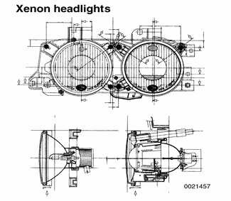

Cars equipped with Xenon headlights also feature automatic headlight adjustment control (LWR) for varying passenger and cargo loads.

Components of the headlight system can be purchased from BMW. Use illustrations on the following pages to identify components.

## Headlight aim, adjusting

Adjust headlight aim with correct tire pressures, fuel tank full, and weight of one person (approx. 75 Kg/200 lb) in driver seat.

Use 6 mm Allen wrench, phillips head screwdriver, or hand to adjust headlight by turning adjusting knobs.

- **A** is primarily for lateral adjustment.
- **B** is primarily for vertical adjustment.

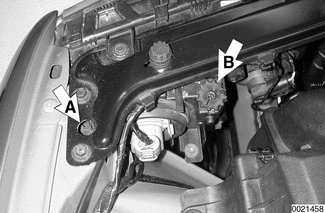

**Note:**

*When adjusting headlights with automatic adjuster system (LWR), wait at least 30 seconds for the LWR to cycle and adjust to its calculated position.*

## Halogen headlight assembly

1. Mounting screw
2. Expanding nut
3. High beam cover
4. High beam bulb
5. High beam bulb socket
6. Low beam bulb socket
7. Low beam bulb
8. Low beam cover
9. Headlight housing
10. Sealing gasket
11. Cover
12. Cover lock strip

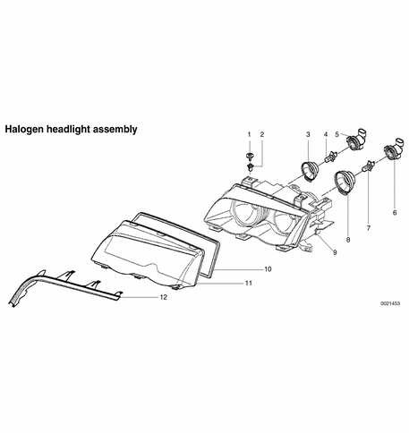

## Xenon headlight assembly

1. Automatic headlight adjustment (LWR) stepper motor
2. Electrical harness connector
3. Expanding nut
4. Mounting screw
5. Xenon bulb control module
6. Control module bracket
7. High beam cover
8. High beam bulb
9. High beam bulb socket
10. Low beam cover
11. Xenon bulb ignition element
12. Supporting ring
13. Xenon low beam bulb
14. Headlight assembly carrier plate
15. Headlight housing
16. Sealing gasket
17. Cover
18. Cover lock strip

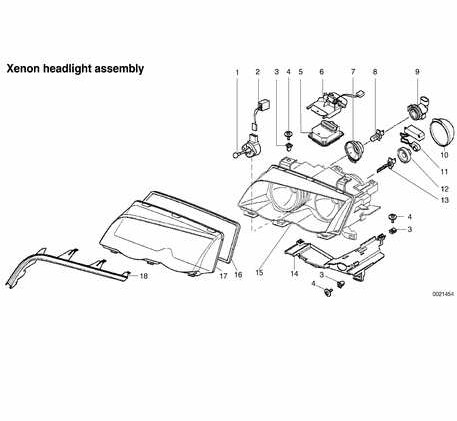

## Headlight bulb (Halogen), replacing

Working in back of headlight assembly:

- Rotate headlight bulb retaining ring (arrows) counterclockwise.
- Pull bulb socket and bulb out of headlight assembly.
- Disconnect harness connector from socket.
- Gently wiggle bulb and pull straight out of socket.
- Replace bulb by pushing firmly into socket. Headlight bulb applications are listed below.
- Installation is reverse of removal.

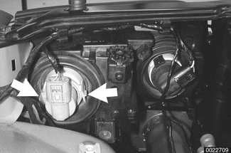

**Note:**

*To remove left side high beam bulb, remove air filter housing cover. See [020 Maintenance].*

> **CAUTION!**
> - Do not touch halogen bulbs with your bare hands. If necessary wipe bulb using a clean cloth dampened with rubbing alcohol.

## Headlight bulb (Xenon), replacing

- Working in back of headlight assembly:
    - Remove low beam (Xenon) cover.
    - Twist Xenon ignition element counterclockwise and remove.
    - Rotate headlight bulb retaining ring counterclockwise. Pull bulb out of headlight assembly.
    - Installation is reverse of removal. Headlight bulb applications are listed below.

> **CAUTION!**
> - Do not touch bulbs with your bare hands. If necessary wipe bulb using a clean cloth dampened with rubbing alcohol.

Headlight bulb application

| Location | Type & rating |
|---|---|
| Low beam (Halogen) | H7 12V 55W |
| Low beam (Xenon) | D2-S |
| High beam | H7 12V 55W |

## Headlight assembly, removing and installing

> **CAUTION!**
> - Following headlight assembly work, headlight beam aim must be adjusted using special equipment.

- Disconnect harness connectors from headlight assembly.
- If necessary, remove headlight washer spray nozzles. See [611 Wipers and Washers].
- Remove front turn signal assembly as described later in this repair group.

Use plastic prying tool to detach and remove trim piece below headlight assembly.

Remove headlight mounting screws (arrows). Lift headlight assembly forward and out of car.

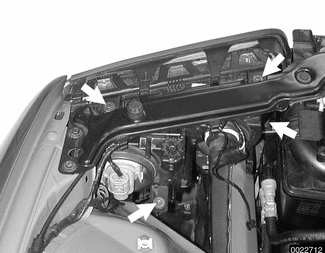

- During reassembly:
    - Install top mounting screws hand tight.
    - Pull headlight assembly toward front of car.

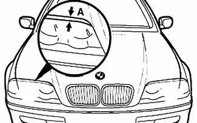

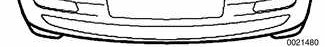

    - Close engine hood and check to make sure that gap between hood and headlight assembly (**A**) is correct. See specification below.
    - Open hood and tighten down mounting screws.
    - Remainder of assembly is reverse of removal.

**Headlight to hood gap**

| Component | Specification |
|---|---|
| Dimension **A** | 5.0 ± 1.0 mm (0.2 0.± 04 in.) |

- Adjust headlight aim as described earlier.

## Headlight lens, removing and installing

- If necessary, remove headlight washer spray nozzles. See [611 Wipers and Washers].
- Remove front turn signal assembly as described later in this repair group.

Use plastic prying tool to detach and remove trim piece below headlight assembly.

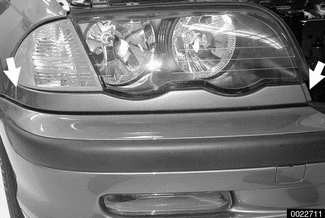

Unclip sealing gasket (arrows) and remove.

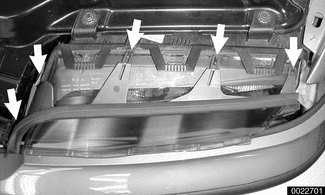

Release clips (arrows) retaining front lens.

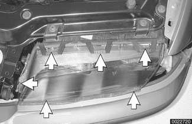

Pull lens forward to remove.

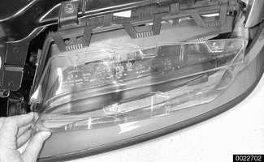

- Installation is reverse of removal. Replace gasket between lens and body of light if necessary.

## Automatic headlight adjustment (LWR)

Vehicles equipped with the optional Xenon low-beam headlight bulbs also feature automatic headlight adjustment (LWR). This system automatically adjusts the vertical positioning of the headlights to maintain optimum headlight beam angle for maximum driving visibility and to prevent undue glare for oncoming motorists. The system compensates for vehicle load angle changes.

LWR monitors vehicle load via two hall effect sensors mounted to the front and rear suspension members. When an adjustment to the angle of the headlight beams is necessary, LWR simultaneously activates two stepper motors (one in each headlight assembly). The stepper motors drive a threaded rod that moves the lower edge of the headlight carrier plates. The pivoting movement adjusts the vertical position of the headlight beams.

At each axle of the vehicle, the LWR sensor (**A**) is mounted to a fixed point on the suspension subframe. A lever (**B**) is connected to the moving suspension member. The sensor output voltage changes as the suspension moves up and down.

All LWR diagnosis is accessed through the light control module.

**Note:**

*LWR is not available with standard halogen headlights.*

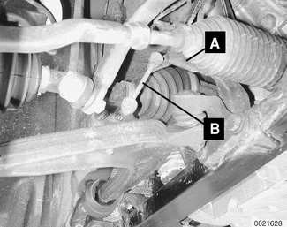

### Headlight vertical aim system components

1. Bolt M5
2. Right front ride height sensor mounting bracket
3. Self-locking nut M6
4. Front ride height sensor
5. Front ride height sensor link
6. Self-locking nut M8
7. Bolt M5
8. Right rear ride height sensor mounting bracket
9. Bolt M6
10. Rear ride height sensor
11. Self-locking nut M6
12. Rear ride height sensor link
13. Extension
14. Bracket
15. Bolt M6

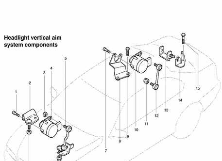

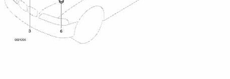
