# Heater Components

> Source: Bentley *BMW 3 Series (E46) 1999–2005 (M3) Repair Manual*, section 640-5 (PDF pages 1149–1157 of 1252).

The heater valve is located in the left side of the engine compartment, attached to the left strut tower. The solenoid operated valve controls coolant flow through the heater core. The IHKA housing, located underneath the center of the dashboard, houses the heater core, the A/C evaporator, the heating and A/C blower and associated sensors and air distribution motors.

> **CAUTION!**
> - Removal of either the heater core or the IHKA housing involves dashboard removal. Before starting work, disconnect the battery negative (-) cable in the trunk. Be sure to read the battery disconnection cautions on page viii and the airbag warnings in [721 Airbag System (SRS)].

## Heater valve, replacing

- Drain engine coolant. See [170 Radiator and Cooling System].

> **WARNING!**
> - Allow the cooling system to cool before opening or draining the cooling system.

Disconnect hoses (**A**) and electrical harness connector (**B**) at heater valve on left inner fender.

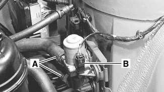

- Carefully pull heater valve out of rubber mounting and pull up and out of engine compartment.

- Installation is reverse of removal:
    - Inspect hoses and rubber mounts. Replace as necessary.
    - Use new hose clamps.

Tightening torque

| Component | Tightening torque |
|---|---|
| Coolant hose clamp 32 - 48 mm (2 1/4 - 4 in.) | 2.5 Nm (22 in-lb) |

## Heater core, replacing

Remove housing for interior ventilation microfilter.

- Remove upper cover and microfilter.
- Open wiring harness loom (**A**) and remove wires.
- Unfasten screws (**B**) and remove lower housing.

- Remove center console and dashboard. See [513 Interior Trim].
- Drain engine coolant. See [170 Radiator and Cooling System].

> **WARNING!**
> - Allow the cooling system to cool before opening or draining the cooling system.

Working at rear engine compartment bulkhead, loosen hose clamps (arrows) and detach heater hoses.

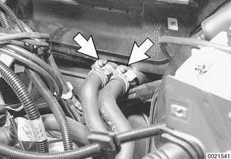

- Blow out excess coolant from heater core using compressed air at coolant lines.
- Release right air duct from IHKA housing.

Working inside passenger compartment at IHKA housing:

- Detach wiring harness (**A**) from housing.
- Remove heater core temperature sensor (**B**) by pulling straight out.
- Remove retaining clips (**C**) from housing cover.
- Lift off front of cover, then unhook tabs from housing at rear.

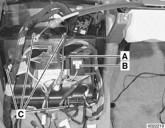

Remove coolant pipe retaining clamps mounting screws (arrows).

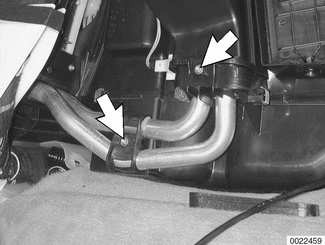

To remove heater core from IHKA housing:

- Remove coolant pipe retainers (arrows) to detach pipes.
- Tilt heater core to remove from housing.

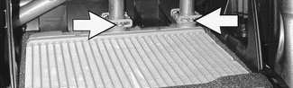

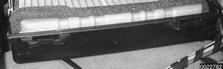

- Installation is reverse of removal:
    - Fit lugs in back of housing cover in heater housing slots.
    - Use new sealing O-rings and coat with anti-seize agent.
    - Fill and bleed cooling system. See [170 Radiator and Cooling System].

> **CAUTION!**
> - Replace coolant flange O-rings and tighten fasteners to specified torques.

Tightening torque

| Component | Tightening torque |
|---|---|
| Coolant hose clamp 32 - 48 mm (2 1/4- 4 in.) | 2.5 Nm (22 in-lb) |

## IHKA housing, removing and installing

> **CAUTION!**
> - Removing the IHKA housing requires evacuating the A/C system. DO NOT attempt this procedure without proper tools and training.
> - Any person who services a motor vehicle air conditioner must, by law, be properly trained and certified, and use approved refrigerant recycling equipment. Technicians must complete an EPA-approved recycling course to be certified

Remove housing for interior ventilation microfilter.

- Remove upper cover and microfilter.
- Open wiring harness loom (**A**) and remove wires.
- Unfasten screws (**B**) and remove lower housing.

Remove heater bulkhead cover:

- Remove engine compartment side trim panel. Turn locking clips (**A**) and slide trim panel up.
- Remove heater bulkhead cover mounting screws (**B**) and lift cover off bulkhead.

- Drain engine coolant. See [170 Radiator and Cooling System].

> **WARNING!**
> - Allow the cooling system to cool before opening or draining the cooling system.

Working at rear engine compartment bulkhead, loosen hose clamps (arrows) and detach heater hoses.

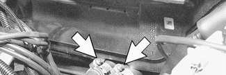

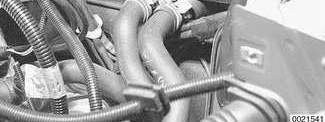

- Blow out excess coolant from heater core using compressed air at coolant lines.
- Following manufacturer's instructions, connect approved refrigerant recovery/recycling /recharging unit to A/C system and discharge system.

Working in right rear of engine compartment, detach A/C lines:

- Remove A/C recharging port bracket mounting nut (**A**).
- Remove allen bolts (**B**) at bulkhead.
- Using BMW special tool 64 5 102 or equivalent, detach and plug A/C lines.

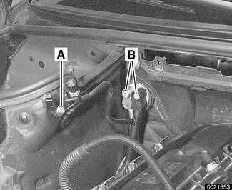

Working inside right side of cowl, pull up on lever (arrow) and detach right air intake flap from blower housing.

- Working in right front of IHKA housing, detach double pipe (A/C line) from expansion valve.
    - Lay double pipe aside.
    - Plug up open A/C ports.

Remove IHKA housing mounting nuts (arrows) at bulkhead.

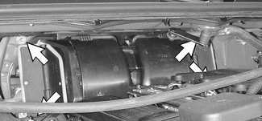

- Remove center console and dashboard. See [513 Interior Trim].
- Working inside passenger compartment below steering column, drill out steering column shear bolt. See [320 Steering and Wheel Alignment].
    - Remove steering column mounting bolts.
    - Lower column.

Under dash attachments

1 - Bulkhead
2 - Left A-pillar
3 - Head protection airbag
4 - Steering column
5 - Dashboard mounts
6 - Center tunnel
7 - Relay panel
8 - Right A-pillar

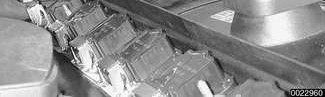

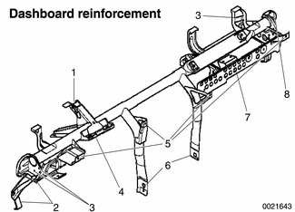

Remove dashboard reinforcement fasteners:

- Detach bulkhead brace (1).
- Detach left and right A-pillar braces (2 and 8).
- Detach head protection airbag (3).
- Remove center tunnel mounting bolts (6).
- Detach heater housing electrical harness connectors.

Working at right side of dash:

- Cut wire tie (**A**) at dashboard reinforcement support for relay panel.
- Turn fuse panel lock tabs (**B**) 90° and swing fuse panel down.
- Detach fuse panel pivots (**C**) from dashboard reinforcement.

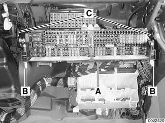

- Lift off dashboard reinforcement, making sure all electrical harnesses and hoses are free.
- Remove IHKA housing, making sure all electrical harnesses and hoses are free.
- Installation is reverse of removal. Note the following:
    - Make sure A/C condensate drain is routed correctly.
    - Replace wire ties, sealing O-rings and hose clamps.
    - Use new shear bolt at steering column mounting. Tighten bolt until head shears off.
    - Evacuate and recharge A/C system using specialized equipment.
    - Fill and bleed cooling system. See [170 Radiator and Cooling System].

> **CAUTION!**
> - Replace heater and A/C flange O-rings and tighten fasteners to specified torques.

Tightening torques

| Component | Tightening torque |
|---|---|
| Coolant hose clamp 32 - 48 mm (2 1/4 - 4 in.) | 2.5 Nm (22 in-lb) |
| Steering column to dashboard reinforcement | 22 Nm (16 ft-lb) |
