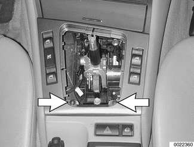
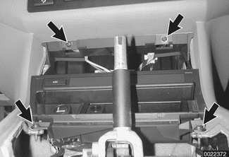
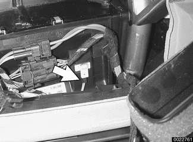
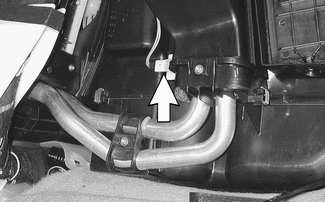
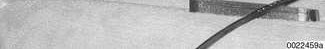

# Heating and A/C Controls

> Source: Bentley *BMW 3 Series (E46) 1999–2005 (M3) Repair Manual*, section 640-3 (PDF pages 1141–1144 of 1252).

The IHKA control module is integrated with the control panel in the center console below the radio. There is a built-in interior temperature sensor and fan.

Models with GPS navigation are equipped with a center console-mounted On-Board Monitor. This combines sound system control functions, GPS monitoring and heating/A/C control functions.

## IHKA control panel, removing

If BMW special tools 64 1 010 are available, slide them between IHKA control panel front bezel and dashboard, then pull panel out. Otherwise, use the following procedure.

Remove utility compartment below IHKA control panel:

- Open compartment door.
- Push upward in center of compartment to release locking tabs (arrows).
- Pull out compartment.

- Shifter bezel: Lift up by prying gently.
- Shifter boot: Unclip bottom of boot from shifter trim (window switch carrier) by pushing forward. Pull boot up around shifter, but do not remove.

Remove screws (arrows) at rear of shifter trim (window switch carrier). Lift trim at back to unhook from front.

Remove screws (arrows) at front and rear of ashtray carrier. Lift up ashtray carrier.

- Reach up through opening and push IHKA control module and panel out.
- Detach electrical harness connectors.
- Disassemble panel from module using an anti-static mat as a working surface.

> **CAUTION!**
> - Do not touch circuit boards with bare fingers.

- Installation is reverse of removal.

## On-Board Monitor, removing

- Remove dashboard center vent as described earlier.
- Pull off menu button on face of monitor. Reach through apertures with screwdriver to twist catches. This releases monitor from console.
- Pull out monitor and detach electrical harness connectors in back.

## Heater core temperature sensor, removing and installing

- Remove IHKA control panel or On-Board Monitor as described earlier.

Reach through dashboard opening and detach heater core temperature sensor electrical harness connector (arrow).

- Pull sensor out of IHKA housing.
- Installation is reverse of removal.

## Evaporator temperature sensor

To gain access to evaporator temperature sensor (arrow):

- Remove left footwell trim panel (above pedals). See [513 Interior Trim].
- Sensor is installed in left side of IHKA housing above coolant pipes.

