# Ignition System Service

> Source: BMW 3 Series (E46) Repair Manual, section 120-2, Ignition System chapter (PDF pages 308–317 of 1252).

## Ignition firing order

Each ignition coil is mounted above the corresponding spark plug. Cylinder 1 is at the front of the engine.

Ignition firing order

| M52 TU/M54 engine | 1-5-3-6-2-4 |
|---|---|

## Disabling ignition system

The ignition system operates in a lethal voltage range and should therefore be disabled any time engine service or repair work is being done that requires the ignition to be switched on.

The engine management system can be disabled by removing the DME main relay (arrow). The relay is located in the electronics box (E-box) in the left rear of the engine compartment.

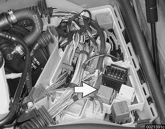

> **CAUTION!**
> - Relay locations may vary. Use care when identifying relays. The main relay has a large (4 mm²) red wire at terminal 30 and a large (4 mm²) red/white wire at terminal 87. See [610 Electrical Component Locations].

## Checking for spark

> **CAUTION!**
> - If a spark test is done incorrectly, damage to the Engine Control Module (ECM) or the ignition coils may result.

> **Note:**
> - Spark plug replacement is covered in [020 Maintenance].

Checking for spark is difficult on engines with distributorless ignition systems.

Try removing the spark plugs and inspecting for differences between them. A poor-firing plug may be wet with fuel and/or black and sooty, but not always. If a coil is not operating, the engine management system will electrically disable the fuel injector to that cylinder. The key is to look for differences between cylinders.

## Ignition coil assembly, testing and replacing

> **CAUTION!**
> - Use a digital multimeter for the following tests.

- Remove interior ventilation microfilter.

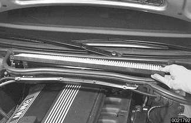

- Remove housing for microfilter for interior ventilation.
    - Open wiring harness loom (A) and remove wires.
    - Unfasten screws (B) and remove lower microfilter housing.

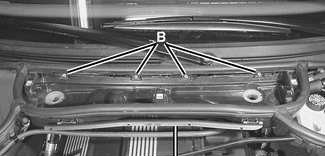

- Remove plastic engine cover from top of valve cover by prying off bolt covers and removing cover mounting bolts.

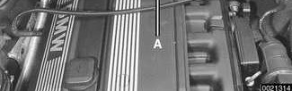

- Disconnect harness connector from coil. Connect multimeter between terminal 15 (+) in connector and ground.
    - Turn ignition on and check for battery voltage.
    - If battery voltage is not present, check wire between terminal 15 and ignition switch. See [Electrical Wiring Diagrams].

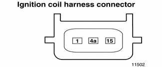

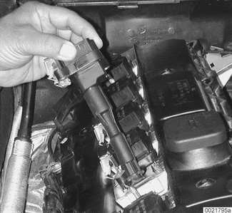

> **CAUTION!**
> - The wiring to terminal 15 (+) of the coil (via the ignition switch) is not fuse protected. Use care when testing this circuit.

- Turn ignition off.
- Remove coil and inspect coil housing for hairline cracks or leaking casting material. A leaky ignition coil may indicate a faulty Engine Control Module (ECM). Check ECM before installing a new coil.

> **CAUTION!**
> - Note location of coil ground straps before coil removal; reinstall in the same location.

- Use a multimeter to test:
    - Coil primary resistance at coil terminals
    - Spark plug connector resistance
- Compare results to specification in [Table e].

Table e. Ignition coil resistance

| Component | Terminals | Resistance |
|---|---|---|
| Coil primary | 1 (-) and 15 (+) | approx. 0.8 Ω |
| Coil secondary | | N.A. |
| Spark plug connector, Bosch | | 1 kΩ 20% |
| Beru | | 1.8 kΩ 20% |

- Replace ignition coil or spark plug connector if resistance readings do not meet specifications.
- Remove ignition coil to be tested.
- Install BMW special tool 12 7 030 (A) on coil to be tested.
- Connect ground jumper between coil mounting point and engine ground point (B).
- Clip scope high pick-up lead (C) around ignition lead.
- Start engine.

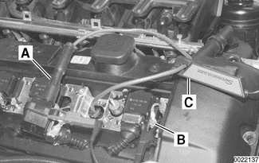

- Compare scope pattern with diagrams in [Basic troubleshooting principles].

> **Note:**
> - When replacing ignition coils, ensure that the replacements are from the same manufacturer with the same part/code numbers. If individual coils with the correct specifications are not available, all coils should be replaced.

## Crankshaft speed sensor, replacing

The crankshaft speed sensor is mounted in the left rear side of the cylinder block below the starter. The sensor reads a toothed pulse wheel (arrow) mounted to the end of the crankshaft.

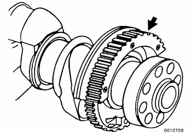

If the Engine Control Module (ECM) does not receive a signal from the crankshaft speed sensor during cranking, the engine will not start.

If the OBD II system misfire detection protocol detects a catalyst damaging fault due to a malfunction in crankshaft speed sensor components, the Check Engine light (Malfunction Indicator Light or MIL) will be illuminated.

> **Note:**
> - If the crankshaft speed sensor pulse wheel is damaged, the engine will have to be disassembled down to the crankshaft to replace the wheel.

- Make certain ignition has been turned off.
- Raise car and support in a safe manner.

> **WARNING!**
> - Make sure the car is stable and well supported at all times. Use a professional automotive lift or jack stands designed for the purpose. A floor jack is not adequate support.

- Remove under-engine splash guards.
- Working just underneath starter:
    - Cut off wire tie securing crankshaft speed sensor harness connector (arrow) to sensor.
    - Disconnect harness connector.

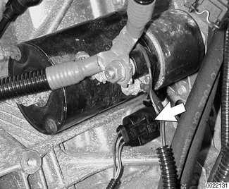

- Remove sensor mounting screw (arrow) and remove sensor from cylinder block.

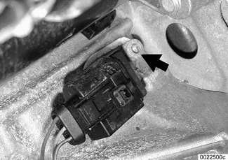

- Installation is reverse of removal, noting the following:
    - Use a new O-ring when installing sensor.
    - Be sure wiring is rerouted in same orientation.
    - Secure sensor using new wire ties.
- Use scan tool to read out and clear ECM fault memory.

## Camshaft position sensors

The camshaft position sensors are used by the engine management system for VANOS control, sequential fuel injection and knock control.

### Intake camshaft position sensor, replacing

- Make certain ignition has been turned off.
- Remove housing for the microfilter for interior ventilation as shown earlier.
- Remove plastic cover from above fuel injectors by prying off bolt covers and removing cover mounting bolts.
- Remove complete air filter housing:
    - Disconnect electrical harness connector on mass air flow sensor (B).
    - Detach vacuum line at intake boot (A).
    - Remove filter housing mounting screws (D).
    - Loosen hose clamp at intake boot and detach air duct connections (C).
    - Disconnect cold air duct tube (E).

- Disconnect harness connector from VANOS solenoid and unscrew solenoid from VANOS control unit. Be prepared with shop rags to catch oil released from VANOS unit.
- Remove camshaft sensor (arrow) from left front of cylinder head, next to top of oil filter housing.

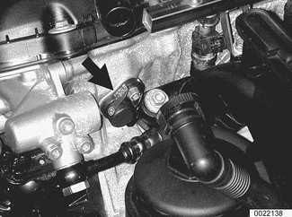

- Disconnect camshaft sensor harness from under intake manifold. Prior to removal, attach a stiff piece of wire to the harness connector end to preserve proper routing of harness for reinstallation.
- Installation is reverse of removal.
    - Use new O-rings when installing sensor and solenoid.
    - Be sure wiring is rerouted in same orientation.
- Use scan tool to read out and clear ECM fault memory.

Tightening torques

| Component | Tightening torque |
|---|---|
| Intake camshaft sensor to cylinder head | 5 Nm (3.5 ft-lb) |
| VANOS solenoid to VANOS control unit | 30 Nm (22 ft-lb) |

### Exhaust camshaft position sensor, replacing

- Make certain ignition has been turned off.
- Working at front of engine on exhaust (right) side, detach exhaust camshaft position sensor electrical harness connector (arrow).

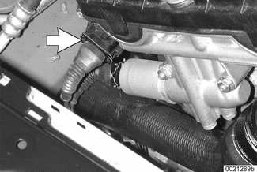

- Remove camshaft sensor from right front of cylinder head.
- Installation is reverse of removal.
    - Use a new O-ring when installing sensor.
    - Be sure wiring is rerouted in same orientation.
- Use scan tool to read out and clear ECM fault memory.

Tightening torque

| Component | Tightening torque |
|---|---|
| Exhaust camshaft sensor to cylinder head | 5 Nm (3.5 ft-lb) |

## Knock sensors, replacing

The knock sensors are bolted to the left side of the cylinder block under the intake manifold.

- Remove intake manifold as described in [113 Cylinder Head Removal and Installation].
- Disconnect knock sensor electrical harness connector (arrow) on left side of engine cylinder block.

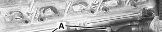

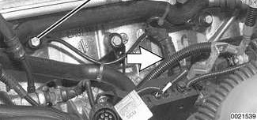

- Remove knock sensor mounting bolts (A) on side of cylinder block. Remove sensors.

> **CAUTION!**
> - Note the installed angle of the knock sensor on the block before removing it. Reinstall the sensor in the same position. Be sure to use a torque wrench when tightening the sensor mounting bolt.

- Clean knock sensor contact surface on engine block and sensor (arrows) before installing knock sensor.

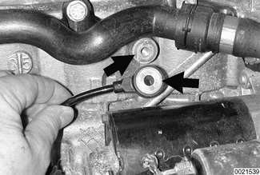

Tightening torque

| Component | Tightening torque |
|---|---|
| Knock sensor to cylinder block | 20 Nm (15 ft. lbs.) |

- Use scan tool to read out and clear ECM fault memory.
