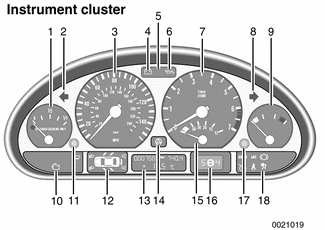
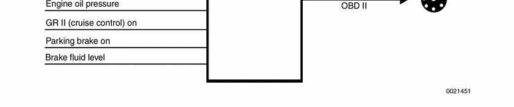
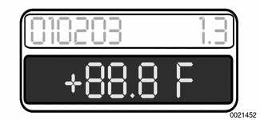
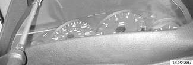
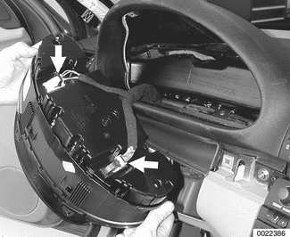
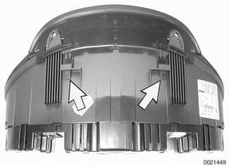

# Instrument Cluster

> Source: Bentley *BMW 3 Series (E46) 1999–2005 (M3) Repair Manual*, section 620-2 (PDF pages 1072–1080 of 1252).

The dashboard mounted instrument cluster is the control and information center of the E46 cars. It is connected to most of the systems and sensors in the car through the use of "bus" networks:

- K-bus connects to Central Body Electronics (ZKE V) functions, heating/A/C (IHKA), rain sensor system, exterior and interior lights, Multiple Restraint System (MRS III), and Driveway Protection (EWS III).
- CAN-bus connects to engine management (DME), transmission control (AGS) and traction/stability control (ASC/DSC).
- D-bus connects to 20-pin Diagnostic Link Connector (DLC) and/or 16-pin OBD II diagnostic connector.

The instrument cluster stores and communicates Diagnostic Trouble Codes (DTCs) via the D-bus diagnostic link.

If the vehicle is equipped with On-Board Computer, pushing the button at the end of the directional stalk switch brings up on the cluster information of interest to the driver:

- Time
- Outside temperature
- Average fuel consumption
- Cruising range
- Average vehicle speed

These functions are more fully explained in the Owner's Manual.

The cluster also stores important vehicle memory functions such as total mileage and service interval data. Instrument cluster replacement must be followed by special procedures, using BMW scan tools DIS or MoDiC or equivalent, to synchronize vehicle memory and mileage with the new cluster unit.

**Note:**

*Specific vehicle information is stored redundantly in the instrument cluster and the light control module. This information includes: Vehicle identification number (VIN), Total vehicle mileage, and Service interval data.*

## Instrument cluster layout

The instrument cluster uses stepper motor driven analog gauges for display of engine and road speed, engine temperature, fuel level and economy.

1 - Fuel Gauge
2 - Left directional
3 - Tachometer
4 - Alternator warning light
5 - High beam warning
6 - Oil warning light
7 - Speedometer
8 - Right directional
9 - Temperature gauge
10 - Warning lights (Check Engine, etc.)
11 - Left reset button (odometer/service interval)
12 - Check Control LCD
13 - Odometer/On-Board Computer LCD
14 - ASC/DSC warning light
15 - Fuel economy gauge
16 - Transmission range/ program LCD (includes transmission fault indicator)
17 - Right reset button (clock)
18 - Warning lights (brakes, etc.)

In addition, three LCD blocks display:

- Check Control pictographs
- Service interval and mileage (On-Board Computer)
- Automatic transmission range/program and failure display

Warning indicators and lamps are arranged to the right and left of the LCD blocks. The ASC/DSC light, charge indicator, high beam and oil pressure lamps are located between the speedometer and tachometer.

The instrument cluster is a sealed unit and contains no serviceable components.

**E46 instrument cluster**

## Instrument cluster, self-testing

In addition to the storing diagnostic trouble codes (DTCs) and communicating through the diagnostic link, the instrument cluster is programmed with a series of test menus that can be accessed to check various functions and values. The odometer/On-Board Computer LCD block is used to display the test menus and results. There are a total of 21 test menus.

[Table a] lists instrument cluster test menus and submenus.

To scroll through numbered test menus:

- Make sure ignition switch is OFF.
- Press and hold left cluster button.
- Turn ignition switch to "radio". Test 1 main menu will be displayed.
- Do nothing and display will automatically scroll through Test 1 submenus.
- Tap or press instrument cluster left button. This signals cluster to display submenus or continue on to next main test menu.

**Note:**

- *Tests 1 and 2 are always unlocked.*
- *Tests 3 - 21 are only accessible after unlocking the test function.*
- *Test 19 is the unlock function for accessing the displays.*
- *If adjustment is necessary, enter into Test 20 using the cluster button. The correction factor number is changed by using the sub-menus for the 1s, 10s and 100s of the factor number. The digits will automatically scroll through 0 - 9 within each group (1s, 10s, 100s).*

Table a. Instrument cluster test functions

| Menu | Submenu | Sample output | Meaning |
|---|---|---|---|
| Test 1: Vehicle specific data (see Note below) | 1.0 | 12345 | Vehicle identification number (VIN) |
| Test 1: Vehicle specific data (see Note below) | 1.1 | 4812 | Body number |
| Test 1: Vehicle specific data (see Note below) | 6_1.2 | 834762 | Part number of cluster |
| Test 1: Vehicle specific data (see Note below) | 1.3 | 010203 | Coding/diagnosis/bus index |
| Test 1: Vehicle specific data (see Note below) | 1.4 | 3499 | Manufacturing date (calendar week/year) |
| Test 1: Vehicle specific data (see Note below) | 1.5 | 04_600 | Hardware/software version of cluster (hardware = 04, software = 6.00) |
| Test 1: Vehicle specific data (see Note below) | 3_1.6 | 415_06 | Injection status, number of cylinders, engine factor |
| Test 1: Vehicle specific data (see Note below) | 1.7 |  |  |
| **Test 2: Cluster system test - activates gauge drivers, indicators and LEDs to confirm function (see Note)** |  |  |  |
| Test 3: SI data | 3.0 | 1500 | Liters |
| Test 3: SI data | 3.1 | 0 | Periodic inspection days (not applicable for US) |
| Test 4: Fuel consumption data (current) | 4.0 | 0267 | 26.7 liters/1000km |
| Test 4: Fuel consumption data (current) | 4.1 | 0073 | 7.3 liters/hour |
| Test 5: Fuel consumed/distance traveled | 5.0 | 0195 | 9.5 liters/100 km |
| Test 5: Fuel consumed/distance traveled | 5.1 | 226 | Distance left to go (226 km) |
| Test 6: Fuel level sensor input in liters | 6.0 | 237415 | Fuel level averaged ◆ Left side fuel sensor input = 23.7 liters ◆ Right side fuel sensor input = 41.5 liters |
| Test 6: Fuel level sensor input in liters | 6.1 | 0652 | Total tank level averaged = 65.2 liters |
| Test 6: Fuel level sensor input in liters | 1_6.2 | 0667 | Indicated value and tank phase ◆ 1 = Both sensors OK ◆ 2 = One sensor faulty ◆ 3 = Implausible input |
| Test 7: Temperature and speed | 7.0 | 032 | Coolant temperature input = 32°C |
| Test 7: Temperature and speed | 7.1 | 245 | Outside temperature input = 24.5°C |
| Test 7: Temperature and speed | 7.2 | 5283 | Engine speed = 5,283 RPM |
| Test 7: Temperature and speed | 7.3 | 058 | Vehicle speed = 58 km/h |
| Test 8: Input values in HEX code | 8.0 - 8.3 | XXX | HEX code, instrument cluster inputs |
| Test 9: Battery voltage | 9.0 | 125 | 12.5 volts |
| Test 10: Country coding | 10.0 | 02 | US (= 02) |
| Test 11: Cluster code | 11.0 | 000003 | Cluster code |
| **Test 12: Not used** |  |  |  |
| Test 13: Gong test | 13.0 | "Gong" | Activate gong by pressing button (gong response is delayed). |
| **Test 14: Fault memory (not for diagnosis)** |  |  |  |
| **Tests 15 - 18: Not used** |  |  |  |
| Test 19: Lock/unlock (see Note) |  | L-ON | Display changes from L-ON to L-OFF every second. To unlock test functions, press cluster button immediately when it changes to L-OFF. Tests are automatically locked when exiting test functions. |
| Test 19: Lock/unlock (see Note) | 19.0 | L-OFF | Display changes from L-ON to L-OFF every second. To unlock test functions, press cluster button immediately when it changes to L-OFF. Tests are automatically locked when exiting test functions. |
| Test 20: Average fuel consumption correction factor (see Note) | 20.0 | XXX9 | Press button when correct 1s position is attained. |
| Test 20: Average fuel consumption correction factor (see Note) | 20.1 | XX5X | Press button when correct 10s position is attained. |
| Test 20: Average fuel consumption correction factor (see Note) | 20.2 | 12XX | Press button when correct 100s position is attained. |
| Test 21: Software reset | 21.0 | reset | Reset software |

Note: Menu cells and the Test 19 meaning cell span multiple rows in print (merged cells); values are repeated here. Table splits across pages 1077–1079 with repeated headers — merged.

## Instrument cluster, removing and installing

- Remove instrument cluster retaining screws (arrows).

Place a towel over steering column. Carefully tilt top of cluster out of dash panel. Unlock and disconnect harness connectors (arrows) from back of cluster.

**Note:**

*Steering wheel does not need to be removed to remove instrument cluster.*

If it is necessary to replace cluster, detach trim by unlocking plastic clips (arrows) and pushing through slots.

- Installation is reverse of removal, noting the following:
    - Instrument cluster harness connector locking levers must be in up position before installing connector.
    - Recode new or replacement cluster using BMW scan tools DISplus, MoDiC or equivalent.
