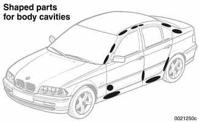
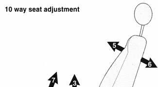
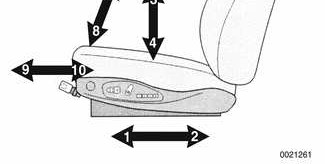
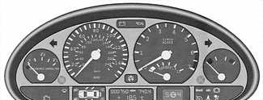
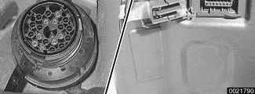
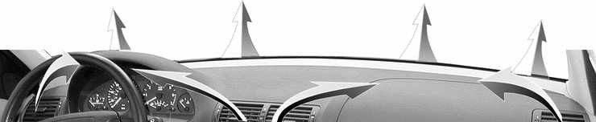
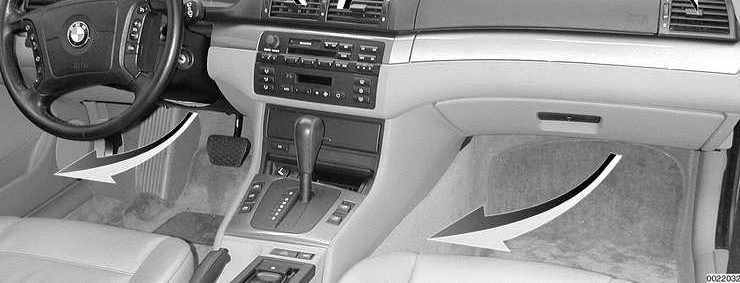

# Interior Features

> Source: BMW 3 Series (E46) Repair Manual, section 400-4, Body — General chapter (PDF pages 735–741 of 1252).

E46 interiors have a unique character, with a combination of sporty features and innovative design. All body versions were made in a wide choice of interior and exterior colors. New colors with matching leather or leatherette upholstery were introduced for each model year, including light-alloy wheels in new designs.

Driving comfort is enhanced by power steering, tilt steering wheel, height-adjustable front seats, and electrically adjustable and heated rear-view mirrors. Inside the car there are reading lights at four seating positions.

## Noise reduction

To reduce interior noise, certain body cavities are sealed with shaped parts installed during the manufacturing process. The body is heated to approx 180°C (356°F) and kept at that temperature for approx. 20 minutes, during which interval the shaped parts expand to fit the shapes of the cavities.

## Seats

Anatomically correct seats are constructed from polyurethane foam containing areas or "zones" of different firmness. They offer good lateral support without constricting the occupant.

Driving comfort is enhanced by power steering, tilt steering wheel, height-adjustable front seats, and electrically adjustable and heated rear-view mirrors. Inside the car there are reading lights at four seating positions.

The seats have a passive internal ventilation system: Cylindrical cavities within the cushions and backrests generate a pumping effect as the car's ride motions cause occupant motion. This helps remove moisture and feeds fresh air into the seats.

Other features of the seating system:

- The seat bases have steel springs for added support and strength.
- The seat control switches are along the outside edge of the seat.
- Heated seats are an option in all models.
- In cars equipped with seat position memory, three different seat configurations can be memorized by the seat control module(s). Seat memory coordinates with outside mirror memory.
- In Convertible models: When a rear passenger presses the seat back switch forward, the comfort entry aid system moves the seat forward and lowers the headrest to prevent it from contacting the sun visor. The seat and headrest are then returned to memorized positions. These functions are controlled by the seat memory module(s).
- For security reasons, the release lever to fold the rear seat backrest forward is installed in the trunk.
- In Sport Wagon models: Rear seat backs are split 60/40 with the center arm rest on the left seat back. The center arm rest incorporates a non adjustable headrest. When folded down, the arm rest opens out with cup-holders and a storage compartment.

See [520 Seats] for more details.

## Instruments and controls

Everything in the interior passenger compartment essential to the driver is logically grouped and easy to reach. All instruments and controls have been arranged ergonomically and are fully integrated into the overall design of the vehicle. The following features are optional in some models.

- Tilt-telescopic steering wheel has 30 mm (1.2 in.) of vertical and longitudinal adjustment.
- Multi-function steering wheel contains two key pads containing controls for the sound system, telephone and cruise control.
- Padded dashboard houses the instrument cluster and the ventilation and heating system.
- Instrument cluster uses large easy-to-read analog instruments and is removable as a unit without removing the dashboard. On-board computer and Check Control functions are integrated into the instrument cluster displays.

- Service Interval Display calculates vehicle service needs, based on current driving patterns, and indicates to the driver when the car requires service.
- Integrated on-board navigation system, based on Global Positioning System (GPS) technology, is optionally available on E46 cars. When installed, a multi-function monitor is included in the center of the dash above the radio. In addition to displaying navigation system information, this monitor accesses On-Board Computer functions, audio system controls, mobile phone dialling and memory, and automatic ventilation.
- Park Distance Control (PDC) is an optional system which uses ultra-sonic sensors in the rear bumper trim to warn the driver when approaching too close to obstacles when parking.

## Central Body Electronics (ZKE V)

E46 cars are equipped with a sophisticated centralized body electric/electronics plan. Central Body Electronics (ZKE V) is self-diagnostic and incorporates many functions into a single control module. The consolidation of several systems into a single control module minimizes power requirements and the incorporation of the diagnostic link results in more efficient and accurate troubleshooting.

ZKE V directly controls the following functions:

- Windshield wiper/washer system, with optional Rain Sensor Interface. See [611 Wipers and Washers].
- Central locking with power trunk release. See [515 Central Locking and Anti-theft].
- Keyless entry (FZV)
- Power window control. See [512 Door Windows].
- Car/key memory
- Interior lighting
- Alarm system (DWA)
- Electronic consumer sleep mode. See [600 Electrical System–General].

Other functions not directly controlled by ZKE V but interconnected:

- Rain sensor (AIC)
- Sunroof operation. See [540 Sunroof].
- Seat memory. See [520 Seats].
- Outside rear-view mirror control and heating
- Windshield washer jet heating

ZKE V Diagnostic Trouble Codes (DTCs) are accessible electronically through the data-link connector (DLC). See [610 Electrical Component Locations].

> **Note:**
> - All 1999 models and cars produced through June 2000 are equipped with the DLC socket in the rear right corner of the engine compartment.
> - In cars produced after June 2000, the DLC socket in the engine compartment has been discontinued. All scan tool codes can now be accessed through the OBD II interface socket on the driver's side of the dashboard, left and below the instrument cluster, under a cover.

## Heating and air conditioning (IHKA)

The integrated heating and air conditioning (IHKA) system uses an extra large, infinitely variable radial blower motor for good distribution of air. Fresh air enters through the grille below the engine hood and into the passenger compartment via the dashboard and footwell vents.

Repair information for the heating and air conditioning system is covered in [640 Heating and Air Conditioning].

Heating and air conditioning vent diagram

## Sport Wagon interior features

**Child seats.** There are three child seat hold down anchors behind the rear seat back rest. Plastic trim covers are used to hide the anchors.

**Cargo area.** There is a spring-loaded blind and a cargo safety net installed behind the rear seat.

**Storage.** There are extra storage compartments on the left and right sides in the rear. These house the rear window washer fluid reservoir and sound system components.

**Power socket.** A 12 volt power socket is in the left side of the cargo area behind the rear seat backrest.
