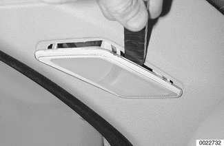
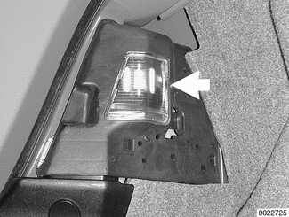

# Interior Lights

> Source: Bentley *BMW 3 Series (E46) 1999–2005 (M3) Repair Manual*, section 630-6 (PDF pages 1108–1112 of 1252).

The ZKE V general module (GM V) controls the interior lighting automatically using input from several monitors. The lighting can also be manually controlled.

Each door lock actuator contains a hall effect sensor for the purpose of monitoring door open/closed status. The hall effect sensor is located directly behind the rotary latch plate encased in the lock actuator. The sensor is activated by the rotary latch plate position.

- Door closed: Rotary latch plate in latched position. Current flow through hall sensor <5 mA.
- Door open: Rotary latch plate in open position. Current flow through hall sensor >12 mA.

A change in current flow informs the GM V when a door is opened or closed.

The overhead front seat interior/map light unit contains a single main interior light. The light is controlled by the GM V automatically or by momentarily pressing the interior light switch located on the light assembly. The switch provides a momentary ground signal that the GM V recognizes as a request to either turn the light on (if off) or turn the light off (if on).

If the switch is held for more than 3 seconds, the GM V interprets the continuous ground signal as a request to turn the interior light circuit off (workshop mode). Workshop mode is stored in memory: Even if the GM V is removed from the power supply and reconnected, the lights do not come back on unless the switch is pressed again.

There are two reading/map lights located in the front interior light assembly. Each is mechanically controlled by depressing the corresponding switch. The power supply for the map lights is supplied by the GM V.

There is a courtesy light in each front footwell. These lights are only operated when the GM V provides power to the interior lighting circuit.

**Interior lighting system**

## Interior light automatic controls

The GM V provides 12 volts to the interior lighting circuit when the status of one of the following input signals changes:

- Door contact hall sensor active (door open)
- "Unlock" request received from driver door key lock hall sensor (ignition switch OFF)
- "Unlock" request from FZV keyless entry system received via K bus (ignition switch OFF)
- Vehicle exterior lights on for minimum of 2 minutes when ignition switch is OFF
- Active crash signal from MRS II control module
- Lock button of FZV key pressed with vehicle already locked (interior search function)
- Immediately after ignition switch is turned to "radio" position with driver door closed.
- When vehicle is locked (single or double) with door contacts closed.
- When vehicle door contacts are closed. Lights remain on for 20 seconds, then go to soft off.
- After interior search function is activated, lights automatically turn off (soft off) after 8 seconds.
- After 16 minutes with door contact active (open door) and key off, lights are switched off (consumer cutoff function).

The component activation function of DIS also has the ability to switch the lights.

## Interior light, footwell light, or cargo compartment light (Sport Wagon), replacing bulb

Pry interior light fixture gently to remove.

- Detach electrical harness connector.
- Remove bulb and replace.

> **CAUTION!**
> - When replacing bulbs, do not touch glass of bulb with fingers. Only touch bulb with clean cloth or bulb packaging.

- Installation is reverse of removal. Bulb types and specifications for various interior lamps are listed below.

Interior light applications

| Location | Type & rating |
|---|---|
| Footwell light bulb | Softlite 5W |
| Glove compartment light bulb | Softlite 5W |
| Passenger compartment bulb, front or rear | Softlite 5W |
| Reading bulb, front or rear | 6W |
| Tailgate courtesy light bulb | Softlite 10W |
| Visor vanity light bulb | Softlite 10W |

Note: Table splits across pages 1111/1112 with repeated header, and the "Passenger compartment bulb" row is split by the page break — merged.

## Trunk light bulb, replacing

The trunk lights are integrated with the taillight assembly.

Pry trunk light cover (arrow) gently to remove from taillight corner bulb carrier.

- Remove bulb and replace.
- Installation is reverse of removal.

Trunk light application

| Location | Type & rating |
|---|---|
| Trunk light bulb | Softlite 10W |
