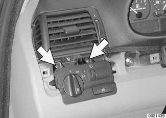
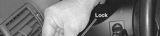
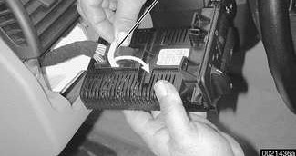
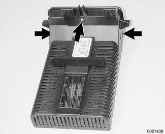
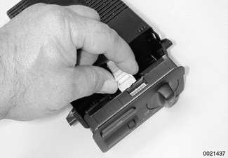

# Light Switch

> Source: Bentley *BMW 3 Series (E46) 1999–2005 (M3) Repair Manual*, section 630-2 (PDF pages 1087–1088 of 1252).

## Light switch assembly, removing and installing

Pry gently at left dashboard trim to remove.

> **CAUTION!**
> - To avoid marring interior trim, work with a plastic prying tool.

Remove light switch mounting screws (arrows).

- Lift switch slightly and withdraw from dashboard.

> **Note:**
> - If the vehicle is equipped with a left side glove compartment, remove the compartment for improved access to the back of the headlight switch and its electrical harness.
> - Remove the left side footwell trim (above the pedals) for better access to the headlight switch electrical harness. See [513 Interior Trim].

To release harness connector latch:

- Swing latch backward (arrow).
- Pull electrical harness connector off switch assembly.
- Installation is reverse of removal.

## Light control module, separating

- Remove light switch assembly as described earlier.

Press in on tabs (arrows) in light switch assembly to separate light switch from light control module.

Gently wiggle harness connector to remove from switch.

