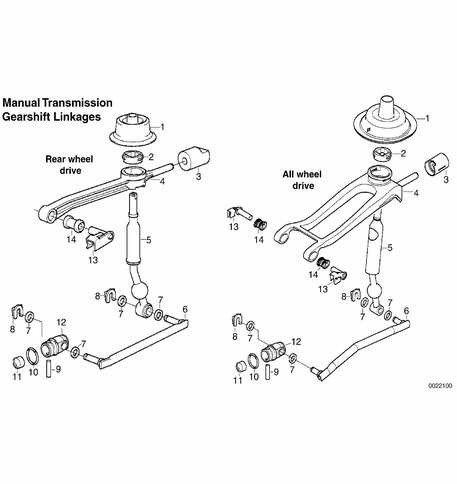
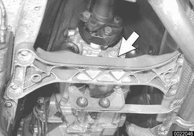
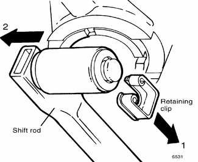
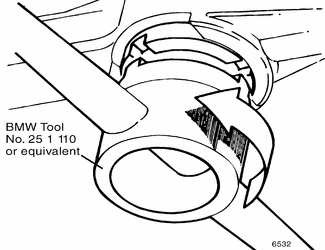
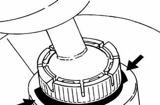
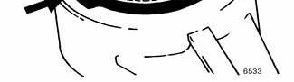
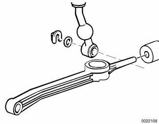

# Manual Transmission Gearshift

> Source: BMW 3 Series (E46) Repair Manual, section 250-2, Gearshift Linkage chapter (PDF pages 442–445 of 1252).

| No. | Part |
|---|---|
| 1 | Rubber boot |
| 2 | Shift lever bearing |
| 3 | Shift arm bearing |
| 4 | Shift arm |
| 5 | Shift lever |
| 6 | Selector rod |
| 7 | Spacer ring |
| 8 | Circlip |
| 9 | Dowel pin |
| 10 | Lock ring |
| 11 | Washer |
| 12 | Gear selector rod joint |
| 13 | Bearing bolt |
| 14 | Bearing bushing |

## Gearshift lever, removing (manual transmission)

Use the above illustration as a guide when removing and installing the linkage.

- Remove shift knob by pulling knob straight off the manual gearshift.

> **Note:**
> - Removal of the shift knob will require about 90 lbs. of force. Do not twist knob or locating key can be damaged.

- Pry up on rear of shift boot to unclip, then remove boot from front retainers.
- Raise vehicle to gain access to underside of vehicle.

> **WARNING!**
> - Make sure the car is stable and well supported at all times. Use a professional automotive lift or jack stands designed for the purpose. A floor jack is not adequate support.

- Remove complete exhaust system. See [180 Exhaust System].
- Remove driveshaft(s). See [260 Driveshaft].
- Support transmission with transmission jack. Remove crossmember (arrow) from rear of transmission.

- Lower rear of transmission to access gearshift linkage.

> **CAUTION!**
> - Tilting the engine to lower the transmission can lead to damage to various components due to lack of clearance.

- Working above transmission, disconnect shift rod from gearshift lever by pulling off shift rod retaining clip in direction of arrow (1). Disengage shift rod from gearshift lever (2). Note washers on either side of shift rod end.

- Release gearshift lever retaining ring from below using BMW special tool 25 1 110. Turn tool 90° ( turn) counterclockwise.

- Raise transmission and temporarily install transmission crossmember.
- Lower vehicle. Working from inside passenger compartment, pull up on gearshift lever to remove it together with retaining ring and rubber grommet.

## Gearshift lever, installing (manual transmission)

- Install shift lever, aligning locking tabs with openings in shift console (arrows). Press down on retaining ring until it clicks into place.

- Install rubber grommet with arrow pointing forward. Install shift rod and shift boot.

> **Note:**
> - Install rubber grommet correctly so that it seals out water.

- Connect shift rod to shift lever. Install transmission crossmember. Lift transmission and tighten crossmember bolts.

Before connecting the shift rod to the lever, be sure the gearshift lever is facing the correct way as illustrated.

- Install driveshaft(s) and heat shield. See [260 Driveshaft].
- Reinstall exhaust system. See [180 Exhaust System]
- Lower vehicle. Install shift boot cover. Push shift knob onto lever.

Tightening torques

| Component | Tightening torque |
|---|---|
| Rear driveshaft to final drive flange, With U-joint (M10 ribbed nut) | 80 Nm (59 ft-lb) |
| Rear driveshaft to final drive flange, With U-joint (M10 compressed nut) | 64 Nm (47 ft-lb) |
| Flex-disc to driveshaft or transmission flange, M10 (8.8 grade) | 48 Nm (35 ft-lb) |
| Flex-disc to driveshaft or transmission flange, M10 (10.9 grade) | 60 Nm (44 ft-lb) |
| Flex-disc to driveshaft or transmission flange, M12 (10.9 grade) | 100 Nm (74 ft-lb) |
| Front driveshaft to final drive flange (with U-joint) (M10) | 70 Nm (52 ft-lb) |
| Transmission crossmember to body (M8) | 21 Nm (15 ft-lb) |
