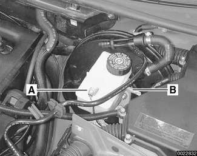
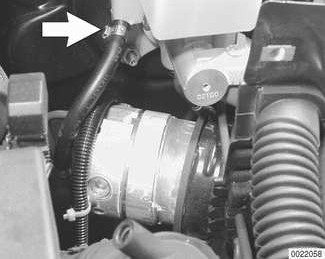

# Master cylinder

> Source: BMW 3 Series (E46) Repair Manual, section 340-4, Brakes chapter (PDF pages 696–699 of 1252).

The brake master cylinder is mounted to the front of the vacuum booster on the driver side bulkhead.

> **CAUTION!**
> - All U.S. market E46 vehicles are equipped with Antilock Braking System (ABS) and either Automatic Stability Control (ASC) or Dynamic Stability Control (DSC). Replacing the master cylinder requires that the braking system be properly bled by an authorized BMW repair facility. This procedure is necessary for the braking and stability controls to function properly.

## Master cylinder, removing and installing

- Using a clean syringe, empty brake fluid reservoir.

> **WARNING!**
> - Brake fluid is highly corrosive and dangerous to the environment. Dispose of it properly.

Remove interior ventilation microfilter housing:

- Remove upper cover and microfilter.
- Open wiring harness loom (A) and remove wires.
- Unfasten screws (B) and remove lower microfilter housing.

Remove side trim panel from left rear of engine compartment:

- Remove rubber strip from top of trim panel at brake booster.
- Detach vacuum line (A) from brake booster Y-connector, unhook from trim panel and push to side.
- Unhook plastic vacuum line and positive starter cable (B) from trim panel and pull forward off trim panel.
- Release locking clips (C) on edges of trim panel and remove panel by pulling upwards.

Working at brake master cylinder:

- Disconnect brake fluid level sensor connector (A) from fluid reservoir.
- Disconnect hydraulic clutch system supply line (B) if applicable. Plug open brake fluid ducts to prevent fluid leakage or contamination.

> **CAUTION!**
> - Keep clutch supply line supported and above clutch master cylinder to prevent any air bubbles from reaching the clutch hydraulic system.

If DSC precharge pump is installed below brake master cylinder:

- Release hose clamp (arrow) at brake fluid reservoir and remove precharge pump supply hose. Plug hose and reservoir to prevent fluid leakage or contamination.
- Remove brake fluid reservoir.
- Working at master cylinder:
  - Disconnect brake fluid lines and electrical harness connectors from master cylinder as needed.
  - On vehicles equipped with Teves DSC: remove brake system pressure sensors if replacing master cylinder.
  - Unscrew mounting nuts and remove master cylinder from brake booster.
  - Plug open brake lines to prevent contamination.
- Make sure all nuts, fluid couplings, thread bores, and mating surfaces are clean.
- Mount master cylinder to brake booster using a new O-ring and new self-locking nuts.

Tightening torque

| Component | Tightening torque |
|---|---|
| Brake master cylinder to brake booster | 26 Nm (19 ft-lb) |

> **CAUTION!**
> - Be sure to align master cylinder pushrod and booster pushrod.
> - Use care not to over-torque master cylinder mounting nuts. This could damage brake booster and prevent proper vacuum build-up.

- Connect brake fluid lines to master cylinder.

Tightening torque

| Component | Tightening torque |
|---|---|
| Brake fluid lines to master cylinder | 18 Nm (13 ft-lb) |

> **Note:**
> - On Teves MK 20 ASC equipped vehicles: Be sure to leave flex in flexible brake lines between master cylinder and hydraulic unit.

- Carefully reinstall fluid reservoir using new sealing grommets.
- Reconnect supply hose of brake system precharge pump to brake fluid reservoir, if applicable.
- Connect hydraulic clutch hose to brake fluid reservoir, if applicable.
- Remainder of installation is reverse of removal. Bleed entire brake system as described earlier.
