# Oil Pan

> Source: BMW 3 Series (E46) Repair Manual, section 119-2, Lubrication System chapter (PDF pages 277–292 of 1252).

The oil pan removal procedure requires that the engine be supported from above and the front suspension subframe be unbolted and lowered from the chassis.

## Oil pan, removing and installing (rear wheel drive models)

- Raise car and place securely on jack stands.

> **WARNING!**
> - Make sure the car is stable and well supported at all times. Use a professional automotive lift or jack stands designed for the purpose. A floor jack is not adequate support.

- Remove splash shield from under engine.
- Drain engine oil as described in [020 Maintenance]
- Remove air filter housing complete with mass air flow sensor.
- Install engine lifting equipment at front engine lifting point and raise approximately 5 mm ( inch) until engine weight is supported.

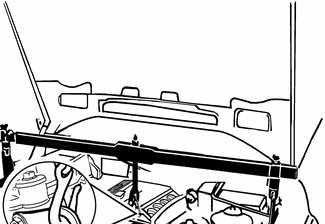

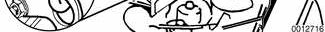

- On cars with automatic transmission, remove ATF cooler line brackets from oil pan and from transmission.

> **Note:**
> - Place drain pan under lines to catch ATF drips.

- Remove oil dipstick guide tube:
    - Detach mounting bolt (A) from left engine mounting bracket.
    - Detach fuel lines and wiring harness brackets (B).
    - Disconnect oil separator hose (C) from base of guide tube and remove tube from oil pan.

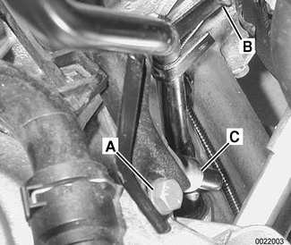

> **Note:**
> - The guide tube is sealed in the block using an O-ring. Check that the O-ring comes out with the tube.

- Working underneath car, remove bolts (arrow) and lower reinforcing brace between front suspension subframe and body.

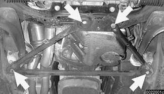

> **Note:**
> - Reinforcement consists of a triangulated bar for Sedan or Sport Wagon or a reinforced plate for Convertible or Coupe.

- Separate steering column shaft from steering rack at universal joint.

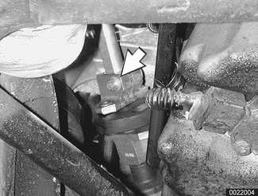

> **CAUTION!**
> - In order to avoid the need for front-end realignment, do not unbolt power steering rack from suspension subframe.

- Remove power steering pump pulley. Remove two mounting bolts from the front (arrows).

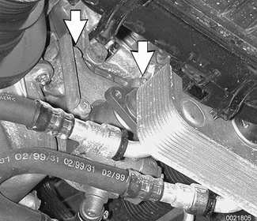

> **Note:**
> - Do not detach power steering fluid lines from pump.

- Remove third power steering mounting bolt (arrow) and remove pump from its mounting bracket. Use stiff wire to suspend pump from chassis.

- Detach electrical harness connector (arrow) at oil level sensor.

- Loosen top engine mount fasteners (arrow).

> **Note:**
> - Right side is shown in photo. Left is similar.

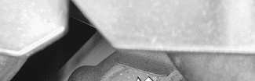

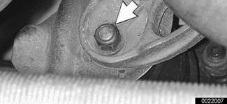

- Loosen lower engine mount fasteners (arrows).

> **Note:**
> - Right side is shown in photo. Left is similar.

- If applicable, remove front ride level sensor mounting bolt (arrow) and lay sensor aside.

- Remove left and right front control arm bracket bolts (arrows) from frame rails.

> **Note:**
> - Right side is shown in photo. Left is similar.

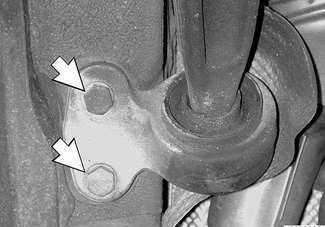

- Detach left and right stabilizer bar anchors from frame rails.
- Remove left control arm ball joint mounting nut (arrow) at front suspension subframe. Drive ball joint out from subframe using soft hammer. Push control arm aside. Repeat for left side.

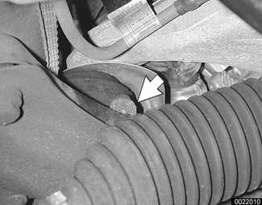

- Support suspension subframe from below using appropriate jacking equipment. Remove subframe mounting bolts (arrows) and lower subframe as far as possible.

> **Note:**
> - Right side is shown in photo. Left is similar.

- Remove oil pan screws (arrows) at cylinder block and transmission bellhousing. Lower oil pan forward to remove.

> **CAUTION!**
> - If the oil pan does not separate easily from the engine cylinder block, a few taps with a rubber mallet should break it free. Do not pry the oil pan loose.

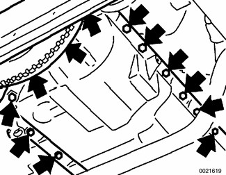

- When installing oil pan:
    - Thoroughly clean all old gasket material from mating surfaces and use a new gasket.
    - Apply a small amount of non-hardening sealer (3-Bond 1209® or equivalent) to oil pan gasket directly below joints (arrows) for end cover and front timing case cover. Apply a bead 3 mm wide by 2 mm high.
    - Tighten oil pan bolts to cylinder block evenly all around.
    - Tighten transmission bellhousing bolts last.

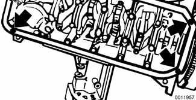

Tightening torque

| Component | Tightening torque |
|---|---|
| Oil drain plug to oil pan (M12) | 25 Nm (18 ft-lb) |
| Oil pan to engine block, M6, 8.8 grade | 10 Nm (89 in-lb) |
| M6, 10.9 grade | 12 Nm (106 in-lb) |
| Transmission bellhousing to oil pan, M8 Allen | 24 Nm (17 ft-lb) |
| M8 Torx | 21 Nm (15 ft-lb) |

- Remainder of installation is reverse of removal.
- Replace self-locking nuts when reinstalling front suspension components.
- Match up key ways while installing steering column shaft. See [320 Steering and Wheel Alignment] for more specific procedures.
- Use new oil dipstick tube sealing O-ring.
- Fill engine with oil as described in [020 Maintenance].
- After adding engine oil, start and run engine. Raise engine speed to 2,500 rpm until oil pressure warning lamp goes out (about 5 seconds).

> **Note:**
> - BMW does not recommend a front end alignment following this procedure.

Tightening torques

| Component | Tightening torque |
|---|---|
| Control arm ball joint to suspension subframe | 90 Nm (66 ft-lb) |
| Front subframe to frame rails (M12, use new bolts), 8.8 grade | 77 Nm (57 ft-lb) |
| 10.9 grade | 110 Nm (81 ft-lb) |
| 12.9 grade | 105 Nm (77 ft-lb) |
| Front end reinforcement to frame rails or suspension subframe (M10, use new bolts), initial torque | 59 Nm (44 ft-lb) |
| Torque angle | 90° + 30° |
| Stabilizer bar to frame rail (M8 nut) | 22 Nm (16 ft-lb) |
| Steering column universal joint clamping screw (M8 bolt, use new bolt) | 22 Nm (16 ft-lb) |

## Oil pan, removing and installing (all wheel drive models)

- Raise car and place securely on jack stands.

> **WARNING!**
> - Make sure the car is stable and well supported at all times. Use a professional automotive lift or jack stands designed for the purpose. A floor jack is not adequate support.

- Remove splash shield from under engine.
- Drain engine oil as described in [020 Maintenance]
- Remove air filter housing complete with mass air flow sensor.
- Install engine lifting equipment at front engine lifting point and raise approximately 5 mm ( inch) until engine weight is supported.

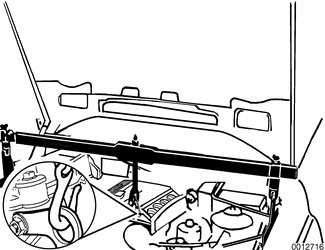

- Remove fuel line clamping brackets from oil pan.
- On cars with automatic transmission, remove ATF cooler line brackets from oil pan and from transmission.

> **Note:**
> - Place drain pan under lines to catch ATF drips.

- Remove oil dipstick guide tube:
    - Detach mounting bolt (A) from left engine mounting bracket.
    - Detach fuel lines and wiring harness brackets (B).
    - Disconnect oil separator hose (C) from base of guide tube and remove tube from oil pan.

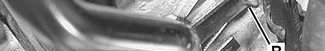

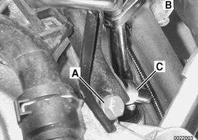

> **Note:**
> - The guide tube is sealed in the block using an O-ring. Check that the O-ring comes out with the tube.

- Separate steering column shaft from steering rack at universal joint. Point wheels straight ahead before disconnecting shaft from rack. See [320 Steering and Wheel Alignment].

- Remove power steering pump pulley. Remove two mounting bolts from the front (arrows).

> **Note:**
> - Do not detach power steering fluid lines from pump.

- Remove third power steering mounting bolt (arrow) and remove pump from its mounting bracket. Use stiff wire to suspend pump from chassis.

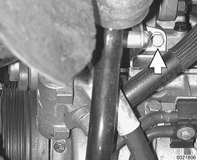

- Detach electrical harness connector at oil level sensor.

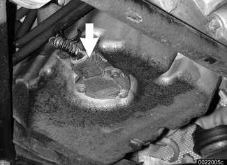

- Remove lower engine mount fasteners.
- If applicable, remove front ride level sensor mounting bolt (arrow) and lay sensor aside.

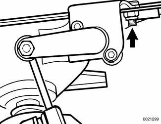

- Working at rear right corner of front subframe, unhook heatshield from subframe (arrow).

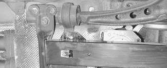

- Detach stabilizer bar anchors from frame rails.

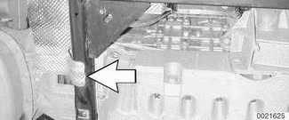

- Remove control arm rear bracket and ball joint mounting bolts (arrows) from subframe.

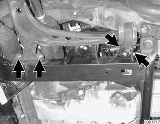

- Remove control arms and front drive axles as described in [310 Front Suspension].
- Remove front differential and right axle inner bearing pedestal as described in [311 Front Axle Final Drive].
- Support subframe while removing four mounting bolts (arrows).

> **CAUTION!**
> - Lower subframe as far as possible without damaging power steering lines. Make sure it is adequately supported throughout the remainder of this procedure.

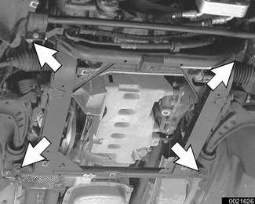

- Remove oil pan:
    - Remove bellhousing bolts from oil pan.
    - Remove all oil pan periphery bolts.
    - Remove center oil pan bolts (arrows).

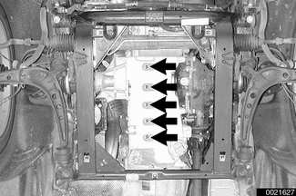

- Lower oil pan to remove.

> **CAUTION!**
> - If the oil pan does not separate easily from the engine cylinder block, a few taps with a rubber mallet should break it free. Do not pry the oil pan loose.

- When reinstalling oil pan:
    - Thoroughly clean all old gasket material from mating surfaces and use a new gasket.
    - Apply a small amount of non-hardening sealer (3-Bond 1209® or equivalent) to oil pan gasket directly below joints for end cover and front timing case cover. Apply a bead 3 mm wide by 2 mm high.
    - Tighten oil pan bolts to cylinder block evenly all around.
    - Tighten transmission bellhousing bolts last.

Tightening torque

| Component | Tightening torque |
|---|---|
| Oil drain plug to oil pan (M12) | 25 Nm (18 ft-lb) |
| Oil pan to engine block, M6, 8.8 grade | 10 Nm (89 in-lb) |
| M6, 10.9 grade | 12 Nm (106 in-lb) |
| M8, 8.8 grade | 22 Nm (16 ft-lb) |
| Transmission bellhousing to oil pan, M8 Allen | 24 Nm (17 ft-lb) |
| M8 Torx | 21 Nm (15 ft-lb) |

- Reinstall front differential and right axle inner bearing pedestal. See [311 Front Axle Final Drive]. Fill differential to lower edge of fill plug.

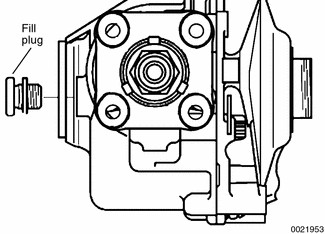

Tightening torques

| Component | Tightening torque |
|---|---|
| Fill or drain plug to front differential | 65 Nm (48 ft-lb) |
| Front differential to oil pan (M10) | 45 Nm (33 ft-lb) |

- Reinstall front axles, control arms and front steering arms as described in [310 Front Suspension].

> **Note:**
> - Be sure to replace seals on differential output flanges.
> - Replace self-locking fasteners when reinstalling front suspension components.

Tightening torques

| Component | Tightening torque |
|---|---|
| Control arm ball joint bracket to subframe, M12 bolt | 77 Nm (57 ft-lb) |
| Control arm mounting bracket to subframe, M10 bolt (always replace) | 59 Nm (44 ft-lb) |

- When reattaching engine to subframe, be sure that left engine mount locating tab (arrow) is seated correctly in subframe slot.

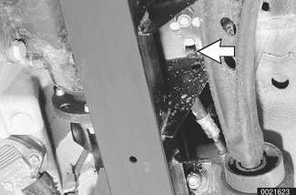

Tightening torques

| Component | Tightening torque |
|---|---|
| Engine mount to subframe, M10 self-locking nut | 45 Nm (33 ft-lb) |
| Front of subframe to frame rail (M12 bolt, always replace), 8.8 grade | 77 Nm (57 ft-lb) |
| 10.9 grade | 110 Nm (81 ft-lb) |
| 12.9 grade | 105 Nm (77 ft-lb) |
| Rear of subframe to mounting adapter, M12 bolt (always replace) | 110 Nm (81 ft-lb) |

- Remainder of installation is reverse of removal.
- Match up key ways while installing steering column shaft. See [320 Steering and Wheel Alignment] for more specific procedures.
- Use new oil dipstick tube sealing O-ring.
- Fill engine with oil as described in [020 Maintenance].
- After adding engine oil, start and run engine. Raise engine speed to 2,500 rpm until oil pressure warning lamp goes out (about 5 seconds).

> **Note:**
> - Be sure to align the front end after this procedure.

Tightening torques

| Component | Tightening torque |
|---|---|
| Stabilizer bar to frame rail (M8 nut) | 22 Nm (16 ft-lb) |
| Steering column universal joint clamping screw (M8 bolt, use new bolt) | 22 Nm (16 ft-lb) |

All wheel drive oil pan, front differential and front subframe assembly

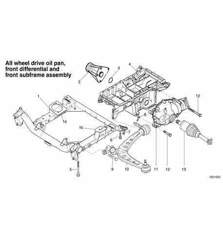

| No. | Part |
|---|---|
| 1 | Front subframe |
| 1a | Right engine mounting point |
| 1b | Left engine mounting point |
| 2 | Right axle inner bearing pedestal |
| 3 | Sealing O-ring |
| 4 | Oil pan |
| 5 | Bolt M12 (always replace), 8.8 grade tighten to 77 Nm (57 ft-lb), 10.9 grade tighten to 110 Nm (81 ft-lb), 12.9 grade tighten to 105 Nm (77 ft-lb) |
| 6 | Bolt M12 (always replace), tighten to 110 Nm (81 ft-lb) |
| 7 | Bolt M10 (always replace), tighten to 59 Nm (44 ft-lb) |
| 8 | Bolt M10 (always replace), tighten to 59 Nm (44 ft-lb) |
| 9 | Bolt M12, tighten to 77 Nm (57 ft-lb) |
| 10 | Front control arm with ball joint and rear mounting bracket |
| 11 | Front differential |
| 12 | Bolt M10, tighten to 45 Nm (33 ft-lb) |
| 13 | Left front axle |
