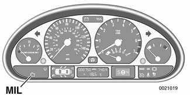
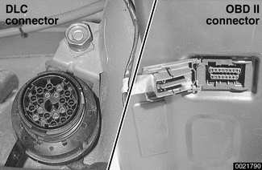

# On-Board Diagnostics (OBD II)

> Source: Bentley BMW 3 Series (E46) 1999–2005 (M3) Repair Manual, section OBD-2 (PDF pages 1222–1232 of 1252). Second copy of the OBD-2 topic — see also on-board-diagnostics.md (pp. 78–88).

OBD II is an acronym for On-Board Diagnostics II, the second generation of on-board self-diagnostic equipment requirements. These standards were originally mandated for California vehicles. Since 1996 they have been applied to all passenger vehicles sold in the United States.

On-board diagnostic capabilities are incorporated into the hardware and software of the engine control module (ECM) to monitor virtually every component that can affect vehicle emissions. OBD II works to ensure that the vehicles remain as clean as possible over their entire life.

Each emission-influencing component is checked by a diagnostic routine to verify that it is functioning properly. If a problem or malfunction is detected, the OBD II system illuminates a warning light on the instrument panel to alert the driver. This malfunction indicator light (MIL) will display the phrase "Check Engine" or "Service Engine Soon."

The OBD II system also stores important information about the detected malfunction so that a repair technician can accurately find and fix the problem.

> **Note:**
> - Specialized OBD II scan tool equipment is needed to access the fault memory and OBD II data. The OBD II fault memory (including the MIL) can only be reset using the special scan tool. Removing the connector from the ECM or disconnecting the battery will not erase the fault memory.

The extra hardware needed to operate the OBD II system consists mainly of the following:

- Additional oxygen sensors downstream of the catalytic converters
- Fuel tank pressure sensor and device to pressurize fuel storage system
- Several engine and performance monitoring devices
- Standardized 16-pin OBD II connector under the dash
- Upgraded components for the federally required 100,000 mile or 10 year reliability mandate

## Malfunction Indicator Light (MIL)

The OBD II system is designed to illuminate the Malfunction Indicator Light (MIL) when emission levels exceed 1.5 times the Federal standards.

> **Note:**
> - On model year 1999 and 2000 cars, the MIL is labeled Check Engine. On model year 2001 cars, the MIL is labeled Service Engine Soon.

The MIL will come on under the following conditions.

- An engine management system fault is detected for two consecutive OBD II drive cycles.
- A catalyst damaging fault.
- A component malfunction (such as catalyst deterioration) causes emissions to exceed 1.5 times OBD II standards.
- Manufacturer-defined specifications are exceeded.
- An implausible input signal is generated.
- Misfire faults occur.
- A leak is detected in evaporative system.
- The oxygen sensors observe no purge flow from purge valve/evaporative system.
- The engine control module (ECM) fails to enter closed-loop operation within specified time.
- The engine control module (ECM) or automatic transmission control module (TCM) enters "limp home" operation mode.
- Key is in "ignition on" position before cranking (bulb check function).

Additional information, MIL:

- A fault code is stored within the ECM upon the first occurrence of a fault in the system being checked.
- Two complete consecutive drive cycles with the fault present illuminate the MIL. The exception to the two-fault requirement is a catalyst damaging fault, which will turn the light on immediately.
- If the second drive cycle was not complete and the specific function was not checked as shown in the example, the ECM counts the third drive cycle as the next consecutive drive cycle. The MIL is illuminated if the function is checked and the fault is still present.
- Once the MIL is illuminated it will remain illuminated unless the specific function has been checked without fault through three complete consecutive drive cycles.
- The fault code will be cleared from memory automatically if the specific function is checked through 40 consecutive drive cycles without the fault being detected.

> **Note:**
> - In order to automatically clear a catalyst damaging fault from memory, the condition under which the fault occurred must be evaluated for 80 consecutive drive cycles without the fault reoccurring.

With the use of a universal or 'generic' scan tool connected to the DLC (Diagnostic Link Connector), diagnostic trouble codes (DTCs) can be obtained, along with the conditions associated with the illumination of the engine service light. Using a more advanced or BMW-dedicated scan tool, additional 'proprietary' information is normally available.

## Scan tool and scan tool display

Owing to the advanced nature of OBD II adaptive strategies, all diagnostics need to start with a scan tool. The aftermarket scan tools can be connected to either the 16-pin OBD II Data Link Connector (DLC) or the BMW 20-pin DLC in the engine compartment. Data from the OBD II DLC may be limited, depending on scan tool and vehicle.

OBD II standards mandate that the 16-pin DLC must be located within three (3) feet of the driver and must not require any tools to be exposed. The communication protocol used by BMW is ISO 9141.

Starting with June 2000 production, the 20-pin BMW diagnostic port (**Data Link Connector or DLC**) which was previously located in the engine compartment has been deleted. All diagnostic, coding and programming functions are incorporated into the **OBD II** diagnostic port, located under left side of dashboard.

> **Note:**
> - On cars built up 06-2000: when accessing emissions related DTCs through the 16-pin OBD II DLC, the BMW 20-pin DLC cap must be installed.

- Professional diagnostic scan tools available at the time of this printing include the BMW factory tools (DISplus and MoDiC) and a small number of aftermarket BMW-specific tools. The CS2000 from Baum Tools Unlimited, the Retriever from Assenmacher Specialty Tools, and the MT2500 from Snap-On Tools are examples of quality OBD scan tools.
- In addition to the professional line of scan tools, inexpensive 'generic' OBD II scan tool software programs and handheld units are readily available. These tools do have limited capabilities, but they are nonetheless powerful diagnostic tools. These tools read live data streams and freeze frame data as well as a host of other valuable diagnostic data.
- For the do-it-yourself owner, simple aftermarket DTC readers are also available. These inexpensive BMW-only tools are capable of checking for DTCs as well as turning off the illuminated MIL and resetting the service indicator lights.

## Diagnostic monitors

A diagnostic monitor is an operating strategy that runs internal tests and checks a specific system, component or function. This is similar to computer self tests.

Completion of a drive cycle ensures that all monitors have completed their required tests. The ECM must recognize the loss or impairment of the signal or component and determine if a signal or sensor is faulty based on 3 conditions:

- Signal or component shorted to ground
- Signal or component shorted to B+
- Signal or component missing (open circuit)

The OBD II system must monitor all emission control systems that are on-board. Not all vehicles have a full complement of emission control systems. For example, a vehicle may not be equipped with secondary air injection, so naturally no secondary air readiness/function code would be present.

OBD II requires monitoring of the following:

- Oxygen sensor monitoring
- Catalyst monitoring
- Misfire monitoring
- Evaporative system monitoring
- Secondary air monitoring
- Fuel system monitoring

Monitoring these emissions related functions is done using DME input sensors and output actuators based on preprogrammed data sets. If the ECM cannot determine the environment or engine operating conditions due to missing or faulty signals it will set a fault code and, depending on conditions, illuminate the MIL.

**Oxygen sensor monitoring:** When drive conditions allow, response rate and switching time of each oxygen sensor is monitored. In addition, the heater function is also monitored. The OBD II "diagnostic executive" knows the difference between upstream and downstream oxygen sensors and reads each one individually.

All oxygen sensors are monitored separately. In order for the oxygen sensor to be effectively monitored, the system must be in closed loop operation.

**Catalyst monitoring:** This strategy monitors the two heated oxygen sensors per bank of cylinders. It compares the oxygen content going into the catalytic converter to the oxygen leaving the converter.

The diagnostic executive knows that most of the oxygen should be used up during the oxidation phase and if it sees higher than programmed values, a fault will be set and the MIL will illuminate.

**Misfire detection:** This strategy monitors crankshaft speed fluctuations and determines if a misfire occurs by variations in speed between each crankshaft sensor trigger point. This strategy is so finely tuned that it can even determine the severity of the misfire.

The diagnostic executive must determine if misfire is occurring, as well as other pertinent misfire information.

- Specific cylinder(s)
- Severity of the misfire event
- Emissions relevant or catalyst damaging

Misfire detection is an on-going monitoring process that is only disabled under certain limited conditions.

**Secondary air injection monitoring:** Secondary air injection is used to reduce HC and CO emissions during engine warm up. Immediately following a cold engine start (-10 to 40°C), fresh air/oxygen is pumped directly into the exhaust manifold. By injecting oxygen into the exhaust manifold, catalyst warm-up time is reduced.

System components:

- Electric air injection motor/pump
- Electric motor/pump relay
- Non-return valve
- Vacuum/vent valve
- Stainless steel air injection pipes
- Vacuum reservoir

The secondary air system is monitored via the use of the pre-catalyst oxygen sensors. Once the air pump is active and air is injected into the system, the signal at the oxygen sensor will reflect a lean condition. If the oxygen sensor signal does not change, a fault will be set and identify the faulty bank(s). If after completing the next cold start a fault is again present, the MIL will be illuminated.

**Fuel system monitoring:** This monitor receives high priority. It looks at the fuel delivery needed (long/short term fuel trim) for proper engine operation based on programmed data. If too much or not enough fuel is delivered over a predetermined time, a DTC is set and the MIL is turned on.

> **Note:**
> - Fuel trim refers to adjustments to base fuel schedule. Long-term fuel trim refers to gradual adjustments to the fuel calibration adjustment as compared to short term fuel trim. Long term fuel trim adjustments compensate for gradual changes that occur over time.

Fuel system monitoring monitors the calculated injection time (ti) in relation to engine speed, load, and the pre-catalytic converter oxygen sensor(s) signals as a result of residual oxygen in the exhaust stream.

The diagnostic executive uses the precatalyst oxygen sensor signal as a correction factor for adjusting and optimizing the mixture pilot control under all engine operating conditions.

**Evaporative system monitoring:** This monitor checks the sealed integrity of the fuel storage system and related fuel lines.

This monitor has the ability to detect very small leaks anywhere in the system. A pressure test is performed on the EVAP system on a continuous basis as the drive cycle allows.

On MS 42.0 cars, a leak detection pump (LDP) is used to pressurize and check system integrity. On MS 43.0 cars, a more sophisticated DMTL (Diagnostic Module - Leak Detection) pump is used.

## Drive cycle

The OBD II drive cycle is an important concept in understanding OBD II requirements. The purpose of the drive cycle is to run all of the emission-related on-board diagnostics over a broad range of driving conditions.

The drive cycle is considered completed when all of the diagnostic monitors have run their tests without interruption. For a drive cycle to be initiated, the vehicle must be started cold and brought up to 160°F and at least 40°F above its original starting temperature.

Once the drive cycle is completed, the system status or inspection/maintenance (I/M) readiness codes are set to "Yes."

System status codes will be set to "No" in the following cases:

- The battery or ECM is disconnected.
- The ECM's DTCs have been erased after completion of repairs and a drive cycle has not been completed.

A scan tool can be used to determine if on-board diagnosis is complete as well as the status of the I/M codes. All required tests must be completed before the I/M readiness codes will be set to "Yes".

## Readiness codes

[The source PDF ends this section with the "Readiness codes" heading only; no content follows it — the next page starts section OBD-3.]
