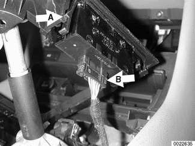
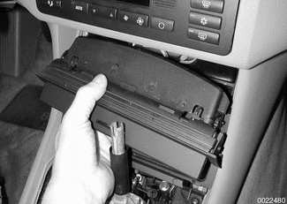
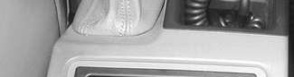
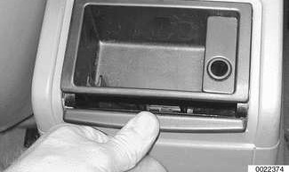
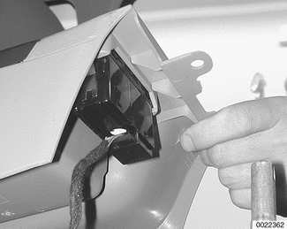
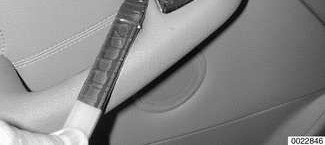

# Other Interior Switches

> Source: Bentley *BMW 3 Series (E46) 1999–2005 (M3) Repair Manual*, section 612-5 (PDF pages 1066–1070 of 1252).

Many of the remaining electrical switches are housed at the bottom center of the dashboard, or in the center console.

The ASC or DCS switch is ahead of the shifter console at the bottom of the center dashboard. When equipped, seat heater switches are in the same location.

The right front and right rear window switches are ganged into one unit on the right side of the shifter. The left front and left rear window switches are ganged with the child safety rear window lockout switch (sedan and Sport Wagon models) on the left side of the shifter.

The central locking switch and hazard warning switch are ganged into one unit behind the shifter mechanism.

Replacement of the above switches is covered below, noting when each switch is accessible.

The left and right electric outside rear view mirrors are controlled by one switch on the driver door armrest.

## Lower dashboard/console switches, replacing

- Remove shift knob by pulling knob straight off the gearshift lever.

**Note:**

*Removal of the shift knob will require about 90 lbs. of force. Do not twist knob or locating key can be damaged.*

- Pry up on rear of shift boot/bezel to unclip, then remove boot from front retainers.
- Remove retaining screws (arrows) under transmission selector boot/trim.

## Power window switches, replacing

- To remove left or right ganged window switches:
    - Shifter bezel: Lift up by prying gently.
    - Shifter boot: Unclip bottom of boot from center console trim by pushing forward. Pull boot up around shifter, but do not remove.

Unclip switch retainer (**A**) and pull out switches from under console trim. Detach electrical harness connector (**B**) from switches.

- Installation is reverse of removal.

## ASC/DSC/seat heater switches, replacing

Either the ASC or DSC switch is located in the storage compartment/ash tray housing. Seat heater switches are also located here, if equipped.

This procedure can be skipped in order to access center console switches.

Remove storage compartment below IHKA control panel:

- Open compartment door.
- Push upward in center of compartment, then pull out.

- Remove retaining screws from storage compartment/ash tray housing.
- Slide housing out and disconnect electrical harness connectors. Remove housing from lower dashboard.
- With housing removed slide switches out of housing by gently pushing from behind.
- Installation is reverse of removal.

## Central locking/hazard warning switches, replacing

Working at rear of center console, press rolling cover of rear ashtray down. Depress cover fully to pop ashtray out of console. Remove ashtray.

- Remove retaining screws and storage tray housing. Disconnect electrical harness connector for storage tray courtesy light.
- Remove screws at base of storage tray compartment in console.

Unclip trim boot for parking brake lever and pull boot and handle forward off brake lever.

- Slide center console back from dash and lift up.

Disconnect electrical harness protector from hazard light/central locking switch.

- To remove switch from console, depress retaining tabs on each side of switch and push switch out through surface of console trim.
- Installation is reverse of removal.

## Outside mirror switch, replacing

Carefully pry outside mirror switch from door arm rest.

- Disconnect harness connector from switch.
- Installation is reverse of removal.

