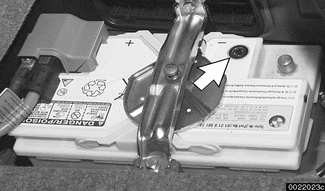
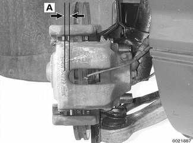
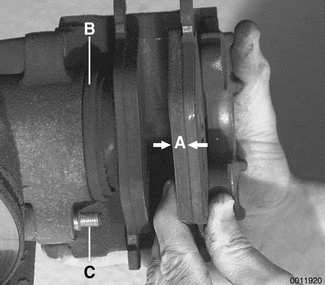
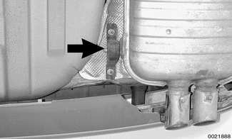
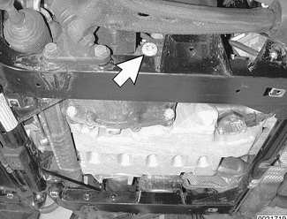
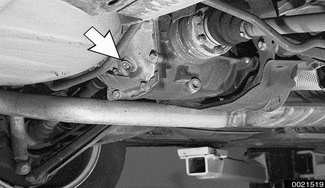
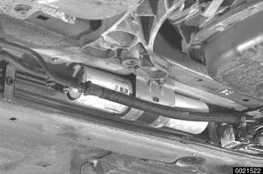
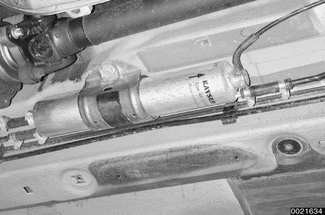
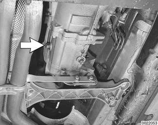

# Other Mechanical Maintenance

> Source: BMW 3 Series (E46) Repair Manual, section 020-6, Maintenance chapter (PDF pages 58–72 of 1252).

## Battery, checking and cleaning

The battery is located in the right side of the luggage compartment. Simple maintenance of the battery and its terminal connections will ensure maximum starting performance, especially in winter when colder temperatures reduce battery power.

> **Note:**
> - Design characteristics of the convertible body cause vibrations in the trunk area. Therefore, E46 Convertibles require a special battery designed for constant vibration. When replacing the battery, be sure the replacement is designed specifically for the Convertible.

Battery cables should be tight. The terminals, the cable clamps, and the battery case should be free of the white deposits that indicate corrosion and acid salts. Even a thin layer of dust containing conductive acid salts can cause battery discharge.

- To remove battery corrosion:
    - Disconnect battery cables. Disconnect negative (-) cable first.
    - Remove battery from trunk. Clean terminal posts and cable clamps with a wire brush.
    - Clean main chassis ground terminal next to battery. Corrosion can be washed away with a baking soda and water solution that will neutralize acid. Apply solution carefully, though, since it will also neutralize acid inside battery.
    - Reconnect cable clamps, positive (+) cable first.
    - Lightly coat outside of terminals, hold down screws, and clamps with petroleum jelly, grease, or a commercial battery terminal corrosion inhibitor.

> **WARNING!**
> - Prior to disconnecting the battery, read the battery disconnection cautions given at the front of this manual on page viii.
> - Battery acid is extremely dangerous. Take care to keep it from contacting eyes, skin, or clothing. Wear eye protection. Extinguish all smoking materials and do not work near any open flames.

Battery electrolyte should be maintained at the correct level just above the battery plates and their separators. The correct level is approximately 5 mm (1/4 in.) above the top of battery plates or to the top of the indicator marks (if applicable). The battery plates and the indicator marks can be seen once the filler caps are removed. If the electrolyte level is low, replenish it by adding distilled water only.

> **Note:**
> - The original equipment battery in E46 models is maintenance free. The original electrolyte will normally last the entire service life of the battery under moderate climate conditions.

## Battery, replacing

The original equipment BMW battery is equipped with a built-in hydrometer "magic eye" (arrow). Battery condition is determined by the color of the eye:

- Green: Adequate charge
- Black: Inadequate charge; recharge
- Yellow: Defective battery; replace

Batteries are rated by ampere hours (Ah), the number of hours a specific current drain can be sustained before complete discharge, or by cold cranking amps (CCA), the number of amps available to crank the engine in cold weather conditions. In general, replacement batteries should always be rated equal or higher than the original battery.

> **CAUTION!**
> - Prior to disconnecting the battery, read the battery disconnection cautions given at the front of this manual on page viii.

The battery is held in place by a single hand screw and plate. A secure battery hold-down is important in order to prevent vibrations and road shock from damaging the battery.

> **Note:**
> - Always disconnect the negative (-) cable first, and connect it last. While changing the battery, clean away any corrosion in or around the battery tray.
> - Design characteristics of the convertible body cause vibrations to oscillate in the trunk area. Therefore, the convertible model uses a special battery and battery retaining mechanism designed for this constant vibration.
> - More battery and charging system information is in [121 Battery, Alternator, Starter].

## Brake fluid, replacing

BMW strictly recommends replacing the brake fluid every two years. This will help protect against corrosion and the effects of moisture in the fluid.

> **Note:**
> - See [340 Brakes] for brake fluid flushing procedures.

## Brake pad/rotor wear, checking

All E46 cars are fitted with disc brakes at all four wheels. Although the brakes are equipped with a brake pad warning system, the system only monitors one wheel per axle. It is recommended that pad thickness should be checked whenever the wheels are off or brake work is being done.

Disc brake pad wear can be checked through opening in caliper:

- Measure distance (A) of brake pad "ear" to brake rotor. See [340 Brakes]. Compare to specification below.

Unbolt caliper from steering arm to properly inspect:

- Brake pad thickness (A)
- Brake rotors
- Condition of caliper seal (B)
- Condition of caliper slider bolts (C)

> **Note:**
> - Brake caliper removal and installation procedures are given in [340 Brakes].

Brake pad lining minimum thickness

| Front or rear pad Dimension A | 3.0 mm (0.12 in.) |
|---|---|

## Brake system, inspecting

Routine maintenance of the brake system includes maintaining the brake fluid in the reservoir, checking brake pads for wear, checking parking brake function, and inspecting the system for fluid leaks or other damage:

- Check that brake hoses are correctly routed to avoid chafing or kinking.
- Inspect unions and brake calipers for signs of fluid leaks.
- Inspect rigid lines for corrosion, dents, or other damage.
- Inspect flexible hoses for cracking.
- Replace faulty hoses or lines, see [340 Brakes].

> **WARNING!**
> - Incorrect installation or overtightening hoses, lines, and unions may cause chafing or leakage. This can lead to partial or complete brake system failure.

## Parking brake, checking

The parking brake system is independent of the main braking system and may require periodic adjustment depending on use. Adjust the parking brake if the brake lever can be pulled up more than 8 clicks. Check that the cable moves freely. A description of the parking brake and parking brake adjustment can be found in [340 Brakes].

> **Note:**
> - The parking brake may lose some of its effectiveness if it is not used frequently. This is due to corrosion build-up on the parking brake drum. To remove corrosion, apply the parking brake just until it begins to grip, then pull the lever up one more stop (click). Drive the car approximately 400 meters (1,300 ft.) and release the brake. To recheck the adjustment of the parking brake see [340 Brakes].

## Clutch fluid, checking

The hydraulic clutch and the brake system share the same reservoir and the same brake fluid. Clutch fluid level and brake fluid level are checked at the same time.

> **Note:**
> - See [340 Brakes] for more information.
> - See [210 Clutch] for information on the clutch and the hydraulic clutch operating system.

## Drive axle joint (CV joint) boots, inspecting

CV joint protective boots must be closely inspected for cracks and any other damage that will allow contaminants to get into the joint. If the rubber boots fail, the water and dirt that enter the joint will quickly damage it.

> **Note:**
> - Replacement of the CV joint boots and inspection of the joints are described in [311 Front Axle Final Drive] and [331 Rear Axle Final Drive].

## Exhaust system, inspecting

Exhaust system life varies widely according to driving habits and environmental conditions. If short-distance driving predominates, the moisture and condensation in the system will not fully dry out. This will lead to early corrosion damage and more frequent replacement.

Scheduled maintenance of the exhaust system is limited to inspection:

- Check to see that all the hangers (arrow) are in place and properly supporting the system and that the system does not strike the body.
- Check for restrictions due to dents or kinks.
- Check for weakness or perforation due to rust.

> **Note:**
> - Alignment of the system and the location of the hangers are described in [180 Exhaust System].

## Differential oil level, checking

The differential units in E46 models are filled with lifetime oil that ordinarily does not need to be changed.

All wheel drive models: Check front differential fluid level at front differential filler plug (arrow).

Check rear differential oil level at rear differential filler plug (arrow).

- Check lubricant level with car on a level surface:
    - Remove oil filler plug.
    - Level is correct when fluid just reaches edge of filler hole.
    - If necessary, top up fluid.
    - Install and tighten oil filler plug when oil level is correct.

The differential should be filled with a special BMW lubricant available through an authorized BMW dealer.

> **Note:**
> - Use a 14 mm or 17 mm Allen socket to remove the drain plug.
> - If the car is raised in the air, it should be level.

Tightening torques

| Component | Tightening torque |
|---|---|
| Front differential filler plug to housing | 65 Nm (48 ft-lb) |
| Rear differential filler plug to housing | 70 Nm (52 ft-lb) |

## Fuel filter, replacing

The fuel filter is located beneath the center of the car, approximately under the driver's seat. A protective cover must be removed to access the filter. Fuel filter for M52 TU engine is shown in illustration.

E46 cars with M54 engine are equipped with a fuel filter that has a built in fuel pressure regulator.

- Disconnect battery negative (-) cable.
- Drain fuel filter from inlet side into a container and inspect drained fuel. Check for rust, moisture and contamination.
- When replacing fuel filter:
    - Clamp filter inlet and outlet hoses to lessen fuel spillage.
    - Loosen center clamping bracket and hose clamps on either end of filter.
    - Note arrow or markings indicating direction of flow on new filter.
    - Install new filter using new hose clamps.

> **WARNING!**
> - Fuel will be expelled when the filter is removed. Do not smoke or work near heaters or other fire hazards. Keep a fire extinguisher handy.

> **CAUTION!**
> - Clean thoroughly around the filter connections before removing them.

> **Note:**
> - When installing fuel filter cover, take care to reinstall foam rubber seal in front of cover correctly to prevent flooding of filter with rain splash water.

## Fuel tank and fuel lines, inspecting

Inspect the fuel tank, fuel lines, and fuel system for damage or leaks. Check for fuel leaks in the engine compartment or fuel odors in the passenger compartment. Check for faulty flexible fuel lines by bending them. If any leaks are present, fuel should be expelled. Check for any evaporative emissions hoses that may have become disconnected, checking carefully at the charcoal canister and evaporative emissions purge system.

> **WARNING!**
> - When checking for fuel leaks, the engine must be cold. A hot exhaust manifold or exhaust system could cause the fuel to ignite or explode causing serious personal injury. Ventilate the work area and clean up spilled fuel immediately.

> **Note:**
> - See [130 Fuel Injection] and [160 Fuel Tank and Fuel Pump] for component locations and additional information.

## Suspension, front, inspecting

Inspection of the front suspension and steering includes a check of all moving parts for wear and excessive play. Inspect ball joint and tie-rod rubber seals and boots for cracks or tears that could allow the entry of dirt, water, and other contaminants.

On All wheel drive models check front differential fluid level and check CV joint boots for cracks.

> **Note:**
> - See [310 Front Suspension] and [331 Rear Axle Final Drive]

## Suspension, rear, inspecting

Differential and rear drive axle service consists of checking and changing the gear oil, inspecting for leaks, and checking the rear drive axle rubber boots for damage.

The areas where leaks are most likely to occur are around the drive shaft and drive axle mounting flanges.

> **Note:**
> - For more information on identifying oil leaks and their causes, see [330 Rear Suspension] and [311 Front Axle Final Drive].

## Tires, checking inflation pressure

Correct tire pressures are important to handling and stability, fuel economy, and tire wear. Tire pressures change with temperature. Pressures should be checked often during seasonal temperature changes. Correct inflation pressures can be found on the driver's door pillar and in the owner's manual. Note that tire pressures should be higher when the car is more heavily loaded.

> **WARNING!**
> - Do not inflate any tire to a pressure higher than the tire's maximum inflation pressure listed on the sidewall. Use care when adding air to warm tires. Warm tire pressures can increase as much as 4 psi (0.3 bar) over their cold pressures.

## Tires, rotating

BMW does not recommend tire rotation. Due to the car's suspension design, the front tires begin to wear first at the outer shoulder and the rear tires begin to wear first at the middle of the tread or inner shoulder. Rotating the tires may adversely affect road handling and tire grip.

## Transmission service, automatic

The automatic transmission is not equipped with a dipstick. Therefore, checking the ATF level is an involved procedure which includes measuring and maintaining a specified ATF temperature during the checking procedure.

> **Note:**
> - For more complete ATF service information, including checking ATF level and ATF filter replacement procedures, see [240 Automatic Transmission].

## Transmission service, manual

Manual transmission service consists of inspecting for leaks and checking the fluid.

Evidence of transmission leaks is likely to be seen around the driveshaft mounting flange and at the bottom of the bellhousing.

> **Note:**
> - For more information on identifying oil leaks and their causes, see [230 Manual Transmission] and [210 Clutch].

## Transmission fluid, checking and filling (manual transmission)

The manual transmission in E46 models is filled with lifetime oil that ordinarily does not need to be changed.

Check manual transmission oil level at transmission filler plug (arrow). Make sure car is on level surface.

> **Note:**
> - Transmission fluid level checking and replacement procedures are covered in [230 Manual Transmission].

## Wheels, aligning

BMW recommends checking the front and rear alignment once a year and whenever new tires are installed.

> **Note:**
> - See [320 Steering and Wheel Alignment] for a more detailed discussion of alignment requirements and specifications.
