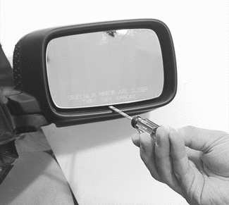
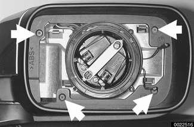
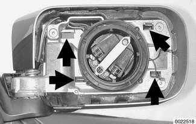
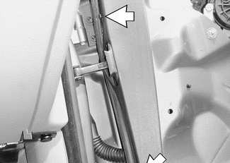
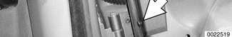
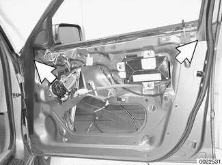
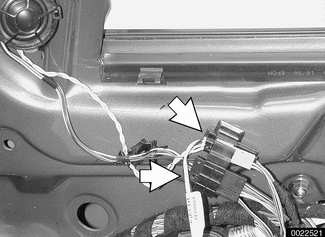
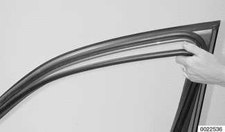
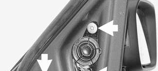
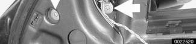

# Outside Rear View Mirrors

> Source: BMW 3 Series (E46) Repair Manual, section 510-2, Exterior Trim, Bumpers chapter (PDF pages 782–785 of 1252).

Many of the mirror components are separately available from an authorized BMW dealer, including the glass and outside plastic housing.

## Outside mirror glass, replacing

> **CAUTION!**
> - Mirror should be at or above room temperature before removal. Otherwise, small plastic parts or glass may break.

- Insert thin pry tool (wooden or tape-wrapped screwdriver) between bottom mirror edge and mirror housing and carefully pry out mirror glass from housing.

*Prying mirror glass out of mirror housing. Note screwdriver shaft wrapped with tape.*

- Heated mirror: remove heating element harness connectors from back of mirror glass.

- Install new glass into position by pressing firmly until it snaps into place.

## Outside mirror housing, removing and installing

- Remove mirror glass as described above.

- Remove housing retaining screws (**arrows**) and lift off rear housing.

- Tilt mirror housing forward and compress plastic retainers (**arrows**) and lift off front housing.

> **Note:**
> - The front mirror housing is retained by either three or four clips, depending on model.

- Installation is reverse of removal. Check mirror function before installing covering parts.

## Outside mirror, removing and installing

- Remove front door panel trim. See [411 Doors].

- Working at door hinge, remove door inner trim panel retaining pins (**arrows**).

- Gently pry off door inner trim panel from retaining clips (**arrows**).

- Disconnect electrical harness connectors for window anti-trapping protection and speaker (**arrows**), if equipped.

- Remove inner door panel trim. On sedan models, trim strip extends around window to door latch area.

- Support mirror and speaker (if equipped) and remove mounting bolts (**arrows**). Lift speaker and mirror off door and feed out cable.

- Installation is reverse of removal. Check mirror function before installing covering parts.

Tightening torque

| Tightening torque | |
|---|---|
| Outside mirror to door (M6) | 6 Nm (4.5 ft-lb) |
