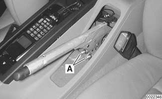
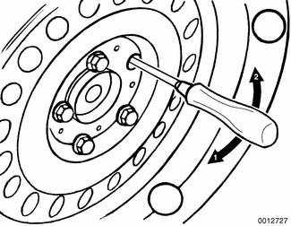
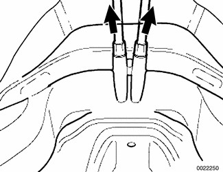
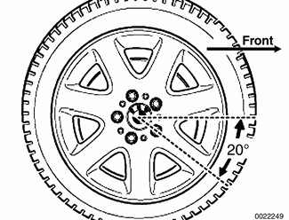
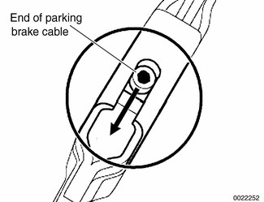
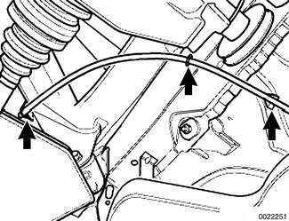

# Parking brake

> Source: BMW 3 Series (E46) Repair Manual, section 340-6, Brakes chapter (PDF pages 704–709 of 1252).

The parking brake is a brake drum system integrated into the rear brake rotors.

The parking brake can be adjusted with the wheels installed, although the rear wheels will have to be raised off the ground.

Adjusting the parking brake becomes necessary under the following circumstances:

- Replacing parking brake shoes
- Replacing rear brake rotors
- Excessive stroke of parking brake handle required for actuation (more than 10 notches)
- Replacement of adjustment unit or parking brake cables

## Parking brake shoes, adjusting

Lift parking brake lever boot out of console. While holding cables stationary, loosen parking brake cable nuts (A) until cables are completely slack.

- Raise rear of car.

> **WARNING!**
> - Make sure the car is firmly supported on jack stands designed for the purpose. Place the jack stands beneath a structural chassis point. Do not place jack stands under suspension parts.

- Remove one lug bolt from each rear wheel. Turn road wheel until lug bolt hole lines up with parking brake adjuster (approximately 65° to rear of wheel centerline).

Use flat-bladed screwdriver to turn adjuster. On left wheel, turn adjuster in direction 1 to expand shoes. On right wheel, turn adjuster in direction 2 to expand shoes.

- Using a screwdriver, turn adjuster to expand brake shoes until road wheel can no longer turn, then back adjuster off. Repeat procedure on other rear wheel.

| Parking brake adjusting (initial) | |
|---|---|
| Back off adjuster through wheel lug bolt hole | 10 notches |

- Working inside car, set parking brake several times to seat cable. Then pull parking brake lever up two notches. Tighten cable adjusting nuts until it is just possible to turn rear wheels with slight resistance.
- Release lever and make sure rear wheels turn freely.
- Turn on ignition. Pull up parking brake lever 1 notch and make sure that light comes on.
- Pull parking brake lever up one more notch and check that rear wheels do not move and parking brake warning light stays lit. If parking brake light goes out, contact switch must be adjusted.
- Install parking brake lever boot. Install road wheel lug bolts.

Tightening torque

| Component | Tightening torque |
|---|---|
| Road wheel to hub | 100 ± 10 Nm (74 ± 7 ft-lb) |

## Parking brake shoes, removing and installing

- Raise rear of car and remove road wheels.
- Without disconnecting brake fluid hose, remove rear brake calipers from trailing arms. Remove rear brake rotors. See [Brake Pads, Calipers, and Rotors].

> **CAUTION!**
> - Do not let the brake caliper assembly hang from the brake hose. Support caliper from chassis with strong wire.

- Unhook upper return spring from brake shoes. Remove shoe retainers by pushing them in and rotating turn. BMW special tool 34 4 000 can be used to remove retainers, if needed.
- Spread shoes apart and lift them out.
- Inspect shoe expander to make sure it functions properly. Apply a thin coat of grease to sliding parts and pins.
- Installation is reverse of removal. Be sure to adjust parking brake cables as described earlier.

## Parking brake cable, replacing

The parking brake is actuated by two separate Bowden cables between the parking brake handle and the parking brake shoe actuators at the rear brake backing plates. Each cable can be replaced separately.

To replace a cable it is not necessary to remove the rear wheel or to disassemble the brakes. However, it is necessary to remove the complete exhaust system and lower the exhaust system heat shield to access the front end of the parking brake cable housing.

- Working inside car, gain access to base of parking brake handle by removing center console storage tray and center armrest, as necessary.

Use BMW special tool 34 1 030 or equivalent deep 10 mm socket to remove parking brake cable lock nuts (A) at base of parking brake handle.

- Raise rear of car.

> **WARNING!**
> - Make sure the car is firmly supported on jack stands designed for the purpose. Place the jack stands beneath a structural chassis point. Do not place jack stands under suspension parts.

- Remove complete exhaust system as described in [180 Exhaust System].
- Remove center tunnel heat shield.

Pull parking brake cable out of body guide tube (arrows) and detach from routing brackets, noting correct routing for reinstallation.

Remove one lug bolt from rear wheel. Turn wheel until lug bolt hole is approx. 20° below horizontal to access end of parking brake cable.

Disconnect cable from parking brake actuator:

- Push free (parking brake handle) end of cable into housing to create slack inside brake drum.
- Poke thin screwdriver through lug bolt hole and pry end of parking brake cable downward (arrow).

Pull cable out of back of backing plate.

- To reinstall:
  - Push new cable housing into hole in back of backing plate.
  - Push free (parking brake handle) end of cable into housing until end of cable snaps audibly into holder inside brake drum.

Reroute new cable under car, attaching to brackets (arrows).

- Remainder of installation is reverse of removal noting the following:
  - Adjust parking brake as described earlier.
