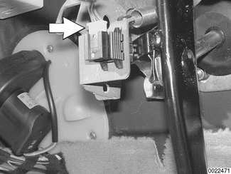

# Pedal Cluster Switches

> Source: Bentley *BMW 3 Series (E46) 1999–2005 (M3) Repair Manual*, section 612-4 (PDF pages 1064–1065 of 1252).

To access either the brake pedal or the clutch pedal switch, remove the left footwell trim (above pedals). See [513 Interior Trim].

## Brake light switch, replacing

Working at pedal cluster:

- Detach electrical harness connector (arrow) from brake light switch.
- Slide switch out of holder (toward rear of car).

**Note:**

*The brake light switch is held in place via a serrated mounting. Remove switch mounting from pedal cluster bracket.*

- Push brake pedal down, install new switch, then allow brake pedal to spring back slowly, automatically adjusting switch position.

## Cruise control clutch switch, replacing

- Working at pedal cluster:
    - Push clutch pedal to floor and lock in position using a pedal stop.
    - Detach electrical harness connector from switch.
    - Squeeze together retaining clips at front of switch. Slide switch out of holder (toward rear of car).
- Install new switch, then allow clutch pedal to spring back slowly, automatically adjusting switch position.
