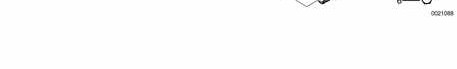
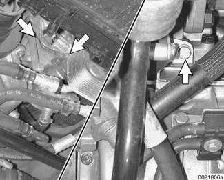
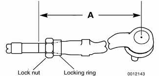
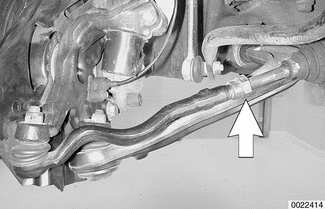
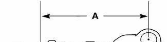
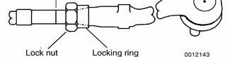
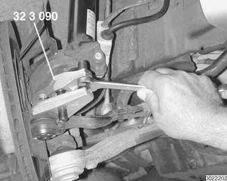
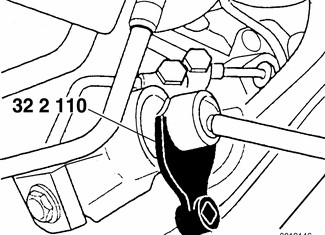
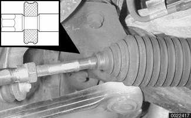

# Power Steering System

> Source: BMW 3 Series (E46) Repair Manual, section 320-4, Steering and Wheel Alignment chapter (PDF pages 607–617 of 1252).

The power steering fluid reservoir is located on the lower left front of the engine.

> **CAUTION!**
>
> - Maintain clean conditions when working with open power steering fluid lines.
> - Plug off power steering lines and connections to keep out contamination.

| Power steering fluid |  |
|---|---|
| Recommended fluid | ATF (automatic transmission fluid) |

## Power steering system

1. Power steering fluid reservoir
2. Fluid supply line
3. Power steering pump
4. Copper sealing ring
5. Banjo bolt M14 — tighten to 35 Nm (26 ft-lb)
6. Banjo bolt M16 — tighten to 40 Nm (30 ft-lb)
7. Power steering rack
8. Pressurized fluid line
9. Fluid return line
10. Fluid cooler
11. Rack boot kit
12. Tie rod nut — tighten to 65 Nm (48 ft-lb)
13. Outer tie rod end
14. Clamp ring
15. Outer tie rod end lock nut — tighten to 45 Nm (33 ft-lb)
16. Inner tie rod — tighten to 100 + 10 Nm (74 + 7 ft-lb)

## Power steering system, bleeding and filling

- With engine off, fill power steering fluid reservoir with clean fluid. Fill level to MAX mark on dip stick.
- Start engine. Slowly turn steering wheel from lock to lock a minimum of two times.
- Turn engine off and check fluid level, adding more if necessary.

## Power steering pump, removing and installing

- Empty power steering fluid reservoir using clean syringe. Do not reuse fluid.
- Raise front of car. Remove splash shield from under engine.
- Remove drive belt from power steering pump. See [020 Maintenance].

> **WARNING!**
>
> Make sure the car is firmly supported on jack stands designed for the purpose. Place the jack stands beneath a structural chassis point. Do not place jack stands under suspension parts.

- Remove power steering pump drive pulley.
- Remove fluid hoses from pump. Plug openings in pump and hose ends.
- Remove brake cooling ducts on left side.
- Remove front stabilizer bar anchors and swing stabilizer bar down out of the way. See [310 Front Suspension].
- Remove pump mounting bolts (**arrows**) and remove pump. Rear wheel drive model shown.

- Installation is reverse of removal, noting the following:
    - Make sure all thread bores, bolts, nuts, fluid couplings and mating surfaces are clean, and inside surface of multi-ribbed-belt is free of grease and dirt.
    - Use new sealing washers when reattaching power steering pressure lines.
    - Make sure hoses have adequate clearance from chassis. Do not over-torque banjo bolts.
    - Fill and bleed power steering system as described earlier.

| Tightening torques |  |  |
|---|---|---|
| Hydraulic hoses to power steering pump | M14 banjo bolt | 35 Nm (26 ft-lb) |
|  | M16 banjo bolt | 40 Nm (30 ft-lb) |
| Power steering pump to bracket M8 self-locking nuts | | 22 Nm (16 ft-lb) |
| Power steering pump bracket to engine block M8 self-locking nuts | | 22 Nm (16 ft-lb) |

## Steering rack, removing and installing

- Empty power steering fluid reservoir using clean syringe. Do not reuse fluid.
- Raise front of car, and remove wheels. Remove splash shield from under engine.
- Make reference measurement (**A**) of left outer tie rod end to tie rod. Record measurement.

**Note:** *Accurate measurement of the tie rod end with reference to the tie rod will help approximate correct wheel alignment when new parts are installed.*

- Note correct placement of inner taper on locking ring.
- Repeat for right side.
- Loosen left outer tie rod end lock nut (**arrow**).

- Unscrew left tie rod end from steering rack by turning inner tie rod shaft.

> **CAUTION!**
>
> - Grip end of rack boot to keep it from twisting as the tie rod shaft is unscrewed.

- Repeat for right tie rod.
- Working underneath car, remove fluid line banjo bolts (**arrows**) from steering rack.

> **CAUTION!**
>
> - Plug off power steering lines and connections to keep out contamination.

**Note:** *It may be necessary to remove other components to gain access to steering rack.*

- Remove lower steering column flexible joint pinch bolt (**arrow**). Pull flexible joint off steering rack shaft.

- Move steering wheel to straight ahead position and remove ignition key to lock steering.
- On all wheel drive vehicles:
    - Support front subframe with a shop hoist or appropriate jack.
    - Detach subframe from engine and lower approx. 20 mm ( in.). See [310 Front Suspension].
- Remove steering rack mounting bolts (**arrows**). Remove steering rack from subframe by pulling it forward.

- Installation is reverse of removal, noting the following:

    - Make sure all thread bores, bolts, nuts, splines and mating surfaces are clean. Use anti-seize paste on inner tie rod threads.
    - Use new self-locking nuts wherever applicable.
    - Use keyed components to reassemble steering column flexible joint to steering rack shaft. Make sure wheels are straight ahead.
    - Use new sealing rings on banjo fittings. Do not over-torque banjo bolts.
    - Use tie rod measurement previously made (measurement A) to temporarily set toe.
    - Fill and bleed power steering system as described earlier.
    - Have car professionally aligned.

| Tightening torques |  |
|---|---|
| Outer tie rod end to steering arm replace self-locking nut | 65 Nm (48 ft-lb) |
| Outer tie rod end lock nut | 45 Nm (33 ft-lb) |
| Steering column flexible joint to steering rack shaft | 22 Nm (16 ft-lb) |
| Steering rack to subframe M10 bolt | 42 Nm (32 ft-lb) |

| Steering fluid lines |  |
|---|---|
| M14 banjo bolt | 35 Nm (26 ft-lb) |
| M16 banjo bolt | 40 Nm (30 ft-lb) |

## Outer tie rod end, replacing

- Raise front of car. Remove road wheel.

> **WARNING!**
>
> Make sure the car is firmly supported on jack stands designed for the purpose. Place the jack stands beneath a structural chassis point. Do not place jack stands under suspension parts.

- Remove outer tie rod ball joint nut. Separate outer tie rod end from steering arm using BMW special tool 32 3 090 or equivalent.

- Make reference measurement (**A**) of outer tie rod end to tie rod. Record measurement.

**Note:** *Accurate measurement of the tie rod end with reference to the tie rod will help approximate correct wheel alignment when new parts are installed.*

- Note correct placement of inner taper on locking ring.
- Loosen outer tie rod end lock nut (**arrow**).

- Unscrew tie rod end from tie rod shaft.
- Installation is reverse of removal.
- Make sure all threaded parts are clean. Use antiseize paste on inner tie rod threads.
- Use new self-locking nuts, where applicable.
- Use tie rod measurement (A) to set toe.
- Have car professionally aligned.

| Tightening torques |  |
|---|---|
| Outer tie rod end to steering arm replace self locking nut | 65 Nm (48 ft-lb) |
| Outer tie rod end lock nut | 45 Nm (33 ft-lb) |

## Tie rod or rack boot, replacing

- Raise front of car. Remove splash shield from under engine.

> **WARNING!**
>
> Make sure the car is firmly supported on jack stands designed for the purpose. Place the jack stands beneath a structural chassis point. Do not place jack stands under suspension parts.

- Remove outer tie rod end self-locking nut, and separate outer tie rod end ball joint as described above.
- Make a reference measurement of outer tie rod end to tie rod. Record measurement.

**Note:** *Accurate measurement of the tie rod end with reference to the tie rod will help approximate correct wheel alignment when new parts are installed.*

- Note correct placement of inner taper on locking ring.
- Cut rack boot band clamp and slide bellows back. Inspect boot for any sign of damage. Replace if necessary.

**Note:** *New rack boot kit comes with new band clamp.*

Using BMW special tool 32 2 110 remove inner tie rod shaft from steering rack.

> **CAUTION!**
>
> - To avoid damage to steering rack while removing tie rod, turn steering until end of rack is as far as possible in housing.

When reassembling, grease tie rod taper so that rack boot support buffer or small end of rack boot (inset) slides on tie rod when tie rod is tightened, preventing rack boot from twisting.

- Installation is reverse of removal, noting the following:
    - Make sure all threaded parts are clean. Replace self-locking nuts.
    - Install outer tie rod end to new tie rod using reference measurement (A) recorded earlier.
    - Have car professionally aligned.

| Tightening torques |  |
|---|---|
| Outer tie rod end to steering arm | 65 Nm (48 ft-lb) |
| Outer tie rod end lock nut | 45 Nm (33 ft-lb) |
| Inner tie rod to steering rack | 100 + 10 Nm (74 + 7 ft-lb) |
