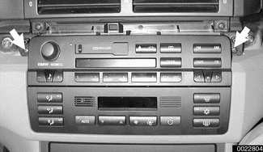
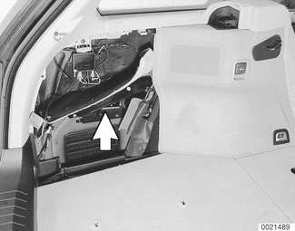

# Radio and Audio Accessories

> Source: Bentley *BMW 3 Series (E46) 1999–2005 (M3) Repair Manual*, section 650-2 (PDF pages 1172–1173 of 1252).

## Radio, removing and installing

> **CAUTION!**
> - Before beginning work on the radio or sound system, verify that the radio is an original equipment BMW radio and that the wiring harness has not been modified.
> - Servicing of aftermarket sound equipment should be referred to an authorized agent of the equipment's manufacturer.

**Note:**

*On-Board Monitor removal is covered in [640 Heating and Air Conditioning].*

- Prying gently, remove right dashboard trim, then center dashboard trim.

> **CAUTION!**
> - To avoid marring interior trim, work with a plastic prying tool.

Remove radio mounting screws (arrows).

- Pull radio out of instrument panel opening. Detach electrical harness connector and antenna lead.
- Installation is reverse of removal.

## Amplifier

In all models the sound system amplifier is installed behind the trim on the left side of the car.

- Sedan or Coupe: To access amplifier, carefully remove trunk trim clips on left side and peel back trim.
- Sport Wagon: Remove left cargo compartment trim cover. Sound system amplifier (arrow) is behind sound insulation.

- Convertible:
    - Disconnect battery negative terminal.
    - Remove lower section of rear seat left side trim.
    - If necessary, remove convertible top module. See [541 Convertible Top].
    - Amplifier is attached to side wall.

## CD changer

The optional CD changer is located in the left side of the trunk behind the trim panel. An access door allows loading of up to 6 CDs.
