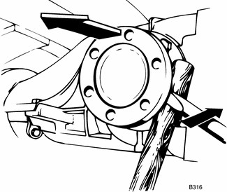
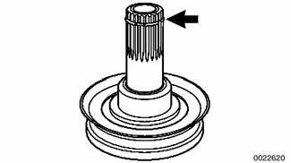
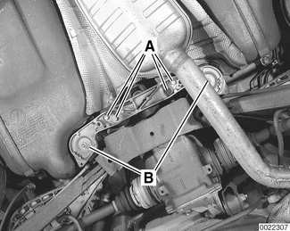
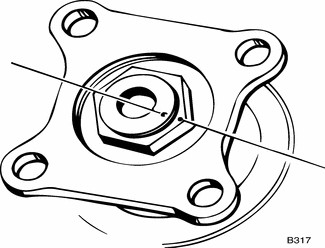

# Rear Differential Oil Seals

> Source: BMW 3 Series (E46) Repair Manual, section 331-4, Rear Axle Final Drive chapter (PDF pages 670–674 of 1252).

Low oil level caused by faulty oil seals may be the cause of noisy differential operation. The drive flange (side) and input shaft (front) oil seals can be replaced while the differential is installed.

> **Note:**
> - Do not mistake leaking CV joints for flange seal leaks. It may be helpful to degrease the differential to pinpoint the source of the leak prior to replacing seals.

## Output drive flange oil seal, replacing

- Raise car and support safely.

> **WARNING!**
> - Make sure that the car is firmly supported on jack stands designed for the purpose. Place the jack stands beneath a structural chassis point. Do not place jack stands under suspension parts.

- If working on left side: Detach rear of exhaust system and tilt down. Support rear muffler securely.
- Detach stabilizer bar from rear subframe.
- Detach drive axle from differential as described earlier.

> **CAUTION!**
> - Suspend the detached drive axle from the car body with a stiff wire hook to prevent damage to the outer CV joint.

Pry output flange from differential. For leverage, use a wooden dowel as shown.

> **Note:**
> - Be prepared to catch dripping oil in a pan.

Inspect flange at the point where the oil seal rides on the shaft. Replace the flange if there is a groove worn in the shaft.

- Pry old oil seal from its recess using BMW special tool 00 5 010 or equivalent seal puller.

> **CAUTION!**
> - Be careful not to mar the differential housing when removing the seal.

- Dip new seal in differential lubricant and drive into place until fully seated.

Replace locking circlip (arrow) on output flange.

- Install flange by pressing it in by hand until snap ring engages. It may be necessary to turn flange slightly while pushing.
- Attach drive axle and tighten bolts.
- Top off differential with oil.

Tightening torque

| Component | Tightening torque |
|---|---|
| **Drive axle to differential flange** | |
| M10x20 mm Torx bolt | 83 Nm (61 ft-lb) |
| M10x46 mm bolt (black) | 100 Nm (74 ft-lb) |
| M10x46 mm bolt (silver) (always replace) | 80 Nm (59 ft-lb) |

## Input drive flange oil seal, replacing

- Raise car and support safely.

Remove rear suspension reinforcement brace:

- Remove heat shield between reinforcement brace and exhaust pipe.
- Remove bolts (A) mounting brace to undercarriage.
- Remove nuts (B) mounting brace and front of rear subframe to undercarriage.
- Lower and remove reinforcement.

> **Note:**
> - If necessary, tilt rear half of exhaust system down. Support exhaust system securely.

- Remove driveshaft from differential input shaft flange. See [260 Driveshaft]. Tie end of driveshaft to side.

Make matching marks on differential input shaft, collar nut and driveshaft flange.

- Pry lock plate from nut. Counterhold input flange with BMW special tool 23 0 020 or equivalent and remove collar nut.
- If necessary, use puller to remove input flange.

> **Note:**
> - Be prepared to catch dripping oil in a pan.

- Pry old oil seal from its recess using BMW special tool 00 5 010 or equivalent seal puller.

> **CAUTION!**
> - Be careful not to mar the differential housing when removing the seal.

- Dip new seal in differential lubricant and drive it into position.
- Lightly lubricate input shaft and press input flange back on. Install collar nut and slowly tighten until matching marks line up.
- Install a new lock plate and refill differential with lubricant.

> **CAUTION!**
> - If the flange collar nut is tightened past the marks, interior components of the differential will be damaged.

**Differential oil**

| Differential oil capacity | |
|---|---|
| Rear wheel drive | 0.9 liter (0.95 US qt) |
| All wheel drive | 1.0 liter (1.06 US qt.) |
| Oil specification | BMW SAF-XO synthetic oil |

- Remainder of assembly is reverse of disassembly.

Tightening torques

| Component | Tightening torque |
|---|---|
| **Driveshaft to differential flange** | |
| M10 compression nut | 64 Nm (47 ft-lb) |
| M10 Torx bolt | 85 Nm (63 ft-lb) |
| Differential drain or fill plug | 70 Nm (52 ft-lb) |
