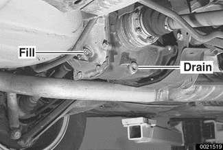
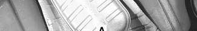
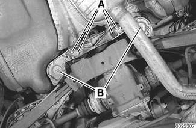
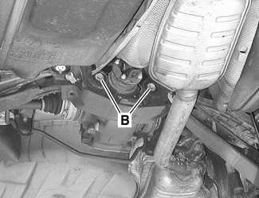
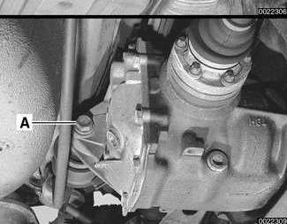

# Rear Differential

> Source: BMW 3 Series (E46) Repair Manual, section 331-3, Rear Axle Final Drive chapter (PDF pages 665–669 of 1252).

All rear differential work requires some method of raising the car and supporting it securely while the work is performed. Jack stands and a floor jack can easily be used, but use extreme caution when working beneath the car. See [010 General].

> **Note:**
> - Removal of rear subframe (differential carrier) is covered in [330 Rear Suspension].

## Rear differential oil, checking and filling

> **Note:**
> - BMW supplies the E46 rear differential with lifetime lubricant.

To check rear differential oil level:

- Remove oil filler plug.
- Insert finger into fill hole. If finger is wetted from oil, level is correct.

> **Note:**
> - Use a 14 mm Allen socket to remove the fill or drain plug. Alternatively, cut approximately 30 mm (1.2 in.) from an Allen key and use a box end wrench on the key stub.

- If necessary, fill differential with appropriate type and quantity of lubricant.

> **Note:**
> - The differential fluid level is correct when the fluid begins to spill from the fill plug.

- Install and tighten fill plug.

**Differential oil**

| Differential oil capacity | |
|---|---|
| Rear wheel drive | 0.9 liter (0.95 US qt.) |
| All wheel drive | 1.0 liter (1.06 US qt.) |
| Oil specification | BMW SAF-XO synthetic oil |

Tightening torques

| Component | Tightening torque |
|---|---|
| Differential drain or fill plug | 70 Nm (52 ft-lb) |

## Rear differential, removing and installing

- Raise rear end of car and support it securely on jack stands.

> **WARNING!**
> - Make sure that the car is firmly supported on jack stands designed for the purpose. Place the jack stands beneath a structural chassis point. Do not place jack stands under suspension parts.

- Remove rear drive axles.
- If necessary, drain differential oil.

Remove rear suspension reinforcement brace:

- Remove heat shield between reinforcement brace and exhaust pipe.
- Remove bolts (A) mounting brace to undercarriage.
- Remove nuts (B) mounting brace and front of rear subframe to undercarriage.
- Lower and remove reinforcement.

> **Note:**
> - If necessary, tilt rear half of exhaust system down. Support exhaust system securely.

- Detach driveshaft from differential input shaft flange and suspend. See [260 Driveshaft].

> **CAUTION!**
> - Suspend the detached drive axle from the car body with a stiff wire hook to prevent damage to the outer CV joint.

- Remove rear stabilizer bar.

Support differential with transmission jack. Remove rear (A) and front (B) mounting bolts at subframe.

- Slowly lower differential unit and remove toward rear.
- Installation is reverse of removal. In order to prevent excess vibration and noise, follow sequence for tightening differential mounting bolts:
  - Install bolts finger tight.
  - Tighten front bolts (B).
  - Tighten rear bolt (A).

Tightening torques

| Component | Tightening torque |
|---|---|
| Differential drain or fill plug | 70 Nm (52 ft-lb) |
| **Differential to rear subframe** | |
| Front mount (M12 bolts) | 95 Nm (70 ft-lb) |
| Rear mount (M14 bolt) | 174 Nm (128 ft-lb) |
| **Drive axle to differential flange** | |
| M10x20 mm Torx bolt | 83 Nm (61 ft-lb) |
| M10x46 mm bolt (black) | 100 Nm (74 ft-lb) |
| M10x46 mm bolt (silver) (always replace) | 80 Nm (59 ft-lb) |
| **Driveshaft to differential flange** | |
| M10 compression nut | 64 Nm (47 ft-lb) |
| M10 Torx bolt | 85 Nm (63 ft-lb) |
| **Rear suspension reinforcement to undercarriage** | |
| M12 self-locking nut | 77 Nm (57 ft-lb) |
| M8 bolt 8.8 grade | 21 Nm (15 ft-lb) |
| M8 bolt 10.9 grade | 30 Nm (22 ft-lb) |

- Be sure to refill differential.

**Differential oil**

| Differential oil capacity | |
|---|---|
| Rear wheel drive | 0.9 liter (0.95 US qt) |
| All wheel drive | 1.0 liter (1.06 US qt.) |
| Oil specification | BMW SAF-XO synthetic oil |

## Differential mounting bushings

- If rear differential mounting bushings are worn, damaged or oil soaked:
  - Remove differential from rear subframe.
  - Working at subframe, use bushing press tools to remove old bushings and install new ones. Carefully note installation marks (arrows) on new bushings.

> **Note:**
> - BMW uses bushings from different manufacturers in the course of production. Always check with an authorized BMW dealer for the latest information on suspension bushings.
