# Rear Driveshaft Service

> Source: BMW 3 Series (E46) Repair Manual, section 260-2, Driveshafts chapter (PDF pages 457–467 of 1252).

Repair kits for the universal joints are not available for BMW driveshafts. Worn or damaged universal joints usually require replacement of the driveshaft.

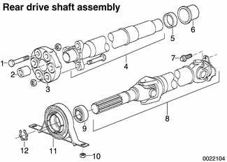

| No. | Part |
|---|---|
| 1 | Hex bolt, M12 |
| 2 | Centering sleeve |
| 3 | Flexible disk |
| 4 | Front section of driveshaft |
| 5 | Clamping sleeve |
| 6 | Clamping ring |
| 7 | Torx screw |
| 8 | Rear section of drive shaft |
| 9 | Center bearing |
| 10 | Nut |
| 11 | Center bearing support |
| 12 | Lock ring |

The driveshaft is balanced to close tolerances. Whenever it is to be removed or disassembled, the mounting flanges and driveshaft sections should be marked with paint or a punch before proceeding with work. This will ensure that the driveshaft can be reassembled or installed in exactly the original orientation.

## Rear driveshaft, aligning

The alignment of the driveshaft does not normally need to be checked unless the engine/transmission or the final drive have been removed and installed. If all other parts of the driveshaft have been inspected and found to be okay, but there is still noise or vibration, driveshaft alignment should be checked.

There are two important driveshaft alignment checks. The first is to make sure that the driveshaft runs straight from the transmission to the final drive, without any variation from side-to-side caused by misalignment of the engine/transmission in its mounts. Make a basic check by sighting along the driveshaft from back to front. Any misalignment should be apparent from the center bearing forward.

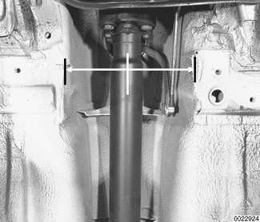

To adjust the side-to-side alignment, loosen transmission or engine mounts to reposition them, then retighten mounts. The driveshaft should be exactly centered in driveshaft tunnel.

The second important driveshaft alignment check is more complicated. It checks the amount the driveshaft is angled vertically at the joints. This angle is known as driveshaft deflection. In general, there should be little deflection in the driveshaft between the engine, the center bearing, and the final drive. Precise checks require the use of a large protractor or some other means of measuring the angle of the engine and the final drive and comparing these angles to the angle of the driveshaft sections.

To change the deflection angle, shims can be placed between the center bearing and the body or between the transmission and its rear support. When using shims to change a deflection angle, keep in mind that the angle of adjacent joints will also change. Deflection angles should be as small as possible.

## Rear driveshaft, removing

> **WARNING!**
> - Be sure the wheels are off the ground before removing the driveshaft. Set the parking brake before removing the driveshaft. Once the driveshaft has been removed, the vehicle can roll regardless of whether the transmission is in gear or not.
> - The driveshaft is mounted to the transmission and final drive with self-locking nuts. These nuts are designed to be used only once and should be replaced during reassembly.

- Remove complete exhaust system. See [180 Exhaust System].
- Remove exhaust heat shields.
- Matchmark front and rear driveshaft connections at transmission and final drive.
- Remove driveshaft mounting bolts. Discard old nuts. Note open-end wrench (arrow) being used to counterhold bolt at transmission flex-disc.

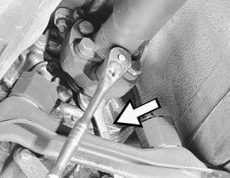

- Support driveshaft sections from body using stiff wire.
- Using BMW special tool 26 1 040, loosen threaded clamping sleeve on driveshaft a few turns.

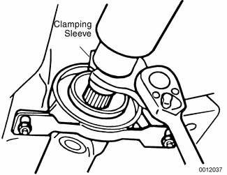

- Remove center support bearing mounting bolts.

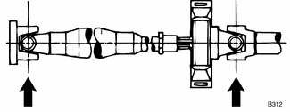

- Remove driveshaft but do not separate two halves. Pull down on center of driveshaft to facilitate removal.

> **Note:**
> - If driveshaft halves were separate and not matchmarked, see [Rear driveshaft, installing]. If a vibration occurs, disassemble driveshaft and rotate one section 180°.

## Rear driveshaft, installing

- Align driveshaft matchmarks at final drive and then at transmission flange. Centerlines of universal joints (arrows) must be parallel or at 90° to each other. Position center support bearing and start attaching nuts. Use new self-locking nuts.

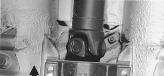

- Tighten flange nuts while preventing bolts from twisting in coupling. Tighten final drive flange first, then tighten coupling at transmission.
- Preload center support bearing by pushing bearing forward (arrow) 4-6 mm (0.16-0.24 in.) from center. Tighten attaching bolts.

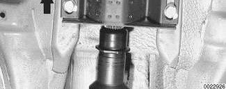

> **CAUTION!**
> - The maximum allowable change in height of the center bearing or transmission support using shims is 3 mm (0.12 in.).

- Tighten threaded sleeve on driveshaft to proper torque.
- Install heat shields.
- Install exhaust system. See [180 Exhaust System]. Connect wiring harness to oxygen sensors.
- Road test vehicle to check for noise or vibration.

> **WARNING!**
> - Do not reuse self-locking nuts. These nuts are designed to be used only once.
> - Avoid stressing the flex-disc when torquing the bolts. Do this by holding the bolts steady and turning the nuts on the flange side.

Tightening torques

| Component | Tightening torque |
|---|---|
| Center bearing to body | 21 Nm (15 ft-lb) |
| Clamping sleeve | 10 Nm (89 in-lb) |
| Drive axle to differential flange, M10 Torx bolt | 83 Nm (61 ft-lb) |
| Drive axle to differential flange, M10 with locking teeth (replace bolts) | 96 Nm (71 ft-lb) |
| Drive axle to differential flange, M10 with ribbed teeth (black) | 100 Nm (74 ft-lb) |
| Drive axle to differential flange, M10 with ribbed teeth (silver) ZNS | 80 Nm (59 ft-lb) |
| Flex-disc to driveshaft or transmission flange, M10 (8.8 grade) | 48 Nm (35 ft-lb) |
| Flex-disc to driveshaft or transmission flange, M10 (10.9 grade) | 60 Nm (44 ft-lb) |
| Flex-disc to driveshaft or transmission flange, M12 (10.9 grade) | 100 Nm (74 ft-lb) |
| Transmission crossmember to body (M8) | 21 Nm (15 ft-lb) |

> **Note:**
> - Bolt grade is marked on the bolt head. When replacing bolts, only use bolts of the same strength and hardness as the originals installed.

## Flex-disc, replacing

The flex-disc between the front section of the rear driveshaft and the output flange of the transmission or transfer case should be checked for cracks, tears, missing pieces, or distortion. Check for worn bolt hole bores in the flange.

- Remove driveshaft as described earlier.

> **Note:**
> - It is possible to only partially remove the driveshaft, leaving it connected to the final drive. The driveshaft can be tilted down in the center and slid off the transmission flange once the clamping sleeve is loosened and the center bearing bracket is unbolted. Suspend the driveshaft using stiff wire in as close to the installed position as possible. If the driveshaft hangs unsupported, the rear universal joint may be damaged.

- Unbolt flex-disc from driveshaft.

> **Note:**
> - Removal and installation of the bolts may be made easier by placing a large hose clamp around the flex-disc, and tightening the clamp slightly to compress the coupling.

- Install new flex-disc using new self-locking nuts. Molded arrows on coupling should face flange arms.

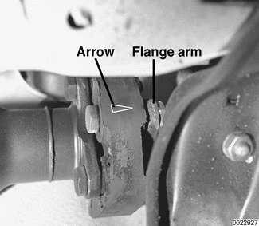

- Install driveshaft as described earlier.

> **Note:**
> - Torque only the nuts while holding the bolt heads. This will prevent damaging or fatiguing the rubber.

Tightening torques

| Component | Tightening torque |
|---|---|
| Center bearing to body | 21 Nm (15 ft-lb) |
| Clamping sleeve | 10 Nm (89 in-lb) |
| Drive axle to differential flange, M10 Torx bolt | 83 Nm (61 ft-lb) |
| Drive axle to differential flange, M10 with locking teeth (replace bolts) | 96 Nm (71 ft-lb) |
| Drive axle to differential flange, M10 with ribbed teeth (black) | 100 Nm (74 ft-lb) |
| Drive axle to differential flange, M10 with ribbed teeth (silver) ZNS (replace bolts) | 80 Nm (59 ft-lb) |
| Flex-disc to driveshaft or transmission flange, M10 (8.8 grade) | 48 Nm (35 ft-lb) |
| Flex-disc to driveshaft or transmission flange, M10 (10.9 grade) | 60 Nm (44 ft-lb) |
| Flex-disc to driveshaft or transmission flange, M12 (10.9 grade) | 100 Nm (74 ft-lb) |
| Transmission crossmember to body (M8) | 21 Nm (15 ft-lb) |

## Center bearing assembly, replacing

To replace the center bearing assembly, the driveshaft must be removed from the car. The center bearing assembly consists of a grooved ball bearing in a rubber mount. The bearing assembly is pressed onto the front section of the driveshaft and secured by a circlip.

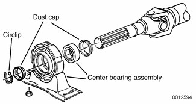

- Remove rear driveshaft. See [Rear driveshaft, removing].
- Match mark front and rear driveshaft sections before separating.
- Loosen clamping sleeve fully and pull driveshaft sections apart. Remove rubber bushing, washer, and clamping sleeve from front section.
- Inspect condition of rubber bushing for splined coupling. Replace worn or damaged parts.
- Remove center bearing circlip (arrow) and dust guard.

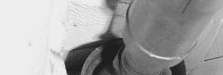

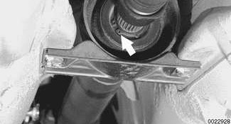

- Install puller so that it pulls on inner hub of bearing. Pulling on outer ring of mount may tear rubber, and entire bearing assembly will need to be replaced.
- Before installation, make sure dust guard is on driveshaft, and then press center mount onto driveshaft flush with dust guard.
- Place clamping sleeve, washer, and rubber bushing on front driveshaft section. Lubricate splines with molybdenum disulfide grease (Molykote® Longterm 2 or equivalent) and then reassemble driveshaft.

> **Note:**
> - Do not retighten clamping sleeve until driveshaft is installed.

- Install driveshaft as described earlier.
- Tighten clamping sleeve.

Tightening torque

| Component | Tightening torque |
|---|---|
| Clamping sleeve | 10 Nm (7.5 ft-lb) |

## Front centering guide, replacing

The front centering guide centers the driveshaft in relation to the transmission or transfer case. The guide is press-fit into a cavity in the front of the driveshaft and slides onto the transmission output shaft.

No specifications are given for wear of the guide, but generally the guide should fit snugly on the transmission output shaft.

> **Note:**
> - Some driveshafts have a dust cap installed on the end of the driveshaft, over the centering guide. The dust cap may become bent or distorted when the driveshaft is removed or installed. Damage to the dust cap should not affect the centering guide and should not be mistaken for guide wear.

- Remove driveshaft as described earlier.
- Pack cavity behind centering guide with heavy grease until grease is flush with bottom edge of guide.
- Insert 14 mm (approximately in.) diameter mandrel or metal rod into guide. Strike guide with hammer to force centering guide out.

> **Note:**
> - The mandrel should fit snugly in the centering guide so that the grease cannot escape around the sides of the mandrel.

- Remove old grease from driveshaft, lubricate new centering guide with molybdenum disulfide grease (Molykote® Longterm 2 or equivalent) and drive it into driveshaft.

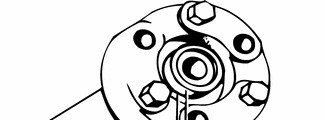

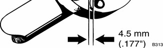

When installing new driveshaft centering guide, the sealing lip of the guide should face outward and it should be driven into the driveshaft to drive guide to a protrusion depth of 4.5 mm (.177 in.).

- Install driveshaft as described earlier.
