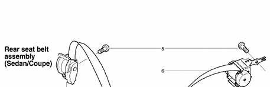
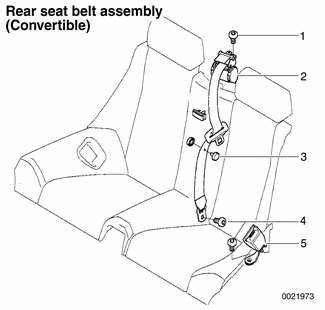

# Rear Seat Belt Assembly

> Source: Bentley *BMW 3 Series (E46) 1999–2005 (M3) Repair Manual*, section 720-3 (PDF pages 1198–1202 of 1252).

## Rear seat belts (Sedan or Coupe models)

- Remove rear parcel shelf to access shoulder belt assembly mounting bolts.
- Remove rear seat cushion to access rear seat belt lock mounting bolts. See [520 Seats].
- The accompanying illustration provides information on rear seat belt component locations and fastener torques.
- When installing seat belt lock straps:
    - Install right lock strap (which is shorter) underneath middle lock strap.
    - Install left lock strap underneath middle lap belt strap.
    - Metal strap ends must rest against stop on floor underneath seat.

Rear seat belt assembly (Sedan/Coupe)

1 - Center shoulder belt reel assembly (if equipped)
2 - Right shoulder belt lock
3 - Lap-belt assembly
4 - Left shoulder belt lock
5 - Bolt M10 -tighten to 31 Nm (23 ft-lb)
6 - Left shoulder belt reel assembly
7 - Center shoulder belt lock (if equipped)
8 - Bolt M12 -tighten to 31 Nm (23 ft-lb)

## Rear seat belts (Sport Wagon models)

- Center shoulder belt:
    - Remove shoulder belt guide trim at top of seat backrest. Feed belt out through slot in trim.
    - Working in cargo compartment, partially remove backrest cover to access shoulder belt reel.
    - Remove shoulder belt reel mounting bolt inside backrest.

**Note:**

*Remove bowden cable from backrest brackets and unhook from backrest release latch. Center seat belt reel can then be removed.*

- Outboard shoulder belt:
    - Remove roof-pillar (C-pillar) trim.
    - Remove center shoulder belt.
- Lift up rear seat cushion(s) to access rear seat belt lock mounting bolt(s).

The accompanying illustration provides information on rear seat belt component locations and fastener torques.

1 - Bolt M10 -tighten to 31 Nm (23 ft-lb)
2 - Right shoulder belt reel assembly.
3 - Center belt lock
4 - Right belt lock
5 - Left belt lock
6 - Center shoulder belt reel assembly
7 - Left shoulder belt reel assembly
8 - Bolt M12 -tighten to 31 Nm (23 ft-lb)

- When installing seat belt lock straps:
    - Install right belt lock strap (which is shorter) underneath center belt lock strap.
    - Install left belt lock strap underneath center lap belt strap.
    - Metal strap ends must rest against stop on floor underneath seat.

## Rear seat belts (Convertible models)

- Access shoulder belt or seat belt lock mounting bolts:
    - Remove center armrest.
    - Push shoulder belts toward sides and feed out of top guides.
    - Lift seat cushion up and forward to remove.
    - Remove lower backrest securing screws located below backrest. Lift backrest straight up and unhook from tabs in back.
    - Remove rear head restraints by pulling straight up.
    - Remove cover of rollover protection bars for right and left side.
    - Open convertible top compartment cover.
- Shoulder belt reels are bolted to convertible top storage compartment.

The accompanying illustration provides information on rear seat belt component locations and fastener torques.

1 - Bolt M10 -tighten to 31 Nm (23 ft-lb)
2 - Left shoulder belt reel assembly.
3 - Seat belt stop button
4 - Left belt lock
5 - Bolt M12 -tighten to 31 Nm (23 ft-lb)
