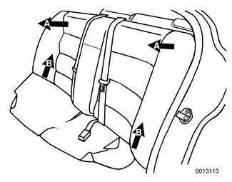
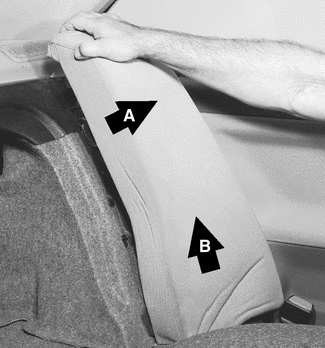

# Rear Seats

> Source: Bentley *BMW 3 Series (E46) 1999–2005 (M3) Repair Manual*, section 520-3 (PDF pages 909–910 of 1252).

## Rear seat cushion and backrest, removing and installing (fixed seat back models)

- Pull front of rear seat cushion up to release clips. While holding front of cushion up, pull cushion forward to remove.

- Remove rear seat backrest:
    - Pull top outer corners of backrest forward (A) to detach from top retainers.
    - Pull entire backrest up (B) to detach from bottom hooks.
    - Slide backrest to side to clear seat belts.

> **Note:** If the car is equipped with heated rear seats, detach electrical harness connector(s) as you remove the seat components.

- When reinstalling, be sure to pull seat belts and buckles up through appropriate slots in seat cushion.

## Rear seat cushion and backrest, removing and installing (fold-down seat back models)

- Pull front of rear seat cushion up and out of clips. While holding front of cushion up, pull cushion forward to remove.

- Tilt backrests forward.

> **Note:** Remove rear headrests, if equipped, by pulling straight up.

- Remove backrest side section by pulling out (A) and up (B).

- Working between two sections of backrest, remove backrest center mount screws.

- Remove outer backrest mounting screws.

- Raise backrests in middle slightly and separate left and right backrest guide. Lift backrest(s) out through back door(s).
