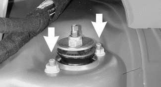
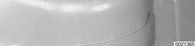
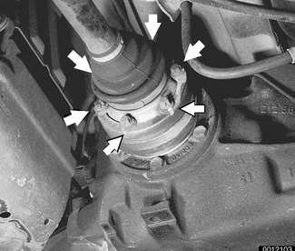
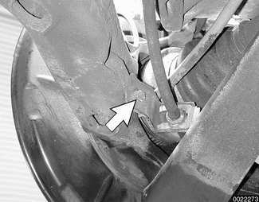

# Rear Shock Absorbers and Springs

> Source: BMW 3 Series (E46) Repair Manual, section 330-2, Rear Suspension chapter (PDF pages 626–631 of 1252).

Replace shock absorbers and springs in pairs only.

## Rear shock absorber, removing and installing

- Raise car and remove rear wheels.

> **WARNING!**
> - Make sure that the car is firmly supported on jack stands designed for the purpose. Place the jack stands beneath a structural chassis point. Do not place jack stands under suspension parts.

Support trailing arm from below using an adjustable jackstand. Remove shock absorber lower mounting bolt (arrow).

> **CAUTION!**
> - The shock absorber prevents the drive axle from dropping too far. Support the trailing arm before removing the lower shock absorber bolt to avoid damage to drive axle CV joints.

- On Sedan or Coupe models: Working in trunk, pry out luggage compartment liner retaining clips. Peel back liner to gain access to upper shock absorber mounting nuts (arrows).

- On Convertible models: Open convertible top storage compartment to access upper shock absorber mount.
- On Sport Wagon models: Working in cargo compartment, remove side trim next to rear seat backrests.
- Support shock absorber from below while removing upper mounting nuts. Lower shock absorber out of wheel housing.

Transfer shock top mounting plate, dust cover (if applicable) and related components to new shock absorber.

1. Self-locking nut M10 — tighten to 14 Nm (10 ft-lb)
2. Upper support plate
3. Top mount
4. Body seal
5. Lower support plate
6. Spacer ring
7. Rubber bump stop
8. Self-locking nut M8 — tighten to 24 Nm (17 ft-lb)

- Installation on car is reverse of removal, noting the following:
    - Make sure all threaded bolts, nuts and mating surfaces are clean.
    - Install shock absorber into shock tower using a new upper mounting seal and new self-locking nuts.
    - Make sure rectangular thrust washer on lower mounting bolt is between bolt head and shock absorber rubber.
    - Tighten lower shock absorber bolt to its final torque once car is on ground.

Tightening torques

| Component | Tightening torque |
|---|---|
| Road wheel to hub | 100 ± 10 Nm (74 ± 7 ft-lb) |
| Shock absorber to trailing arm (car in normal loaded position) | 100 Nm (74 ft-lb) |
| Shock absorber to upper mount | 14 Nm (10 ft-lb) |
| Shock absorber upper mount to body M8 self-locking nuts | 28 Nm (21 ft-lb) |

## Coil spring, removing and installing

- Raise car and remove rear wheel.
- Remove drive axle to final drive mounting bolts (arrows). Detach drive axle from final drive. Suspend drive axle from chassis using stiff wire.

- Remove fuel tank protective panel.
- Detach stabilizer bar from rear subframe. Remove rear brake line bracket mounting bolt (arrow). Detach bracket from trailing arm.

> **CAUTION!**
> - Avoid damaging the brake hose by stretching when the trailing arm is lowered.

Support trailing arm from below using an adjustable jackstand. Remove shock absorber lower mounting bolt (arrow).

- Lower trailing arm slowly and carefully until the compressed coil spring is fully unloaded. Remove spring.
- If spring is to be reused:
    - Inspect spring for any surface damage or corrosion.
    - Inspect top and bottom spring seat rubber pads for signs of damage.
    - Replace any parts showing evidence of wear or damage.

> **Note:**
> - In the "rough road package", the top spring seat pad is 14.5 mm (0.57 in.) thick.

- To install spring:
    - Coat top spring pad with anti-friction paste (e.g., tire mounting paste).
    - Slowly lift suspension back into position, making sure coil spring is correctly seated in upper and lower spring seats.
    - When suspension has been lifted sufficiently, reattach shock absorber to trailing arm. Make sure rectangular thrust washer on lower shock absorber mounting bolt is between bolt head and shock absorber rubber.
    - Tighten lower shock absorber bolt to its final torque once car is on ground.
- Remainder of installation is reverse of removal.

Tightening torques

| Component | Tightening torque |
|---|---|
| **Drive axle to final drive flange** | |
| M10x20 mm Torx bolt | 83 Nm (61 ft-lb) |
| M10x46 mm bolt (black) | 100 Nm (74 ft-lb) |
| M10x46 mm bolt (silver) (always replace) | 80 Nm (59 ft-lb) |
| Road wheel to hub | 100 ± 10 Nm (74 ± 7 ft-lb) |
| Shock absorber to trailing arm (car in normal loaded position) | 100 Nm (74 ft-lb) |
