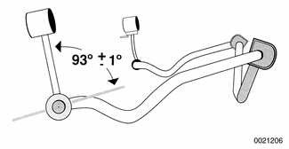

# Rear Stabilizer Bar

> Source: BMW 3 Series (E46) Repair Manual, section 330-4, Rear Suspension chapter (PDF page 651 of 1252).

The rear stabilizer bar is mounted to the rear subframe and attached via stabilizer bar links to the rear upper control arms.

Rear stabilizer bar assembly

1. Stabilizer bar
2. Self-locking nut M8
3. Rubber mounting
4. Clamping support
5. Bolt M8
6. Bolt M
7. Stabilizer link support bracket
8. Bolt M8
9. Self-locking nut
10. M8 Self-locking nut
11. M8 Stabilizer link

When installing new stabilizer link:

- Clean rubber seating surface at end of stabilizer bar.
- Moisten end of bar and inside rubber mount (in link end) with Circolight® or equivalent rubber bonding agent.
- Push bar into rubber mount and position as shown in illustration. Once rubber bond has set stabilizer link can no longer be rotated.

