# Rear Suspension Arms, Subframe and Bushings

> Source: BMW 3 Series (E46) Repair Manual, section 330-3, Rear Suspension chapter (PDF pages 632–650 of 1252).

The trailing arms, control arms and their mounting bushings control the position of the rear wheels. A damaged suspension arm or worn bushings will change the rear wheel alignment and may adversely affect handling and stability.

> **WARNING!**
> - Do not attempt to straighten a damaged suspension arm. Bending or heating may weaken the original part. If the suspension arm shows any signs of damage or excessive corrosion, it must be replaced.

> **Note:**
> - If a rear brake line is disconnected to remove a trailing arm, the complete braking system must be bled as part of the reinstallation procedure.

## Rear suspension arms, assembly

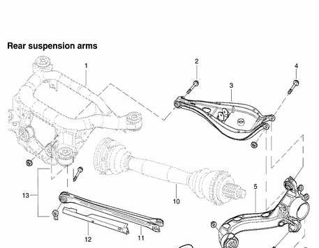

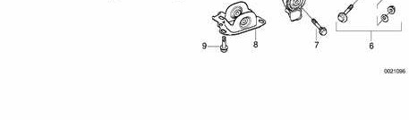

Rear suspension arms, assembly

1. Rear subframe
2. Upper control arm inner bolt self-locking M12 nut — tighten to 77 Nm (57 ft-lb)
3. Upper control arm
4. Upper control arm outer bolt self-locking M12 nut — tighten to 110 Nm (81 ft-lb)
5. Trailing arm
6. Lower control arm eccentric bolt eccentric flat M12 washer self locking M12 nut — tighten to 110 Nm (81 ft-lb)
7. Trailing arm front bolt self-locking M12 nut — tighten to 110 Nm (81 ft-lb)
8. Trailing arm front bracket
9. Bracket mounting bolt — tighten to 77 Nm (57 ft-lb)
10. Drive axle
11. Lower control arm
12. Lower control arm plastic shield
13. Lower control arm inner M12 bolt lock plate — tighten to 110 Nm (81 ft lb)

## Trailing arm, removing and installing

- Raise rear end of car and remove wheel.

> **WARNING!**
> - Make sure that the car is firmly supported on jack stands designed for the purpose. Place the jack stands beneath a structural chassis point. Do not place jack stands under suspension parts.

- Remove drive axle as described in [331 Rear Axle Final Drive].
- Right side: Detach brake pad sensor connector at brake caliper.
- Remove brake rotor and caliper as described in [340 Brakes]. Do not remove brake line from caliper. Suspend caliper from body using stiff wire.
- Remove parking brake cable from brake shoe expander. See [340 Brakes].

Remove rear brake line bracket mounting bolt (arrow). Detach bracket from trailing arm.

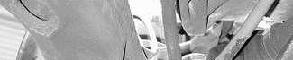

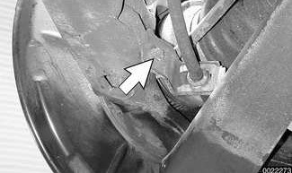

> **CAUTION!**
> - Avoid damaging the brake hose by stretching when the trailing arm is lowered.

- Remove fuel tank protective panel, if equipped.

Remove ABS pulse sensor from trailing arm.

- Unclip pulse sensor and pad sensor (if applicable) harnesses from control arm and lay aside.

Support trailing arm from below using an adjustable jackstand. Remove shock absorber lower mounting bolt (arrow).

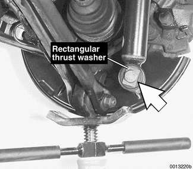

- Slowly lower suspension until coil spring can be safely removed.

Mark position (arrows) of lower control arm eccentric mounting bolt.

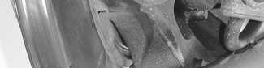

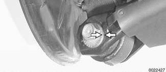

- Unbolt upper and lower control arms from trailing arm. Note direction of bolt insertion in both arms.
- To remove trailing arm:
    - Make reference marks to locate trailing arm bracket to body in order to maintain alignment specifications.
    - Remove trailing arm front bracket mounting bolts (arrows).

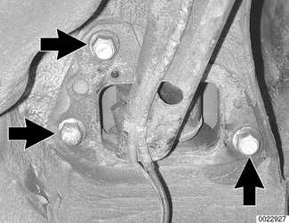

    - Working with trailing arm on workbench, detach front bracket from arm.
- When reinstalling, preload trailing arm front bracket bushing:

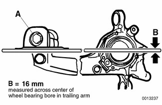

    - Install bolt (A) through bracket and arm and install nut finger tight.
    - Using 16 mm bar stock as shown in illustration, align base of bracket so that it is parallel with center of wheel bearing bore on trailing arm.
    - Torque bracket bolt (A).

Tightening torque

| Component | Tightening torque |
|---|---|
| Trailing arm to front bracket | 110 Nm (81 ft-lb) |

- Remainder of installation is reverse of removal, noting the following:
    - Install new rear wheel bearings.
    - Insert control arm mounting bolts in direction previously marked.
    - Always use new self-locking nuts.
    - Transfer brake system components to new arm as described in [340 Brakes].
    - Have car professionally aligned when job is complete.

> **Note:**
> - BMW-supplied replacement trailing arms come with control arm bushings installed. A new wheel bearing will have to be installed.

Tightening torques

| Component | Tightening torque |
|---|---|
| **Drive axle collar nut to drive flange** | |
| M24 | 250 Nm (184 ft-lb) |
| M27 | 300 Nm (221 ft-lb) |
| **Drive axle to final drive flange** | |
| M10x20 mm Torx bolt | 83 Nm (61 ft-lb) |
| M10x46 mm bolt (black) | 100 Nm (74 ft-lb) |
| M10x46 mm bolt (silver) (always replace) | 80 Nm (59 ft-lb) |
| Road wheel to hub | 100 ± 10 Nm (74 ± 7 ft-lb) |
| Shock absorber to trailing arm (car in normal loaded position) | 100 Nm (74 ft-lb) |
| Trailing arm bracket to body (M12 bolt) | 77 Nm (57 ft-lb) |
| Trailing arm to upper or lower control arm (M12 bolt) | 110 Nm (81 ft-lb) |

## Upper control arm, removing and installing

- Remove drive axle as described in [331 Rear Axle Final Drive].

> **WARNING!**
> - Make sure that the car is firmly supported on jack stands designed for the purpose. Place the jack stands beneath a structural chassis point. Do not place jack stands under suspension parts.

- Remove coil spring as described earlier.

Remove stabilizer bar link bolts (A) at upper control arm. Remove stabilizer bar anchor bolts (B). Carefully push stabilizer bar aside.

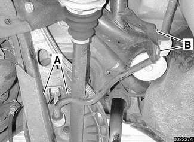

> **Note:**
> - Do not twist stabilizer bar link bushing on end of bar. See [Rear Stabilizer Bar] later in this repair group.

- If necessary, remove ride level sensor from upper control arm.
- Unbolt upper control arm from both trailing arm and rear subframe. Note direction of bolt insertion.

> **Note:**
> - For clearance reasons, it may be necessary to unbolt the differential from the subframe and push it toward the rear of the car in order to remove the control arm mounting bolt from the subframe.

- Installation is reverse of removal, noting the following:
    - Insert mounting bolts in direction previously marked
    - Always use new self-locking nuts.
    - Have car professionally aligned when job is complete.

Tightening torques

| Component | Tightening torque |
|---|---|
| **Drive axle collar nut to drive flange** | |
| M24 | 250 Nm (184 ft-lb) |
| M27 | 300 Nm (221 ft-lb) |
| **Drive axle to final drive flange** | |
| M10x20 mm Torx bolt | 83 Nm (61 ft-lb) |
| M10x46 mm bolt (black) | 100 Nm (74 ft-lb) |
| M10x46 mm bolt (silver) (always replace) | 80 Nm (59 ft-lb) |
| Road wheel to hub | 100 ± 10 Nm (74 ± 7 ft-lb) |
| Shock absorber to trailing arm car in normal loaded position | 100 Nm (74 ft-lb) |
| Upper control arm to rear subframe M12 bolt | 77 Nm (57 ft-lb) |
| Upper control arm to trailing arm M12 bolt | 110 Nm (81 ft-lb) |

## Lower control arm, removing and installing

- Raise rear end of car and support it securely on jackstands. Remove rear wheel.
- Support trailing arm from below using an adjustable jackstand.

Mark position (arrows) of lower control arm eccentric mounting bolt.

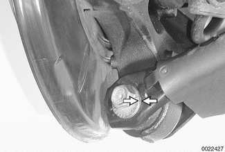

- Remove lower control arm plastic shield.
- Remove both lower control arm mounting bolts. Note direction of bolt insertion.

> **Note:**
> - For clearance reasons, it may be necessary to unbolt the differential from the subframe and push it toward the rear of the car in order to remove the control arm mounting bolt from the subframe.

- Use a soft hammer to tap control arm out of its mounting points.
- Installation is reverse of removal.
    - Welded seam of control arm faces upward.
    - To install mounting hardware at subframe, insert lock plate into opening in subframe from below.
    - Line up eccentric bolt head with marks made previously.
    - Have car professionally aligned when job is complete.

Tightening torque

| Component | Tightening torque |
|---|---|
| Lower control arm to rear subframe M12 bolt | 110 Nm (81 ft-lb) |
| Lower control arm to trailing arm M12 eccentric bolt | 110 Nm (81 ft-lb) |

## Rear subframe

In case of damage to the subframe, or if a pressed-in bushing is worn, remove subframe.

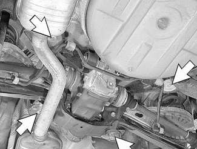

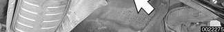

- Convertible models: Remove rear body reinforcing brace.
- Remove exhaust system. See [180 Exhaust System].
- Detach rear driveshaft from rear differential. See [260 Driveshaft].
- Detach rear drive axles from rear differential. Remove rear differential. See [331 Rear Axle Final Drive].
- Detach rear control arms as described earlier.
- Remove rear subframe mounting fasteners (arrows) while supporting subframe securely.
    - In case of damage to subframe mounting stud threads, replace stud.
    - In case of damage to subframe mounting stud threads in body, repair using Helicoil thread insert M12 x 1.5 x 18.

Tightening torques

| Component | Tightening torque |
|---|---|
| Differential to subframe front bolt (M12) | 110 Nm (81 ft-lb) |
| Differential to subframe rear bolt (M14) | 174 Nm (128 ft-lb) |
| **Drive axle to final drive flange** | |
| M10x20 mm Torx bolt | 83 Nm (61 ft-lb) |
| M10x46 mm bolt (black) | 100 Nm (74 ft-lb) |
| M10x46 mm bolt (silver) (always replace) | 80 Nm (59 ft-lb) |
| **Driveshaft to differential flange** | |
| M10 compression nut | 64 Nm (47 ft-lb) |
| M10 Torx bolt | 85 Nm (63 ft-lb) |
| Lower control arm to subframe (M12) | 110 Nm (81 ft-lb) |
| Subframe to body (M12) | 77 Nm (57 ft-lb) |
| Upper control arm to subframe (M12) | 77 Nm (57 ft-lb) |

## Rear subframe assembly

Rear subframe assembly

1. Rear subframe (final drive carrier)
2. M12 mounting stud — tighten to 90 Nm (66 ft-lb)
3. Bushing
4. Bushing
5. M12 bolt with washer — tighten to 110 Nm (81 ft-lb)
6. Rear suspension reinforcement
7. M12 self-locking collar nut — tighten to 77 Nm (57 ft-lb)
8. M8 bolt — 8.8 grade tighten to 21 Nm (15 ft-lb), 10.9 grade tighten to 30 Nm (22 ft-lb)
9. M14 bolt — tighten to 174 Nm (128 ft-lb)
10. Bushing
11. M14 self-locking collar nut
12. Bushing
13. Stop washer
14. M12 reduced shaft bolt — tighten to 77 Nm (57 ft-lb)
15. Heat shield
16. M6 self-tapping screw

## Rear suspension bushings

When replacing any bushing in a rear suspension component, be sure to measure and record orientation and protrusion of old bushing from its boss.

Support car securely before starting work underneath rear suspension.

> **WARNING!**
> - Make sure that the car is firmly supported on jack stands designed for the purpose. Place the jack stands beneath a structural chassis point. Do not place jack stands under suspension parts.

### Trailing arm front bushing

- Before removing trailing arm, be sure to mark position of trailing arm front bracket on body to facilitate resetting of rear toe.
- Using appropriate press tools:
    - Press bushing out of trailing arm.
    - Clean all grease from eye of trailing arm.
    - Draw new bushing into trailing arm:
        - Line up slot in bushing with mark (A) on eye of trailing arm.
        - Fully pressed in, cylindrical bushing must protrude from trailing arm eye by measurement B = 2.5 mm (0.1 in.)

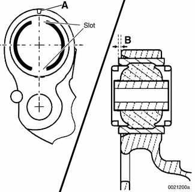

- Have car professionally aligned when job is complete.

Tightening torques

| Component | Tightening torque |
|---|---|
| Trailing arm to front bracket | 110 Nm (81 ft-lb) |
| Trailing arm bracket to body | 77 Nm (57 ft-lb) |

### Upper or lower control arm outer bushing (in trailing arm)

- Upper control arm bushing: Remove trailing arm from car as described earlier. Note direction of bolt insertion.
- Lower control arm bushing: Detach lower control arm from trailing arm. There is no need to remove trailing arm.
- Before detaching lower control arm from trailing arm, be sure to mark position of eccentric mounting bolt to facilitate resetting of rear camber. Note direction of bolt insertion.
- To replace bushing:
    - Measure and record protrusion (A) of old bushing from trailing arm boss.
    - Press old bushing out and install new bushing, using protrusion A as a reference.

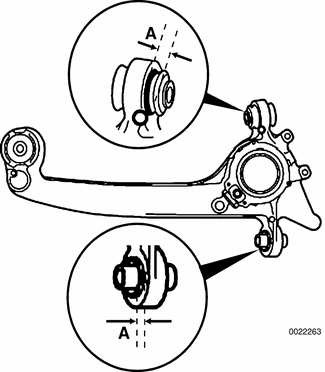

- Have car professionally aligned when job is complete.

Tightening torques

| Component | Tightening torque |
|---|---|
| **Drive axle collar nut to drive flange** | |
| M24 | 250 Nm (184 ft-lb) |
| M27 | 300 Nm (221 ft-lb) |
| **Drive axle to final drive flange** | |
| M10x20 mm Torx bolt | 83 Nm (61 ft-lb) |
| M10x46 mm bolt (black) | 100 Nm (74 ft-lb) |
| M10x46 mm bolt (silver) (always replace) | 80 Nm (59 ft-lb) |
| Lower control arm to trailing arm M12 eccentric bolt | 110 Nm (81 ft-lb) |
| Road wheel to hub | 100 ± 10 Nm (74 ± 7 ft-lb) |
| Shock absorber to trailing arm car in normal loaded position | 100 Nm (74 ft-lb) |
| Upper control arm to rear subframe M12 bolt | 77 Nm (57 ft-lb) |
| Upper control arm to trailing arm M12 bolt | 110 Nm (81 ft-lb) |

### Upper control arm inner bushing

- Remove upper control arm as described earlier.
- Press old bushing out using appropriate press tools.
- Press new bushing starting at inner bevelled end (arrow) of control arm bore.

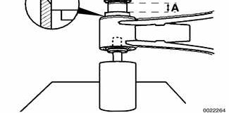

- Be sure that longer collar of bushing (A) is on same side as bevel in control arm.
- Outer bushing housing must be flush with control arm bore when fully pressed in.
- Have car professionally aligned when job is complete.

Tightening torque

| Component | Tightening torque |
|---|---|
| **Drive axle collar nut to drive flange** | |
| M24 | 250 Nm (184 ft-lb) |
| M27 | 300 Nm (221 ft-lb) |
| **Drive axle to final drive flange** | |
| M10x20 mm Torx bolt | 83 Nm (61 ft-lb) |
| M10x46 mm bolt (black) | 100 Nm (74 ft-lb) |
| M10x46 mm bolt (silver) (always replace) | 80 Nm (59 ft-lb) |
| Road wheel to hub | 100 ± 10 Nm (74 ± 7 ft-lb) |
| Shock absorber to trailing arm (car in normal loaded position) | 100 Nm (74 ft-lb) |
| Upper control arm to rear subframe M12 bolt | 77 Nm (57 ft-lb) |
| Upper control arm to trailing arm M12 bolt | 110 Nm (81 ft-lb) |

### Rear subframe bushing

- Remove subframe as described earlier.
- In case of damage to subframe mounting stud threads, replace stud.
- In case of damage to subframe mounting stud threads in body, repair using Helicoil thread insert M12 x 1.5 x 18.
- Press old bushing out and install new bushing using appropriate press tools. Coat new bushing with Circolight® or equivalent rubber bonding agent.
- Bushing position and orientation:
    - Right front bushing has elongated hole (arrow).
    - Orient all bushings with triangular arrow heads pointing front/aft on car.

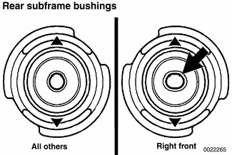

- Have car professionally aligned when job is complete.

Tightening torque

| Component | Tightening torque |
|---|---|
| **Drive axle collar nut to drive flange** | |
| M24 | 250 Nm (184 ft-lb) |
| M27 | 300 Nm (221 ft-lb) |
| **Drive axle to final drive flange** | |
| M10x20 mm Torx bolt | 83 Nm (61 ft-lb) |
| M10x46 mm bolt (black) | 100 Nm (74 ft-lb) |
| M10x46 mm bolt (silver) (always replace) | 80 Nm (59 ft-lb) |
| Road wheel to hub | 100 ± 10 Nm (74 ± 7 ft-lb) |
| Shock absorber to trailing arm (car in normal loaded position) | 100 Nm (74 ft-lb) |
| Subframe to body (M12) | 77 Nm (57 ft-lb) |
| Upper control arm to rear subframe M12 bolt | 77 Nm (57 ft-lb) |
| Upper control arm to trailing arm M12 bolt | 110 Nm (81 ft-lb) |
