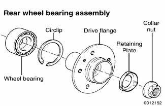
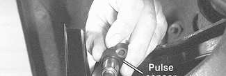
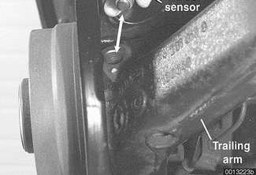
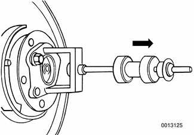

# Rear Wheel Bearings

> Source: BMW 3 Series (E46) Repair Manual, section 330-5, Rear Suspension chapter (PDF pages 652–655 of 1252).

The rear wheel bearing is a unitized assembly and is not repairable separately.

Special press tools, to be used with the trailing arm attached to the car, are required to replace a wheel bearing. Read the procedure through before beginning the job.

## Rear wheel bearing, replacing

- Remove drive axle as described in [331 Rear Axle Final Drive].

> **WARNING!**
> - Make sure that the car is firmly supported on jack stands designed for the purpose. Place the jack stands beneath a structural chassis point. Do not place jack stands under suspension parts.

- Right side: Detach brake pad sensor connector at brake caliper.
- Remove brake caliper assembly and rotor as described in [340 Brakes]. Leave brake hose connected to caliper. Suspend caliper assembly from chassis using stiff wire.

Remove ABS pulse sensor at trailing arm.

Remove drive flange from bearing assembly using impact style puller (BMW special tools 33 2 116, 33 4 201/202/203 or equivalent).

> **CAUTION!**
> - The wheel bearing is destroyed when the drive flange is removed. Do not attempt to reuse bearing.

> **Note:**
> - Use BMW special tool set 33 4 400 or equivalent to separate inner bearing race from drive flange.

- Remove bearing retaining circlip from bearing housing in trailing arm.
- Using appropriate bearing extraction tools (BMW special tools 33 3 261/262/263 or equivalent), pull bearing assembly out of trailing arm bearing housing.
- Inspect bearing housing for any damage or contamination.
    - Clean housing bore thoroughly before installing new bearing.
    - Make sure all mating surfaces are clean.
- Install new bearing assembly using press tools (BMW special tools 33 3 261/264/265 or equivalent).
- Install new circlip.

> **CAUTION!**
> - Apply force only to outer race when installing bearing.
> - Make sure that the bearing is pressed in far enough to contact the shoulder at the back side of the housing and that the circlip is fully seated in its groove.
> - Always use a new retaining circlip.

- Draw drive flange into bearing using appropriate press tools (BMW special tools 33 3 261/262/263 or equivalent).

> **CAUTION!**
> - BMW specifies special tools to pull the drive flange through the wheel bearing into position. If using alternative tools, be sure to support the bearing inner race when pressing or pulling the drive flange into place.

- Install brake caliper assembly and rotor as described in [340 Brakes].
- Reinstall drive axle.

Tightening torques

| Component | Tightening torque |
|---|---|
| Brake rotor to drive flange (M8) | 16 Nm (12 ft-lb) |
| Brake caliper to trailing arm (M12) | 67 Nm (50 ft-lb) |
| **Drive axle collar nut to drive flange** | |
| M24 | 250 Nm (184 ft-lb) |
| M27 | 300 Nm (221 ft-lb) |
| **Drive axle to final drive flange** | |
| M10x20 mm Torx bolt | 83 Nm (61 ft-lb) |
| M10x46 mm bolt (black) | 100 Nm (74 ft-lb) |
| M10x46 mm bolt (silver) (always replace) | 80 Nm (59 ft-lb) |
| Road wheel to hub | 100 ± 10 Nm (74 ± 7 ft-lb) |
