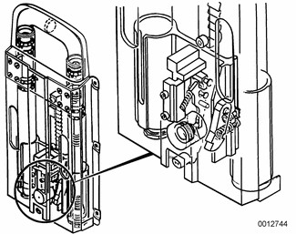

# Rollover Protection System

> Source: Bentley *BMW 3 Series (E46) 1999–2005 (M3) Repair Manual*, section 541-3 (PDF pages 939–940 of 1252).

Two spring-loaded rollbar cassettes are mounted behind the rear seat. The cassettes are bolted into the reinforced carrier behind the seat backs. When retracted they are covered by the rear headrest which incorporates a flap at the back, that will open when the rollbars deploy.

A rollover sensor, mounted in the rear behind the left rear seat back on the rollbar cassette, contains the electronics for rollover detection and deployment final stage for triggering the rollover bar solenoids. Two capacitors are installed for rollbar deployment in case of a power failure during a crash.

The rollover sensor performs a self-check every time the ignition is switched on. The sensor is connected to the diagnostic link (DLC) for troubleshooting purposes.

If faults are detected, the warning lamp in the instrument cluster will light up. In case of a crash, the system will attempt to trigger the rollover cassettes to deploy even if a fault code is stored in fault memory.

> **Note:** Diagnosis of convertible top and Rollover Protection System are beyond scope of this book. Your authorized BMW dealer has proper diagnostic equipment and tools to carry out these tasks.

After deployment, the detent pawl in a rollover protection cassette can be retracted by pulling the reset lever forward so that rollbar can be pushed down and locked into the solenoids.

> **WARNING!**
> - Ensure that area above and adjacent to rollover bars remains clear and unobstructed at all times.

> **CAUTION!**
> - It is not possible to close convertible top with rollover bars extended.
> - If a hardtop is mounted, be sure to install the protective rollover bar covers provided with hardtop to prevent damaging rear window in case of deployment.
