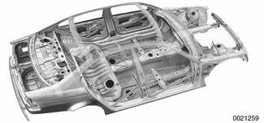
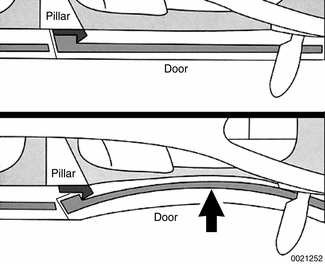
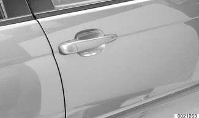
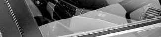
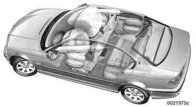
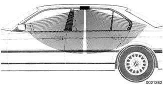
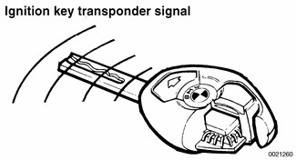

# Safety and Security Features

> Source: BMW 3 Series (E46) Repair Manual, section 400-3, Body — General chapter (PDF pages 730–734 of 1252).

A large number of new or improved safety and security features are incorporated in E46 cars.

## Safety cage

The body safety cage is a continuation of an established BMW concept for passenger protection. Tubular impact structures built into the body provide protection against passenger injury during front or rear impacts.

## Door anchoring system

Each door is reinforced with a diagonal aluminum bar with a metal hook at the rear edge.

Upon severe side impact, the hook locks into a recessed notch in the B or C pillar, thus providing unitized protection against buckling of the door. The body side holds together as a unit, offering significantly greater strength.

After most impacts, the door springs back and unhooks from the notch. It can then be opened again.

## Door locks and door handles

The bow type door handles allow easy door opening, but are secure in accidents.

Electrical components in the locks are fully encapsulated and cannot be picked easily. The new door handles, latches and lock assemblies offer improved reliability and security against theft.

Door position and lock condition are detected by hall sensors.

## Roof padding

In addition to the side and head protection airbags, there is supplementary padding at the roof pillars and along the roof above the doors. This is positioned to present energy absorbing surfaces to passengers thrown around by side impact forces.

## Seat belts

In the Sedan, Coupe and Sport Wagon models, each front seat belt assembly has a height-adjustable anchor at the B pillar.

An automatic pyrotechnic (explosive charge) tensioner tightens the front belt at the buckle upon impact, snugging up lap and shoulder segments of the belt. The tensioners are designed to automatically tension the belts by about 2 inches (55 mm) in the event of a collision.

A force limiter puts an upper limit on the amount of force each belt can exert on the passenger.

The Convertible seat belts are integrated into the seat, but otherwise have features similar to the other models.

## Airbags

As many as 8 airbags are installed in E46 cars, depending on model.

The front airbags operate without sodium azide propellant, widely considered an irritant when an airbag is deployed.

Starting with 2000 models, "smart" front passenger and driver airbags were installed. These are of the dual-threshold, dual stage design, including a sensor to help prevent the unnecessary deployment of the passenger side airbag if the seat is unoccupied.

Depending on options chosen, one airbag may be installed in each door of the Sedan and Sport Wagon models, protecting passengers against side impacts. Coupe and Convertible models are equipped with door-installed airbags as well.

Head Protection System (HPS) airbags stretch diagonally across the tops of the front doors.

Airbag deployment automatically triggers fuel shut-off, turns on the hazard and interior lights, and unlocks the doors.

> **WARNING!**
> - Airbags are inflated by an explosive device. Handled improperly or without adequate safeguards, airbag units can be very dangerous. Special precautions must be observed prior to any work at or near any of the airbags. See [721 Airbag System (SRS)].
> - Always disconnect the battery and cover the negative (-) battery terminal with an insulator before starting diagnostic, troubleshooting or service work on cars fitted with SRS, and before doing any welding on the car.

## Battery safety terminal (BST)

A pyrotechnic (explosive charge) device automatically disconnects the battery positive terminal during impacts or collisions.

The seatbelt system, airbag system and battery safety terminal are controlled by the Multiple Restraint System (MRS II) control module.

## Security

Electronic immobilization (EWS 3.3). All E46 vehicles incorporate an electronic immobilization system known as EWS 3.3. This system uses a wireless communication link between a transponder chip in the ignition key and the ring antenna surrounding the ignition switch. The EWS control module blocks the starting of the vehicle unless the correct coded ignition key is used.

> **Note:**
> - Electronic immobilization is sometimes referred to as the driveaway protection system.

Anti-theft alarm (DWA). This is a dealer-installed option for which the E46 vehicles are factory-wired. When armed, the system monitors door lock contacts and trunk and engine hood locks and sounds a siren if it detects tampering.

Tilt sensor. Located in the right side of the trunk above the battery, the tilt sensor monitors the vehicle parked angle when DWA is armed. The siren is activated if the vehicle angle is changed. This helps prevent theft of the car using a ramp truck.

Ultrasonic interior protection (UIS). An interior ultrasonic emitter/detector is installed in the center of the headliner of Sedan, Coupe and Sport Wagon models. The DWA alarm is triggered if motion is detected inside the car.

Short distance radar (SDR) is the interior motion detector system used in Convertible models. The SDR emitter is located on the driveshaft tunnel under the center console next to the parking brake.

For further information about anti-theft systems, see [515 Central Locking and Anti-theft].

## Emergency location

If emergency assistance is needed, the on-board navigation system (if equipped) uses GPS technology to pinpoint the location of the vehicle.
