# Shock Absorbers and Springs

> Source: BMW 3 Series (E46) Repair Manual, section 310-2, Front Suspension chapter (PDF pages 516–525 of 1252).

> **Note:**
> - Setting the ride height is covered in [300 Suspension, Steering and Brakes-General].

The front suspension shock absorbers in E46 cars are McPherson struts. The strut is a major component of the suspension and supports the spring. Most strut assembly components are available as replacement parts. Struts and/or springs should always be replaced in pairs.

Front strut, upper strut mount or spring replacement is a two-step procedure:

- Removal of strut assembly from vehicle
- Disassembly and replacement of components on workbench

## Strut assembly, removing and installing

- Raise car and remove front wheel.

> **WARNING!**
> - Make sure that the car is firmly supported on jack stands designed for the purpose. Place the jack stands beneath a structural chassis point. Do not place jack stands under suspension parts.

- Pull brake fluid hose and ABS sensor wire harness off bracket at steering arm pinch bolt.

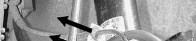

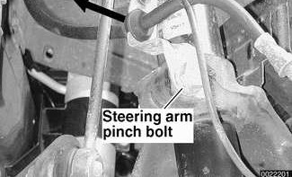

> **Note:**
> - Right side is shown in illustration. Left side bracket also holds brake pad wear sensor wire.

- Unbolt brake caliper assembly, keeping brake hose connected. Suspend brake caliper from chassis using stiff wire. See [340 Brakes].
- Remove ABS wheel speed sensor mounting bolt (arrow). Slide sensor out of steering arm and lay aside.

> **Note:**
> - Rear wheel drive vehicle shown in illustration.

- On cars equipped with xenon headlights: Remove headlight vertical aim sensor link bracket mounting nuts (arrows) from right control arm.

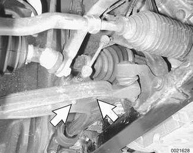

- Loosen and remove stabilizer bar link mounting nut (arrow) from strut. Detach link from strut housing.

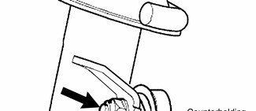

> **Note:**
> - Use a thin wrench to counterhold shaft of stabilizer bar link ball joint while removing mounting nut.

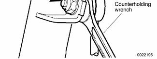

- Remove tie rod outer end nut. Use BMW special tool 32 3 090 or equivalent to press tie rod end off steering arm.

- Remove lower ball joint nut. Use BMW special tool 32 3 090 or equivalent to separate steering arm from control arm.

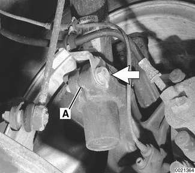

- Support steering arm from below. Loosen pinch bolt (arrow) at top of steering arm. Spread clamping collar at slot A, if necessary, to slide steering arm off strut assembly.

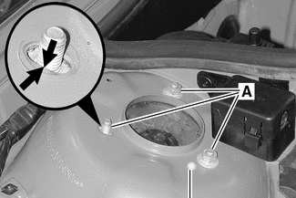

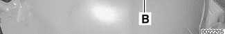

- Support strut assembly from below.
- Working in engine compartment at strut tower, remove three strut mounting nuts (A) on strut tower.
    - If factory alignment locating pin (B) is missing, be sure to mark location of strut mounting studs in strut tower slots (arrows).

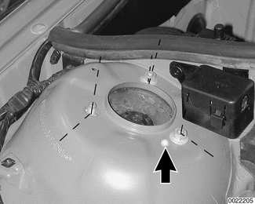

> **CAUTION!**
> - Do not remove center strut retaining nut.

- Lower strut assembly from car.

- When installing strut assembly into car:
    - Make sure locating pin (arrow) of strut bearing is positioned correctly in strut tower.
    - If factory alignment locating pin is missing, make sure three upper mounting studs are positioned correctly in slotted holes according to marks made previously.

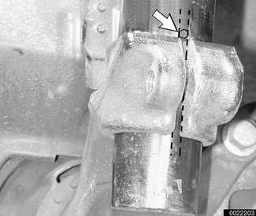

- When installing steering arm to strut assembly, insert positioning pin (arrow) of strut into slot of steering arm clamping collar. To ensure proper alignment specifications, slide steering arm up on strut until stop is reached.

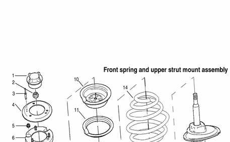

- Remainder of installation is reverse of removal.
    - Be sure to use new self-locking nuts and bolts.
    - Use new steering arm mounting bolts, or clean bolts and use Loctite® 270 or equivalent threadlocking compound.
    - When attaching stabilizer link to strut, use a thin wrench to counterhold link ball joint while tightening nut.
- Have car professionally aligned when job is complete.

Tightening torques

| Component | Tightening torque |
|---|---|
| Brake caliper to steering arm | 110 Nm (81 ft-lb) |
| Road wheel to hub | 100 ± 10 Nm (74 ± 7 ft-lb) |
| Stabilizer bar link to strut | 59 Nm (44 ft-lb) |
| Steering tie rod to steering arm | 65 Nm (48 ft-lb) |
| Steering arm to control arm | 65 Nm (48 ft-lb) |
| Steering arm pinch bolt at strut housing | 81 Nm (60 ft-lb) |
| Strut assembly to strut tower (self-locking nuts) | 24 Nm (18 ft-lb) |
| Upper strut mount to strut tower, self-locking M8 flanged nut: 18 mm flange | 24 Nm (18 ft-lb) |
| Upper strut mount to strut tower, self-locking M8 flanged nut: 21 mm flange | 34 Nm (25 ft-lb) |

## Front spring and upper strut mount assembly

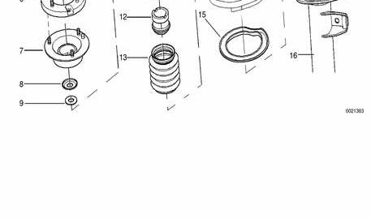

| No. | Part |
|---|---|
| 1 | Cap |
| 2 | Upper strut self locking nut M14, tighten to 64 Nm (47 ft-lb) |
| 3 | Rivet (all wheel drive or rough road package only) |
| 4 | Strut bearing reinforcement (all wheel drive or rough road package only) |
| 5 | Self locking flanged nut M8, tighten to: 24 Nm (18 ft-lb) (18 mm flange), 34 Nm (25 ft-lb) (21 mm flange) |
| 6 | Spacer plate (all wheel drive or rough road package only) |
| 7 | Upper strut bearing |
| 8 | Sealing ring |
| 9 | Flat washer |
| 10 | Upper spring seat |
| 11 | Upper spring pad |
| 12 | Rubber stop |
| 13 | Dust seal |
| 14 | Spring |
| 15 | Lower spring pad |
| 16 | Strut |

## Strut assembly, disassembling and assembling

Replacing the strut, upper strut mount or spring requires that the strut assembly first be removed from the car and disassembled. For a guide to parts used during component replacement, see the accompanying diagram.

- Remove strut assembly as described earlier. Place in shop vice, or support securely.
- Using spring compressor, compress spring until spring force on upper mount is relieved.

> **WARNING!**
> - Do not attempt to disassemble the struts without a spring compressor designed specifically for this job.
> - Make sure the spring compressor grabs the spring fully and securely before compressing it.

- Pry protective cover off top of strut assembly. Use BMW special tool 31 2 210 or equivalent socket to remove strut top (center) nut. Counterhold strut shaft using 6 mm Allen wrench.
- Remove upper strut bearing and related components.
- Replace strut, upper strut mount or spring, as needed.

> **Note:**
> - Springs and/or struts should always be replaced in pairs.
> - Be sure that replacement struts are marked with the same code as the ones being removed.

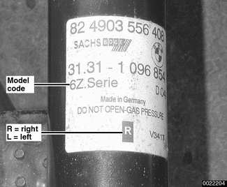

> **Note:**
> - Aftermarket struts are not marked.

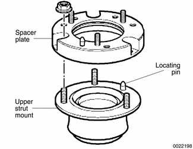

- Vehicles with "rough road" package are equipped with a spacer plate above the upper strut mount. Make sure the strut mount locating pin fits in the corresponding bore of the spacer plate.

> **Note:**
> - If there is no locating bore in the strut tower for the pin in the replacement upper strut mount to fit, drive out the pin before installing the new mount.

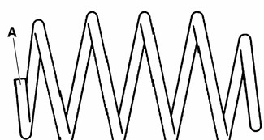

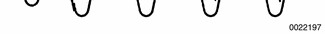

- Replace springs in pairs only. The part number (A) is stamped near the large end of the spring.

- Assembly is reverse of disassembly, noting the following:
    - Line up slot in spring pad with corresponding slot in lower spring seat.
    - Use a new upper strut self locking nut. Tighten nut fully before releasing spring compressor.
    - Be sure upper spring pad is correctly installed to upper spring seat and spring end is correctly seated in upper and lower spring seats.
    - Release spring compressor carefully and evenly, allowing spring to expand slowly.
    - Have car professionally aligned when job is complete.

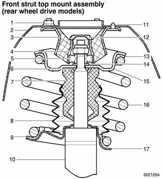

1. Self locking nut M8 -tighten to: 24 Nm (18 ft-lb) (18 mm flange) 34 Nm (25 ft-lb) (21 mm flange)
2. Strut tower
3. Upper strut mount
4. Upper strut self locking nut M14 -tighten to 64 Nm (47 ft-lb)
5. Upper strut bearing
6. Sealing ring
7. Rubber bump-stop
8. Dust shield
9. Lower spring pad
10. Strut housing
11. Locating pin
12. Protective cap
13. Upper spring pad
14. Washer
15. Upper spring seat
16. Spring
17. Lower spring seat

Tightening torque

| Component | Tightening torque |
|---|---|
| Upper strut mount to strut shaft M14 self-locking nut | 64 Nm (47 ft-lb) |
