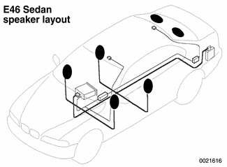
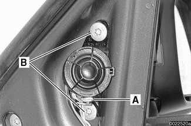
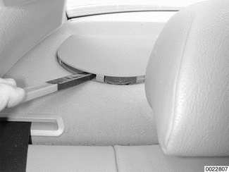

# Speakers

> Source: Bentley *BMW 3 Series (E46) 1999–2005 (M3) Repair Manual*, section 650-3 (PDF pages 1174–1177 of 1252).

Each model in the E46 model line-up features a slightly different speaker setup. Speaker and other component locations also vary depending on the type of sound system installed. Some of the common speaker installations are covered in this section.

**Sedan and Sport Wagon:** The standard installation is six speakers, one in each door and two in the rear. The rear speakers in the Sedan are in the parcel shelf. The rear speakers in the Sport Wagon are mounted on the left and right wheel housings behind trim covers.

**Coupe:** A tweeter and a mid-range speaker are installed in one housing unit in each front door panel. Another speaker pair is in the left and right rear side trim panels.

**Convertible:** The standard speaker set-up consists of four speakers mounted in the rear side trim panels, two on each side. One speaker on each side is a 130 mm wide band and the other is a tweeter.

The Harman/Kardon system incorporates an additional subwoofer installed in the trunk. The amplification for this subwoofer comes from the main sound system amplifier.

In the Convertible, the subwoofer is installed in the ski bag cover. It is hinged so that it can be swung aside when the ski bag is used. A magnet on the subwoofer cover holds it in place against the rear bulkhead while the ski bag is used. The subwoofer functions in either position.

Also in the Convertible, the sound system receives a signal from the rear window defroster relay when the top is lowered. This switches off the stereophonic function.

## Door mounted speaker, removing

> **WARNING!**
> - All E46 cars are equipped with front door airbags. Rear door airbags are optional. Before performing any work involving airbags, disconnect the negative (-) battery cable. See [721 Airbag System (SRS)].

> **CAUTION!**
> - Prior to disconnecting the battery, read the battery disconnection cautions given at the front of this manual on page viii.

- Remove interior door panel as described in [411 Doors].

Detach electrical harness connector (**A**) and remove speaker mounting screws (**B**).

- Remove speaker.

## Rear side panel speaker, removing

- Disconnect battery negative terminal.

> **CAUTION!**
> - Prior to disconnecting the battery, read the battery disconnection cautions given at the front of this manual on page viii.

- Remove lower section of rear seat side trim.
- If necessary, remove convertible top module. See [541 Convertible Top] (left side only).
- Speaker is attached to side wall.

## Rear speaker, removing and installing

Working at rear parcel shelf, pry speaker cover by inner edge and remove.

> **CAUTION!**
> - To avoid marring interior trim, work with a plastic prying tool.

- Remove mounting screws, lift up speaker and detach electrical harness connector.
- When reinstalling, make sure speaker and harness are seated as before.

## Subwoofer, removing

**Coupe:**

- Working in trunk under parcel shelf, remove subwoofer mounting screws.
- Unhook and pull subwoofer down.
- Remove electrical harness connector.

**Convertible:**

- Working in trunk, unhook and swing out subwoofer.
- Squeeze plastic harness cover and remove.
- Detach electrical harness connector.
- Using plastic pry tool, gently pry subwoofer at bottom left and pull out.
