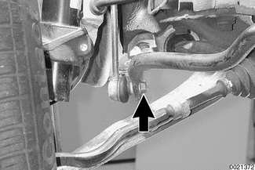
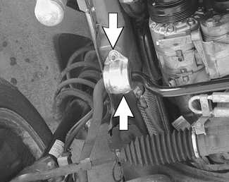
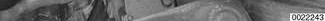
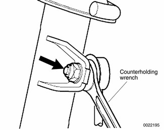

# Stabilizer Bar

> Source: BMW 3 Series (E46) Repair Manual, section 310-5, Front Suspension chapter (PDF pages 552–553 of 1252).

## Stabilizer bar, removing and installing

On E46 models the stabilizer bar links attach to the strut assemblies.

- Raise car and support safely.

> **WARNING!**
> - Make sure that the car is firmly supported on jack stands designed for the purpose. Place the jack stands beneath a structural chassis point. Do not place jack stands under suspension parts.

- Remove stabilizer bar connecting link mounting nut (arrow) from stabilizer bar on right side. Counterhold ball joint with flat wrench. (Rear wheel drive model shown.)

- Repeat on left side.
- Remove stabilizer bar bushing anchor nuts (arrows) on right side.

- Repeat on left side.
- Remove bar.
- If necessary, loosen and remove stabilizer bar link mounting nut (arrow) from strut. Detach link from strut housing.

> **Note:**
> - Use a thin wrench to counterhold shaft of stabilizer bar link ball joint while removing mounting nut.

- Installation is reverse of removal, noting the following
    - Use new self-locking nuts on connecting links.
    - When attaching stabilizer link to strut or bar, use a thin wrench to counterhold ball joints on link while tightening nut.
    - Installation of stabilizer bar is easiest with car level (front wheels at the same height) and as near to normal ride height as possible.

Tightening torques

| Component | Tightening torque |
|---|---|
| Stabilizer bar bushing brackets to subframe | 22 Nm (16 ft-lb) |
| Stabilizer bar link to stabilizer bar M10 self locking nut (always replace) | 65 Nm (48 ft-lb) |
| Stabilizer bar link to strut M10 self locking nut (always replace) | 65 Nm (48 ft-lb) |
