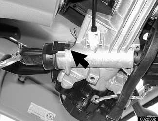
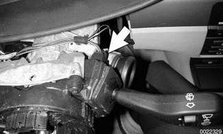
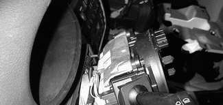
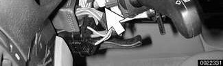
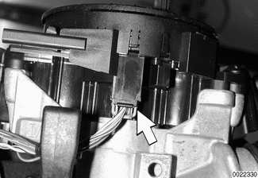
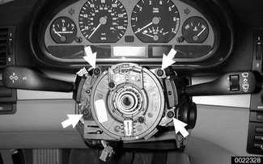
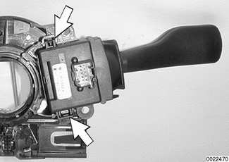

# Steering Column Switches

> Source: Bentley *BMW 3 Series (E46) 1999–2005 (M3) Repair Manual*, section 612-3 (PDF pages 1059–1063 of 1252).

To remove any of the steering column switches, it is necessary to first remove the upper and lower column trim pieces. See [513 Interior Trim].

> **CAUTION!**
> - To prevent marring interior trim, work with plastic prying tools or wrap the tips of screwdrivers and pliers with tape before prying out switches or electrical accessories.

## Ignition lock cylinder, removing and installing

To remove the EWS ring antenna prior to removing ignition lock cylinder, it is necessary to remove the upper and lower steering column trim. Use BMW special tool 61 3 300 to force off the ring antenna. Alternatively, remove the ignition switch key cylinder first.

With ignition key in ON position (60° from LOCKED):

- Insert a thin piece of stiff wire into opening (arrow) in lock cylinder and pull lock cylinder out.
- Detach ring antenna harness connector.
- Gently work ring antenna off key cylinder.
- Reinstallation is reverse of removal.

## Steering column stalk switch assembly, removing and installing

To replace either the directional/headlight dimmer stalk switch or the wiper/washer stalk switch, you must first remove the entire stalk switch assembly from the steering column.

> **CAUTION!**
> - To prevent marring interior trim, work with plastic prying tools or wrap the tips of screwdrivers and pliers with tape before prying out switches or electrical accessories.

- Disconnect negative (-) cable from battery and cover terminal with insulating material.

> **CAUTION!**
> - Prior to disconnecting the battery, read the battery disconnection cautions given at the front of this manual on page viii.

- Remove airbag unit from steering wheel. See [721 Airbag System (SRS)]. Store airbag unit in a safe place with pad facing up.

> **WARNING!**
> - Any work involving the SRS system should only be performed by an authorized BMW dealer. Making repairs without the proper knowledge and special test equipment may cause serious personal injury. See [721 Airbag System (SRS)]

- With front wheels pointed straight ahead, remove steering wheel. See [320 Steering and Wheel Alignment].

**Note:**

*To help with reassembly, mark steering wheel and spindle shaft before disassembly.*

- Remove steering column trim. See [513 Interior Trim].

Detach EWS ring antenna electrical harness connector (arrow).

Detach wiper/washer switch electrical harness connector (arrow).

Detach turn signal/headlight dimmer switch electrical harness connector (arrow).

Detach airbag electrical harness connector (arrow).

Remove stalk switch housing retaining screws (arrows). Slide switch housing off steering column.

- Installation is reverse of removal, noting the following:
    - Place turn signal indicator in center position before installing.
    - Ensure that self cancelling cams on turn signal switch are not damaged during installation.

**Tightening torque**

| Component | Torque |
|---|---|
| Steering wheel to steering column spindle shaft | 63 Nm (46 ft-lb) |

## Turn signal/headlight dimmer switch/ wiper switch removing and installing

- After removing steering column stalk switch assembly, as described above, turn switch assembly face-down on work bench.
- Squeeze locking tabs (arrows) on sides of switch and slide switch out of assembly holder.

- Push in new switch until it positively snaps into switch housing.
