# Steering Column

> Source: BMW 3 Series (E46) Repair Manual, section 320-3, Steering and Wheel Alignment chapter (PDF pages 599–606 of 1252).

## Steering column assembly

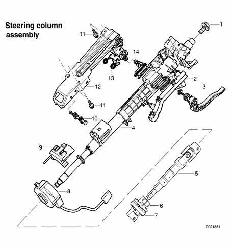

1. Hex bolt (M14 x 1.5) — tighten to 63 Nm (46 ft-lb)
2. Cable duct
3. Steering column adjustment lever
4. Upper steering column
5. Lower steering column with universal joint
6. Torx bolt (M8 x 33) — tighten to 22 Nm (16 ft-lb)
7. Flexible joint (guibo)
8. Steering angle sensor
9. Steering angle sensor bracket
10. Column pivot bushing
11. Bolt (M8 x 36) — tighten to 22 Nm (16 ft-lb)
12. Steering column mounting bracket
13. Column return spring
14. Nut (M8) — tighten to 4.8 Nm (3.5 ft-lb), recheck as necessary

## Ignition lock cylinder, removing and installing

To remove the ring antenna prior to removing ignition lock cylinder, it is necessary to remove the upper and lower steering column trim. Use BMW special tool 61 3 300 to force off the ring antenna. Alternatively, remove the ignition switch key cylinder first.

With ignition key in ON position (60° from LOCKED):

- Insert a thin piece of stiff wire into opening (**arrow**) in lock cylinder and pull lock cylinder out.
- Detach ring antenna harness connector.
- Gently work ring antenna off key cylinder.

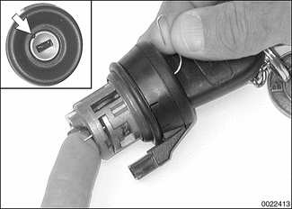

Reinstallation is reverse of removal.

## Lower steering column, removing and installing

**Note:** *Once the lower steering column has been removed there will be no end stop for the steering wheel. In order to prevent damage to contact ring in steering column, follow procedural steps as listed.*

1. Unlock steering wheel. 2. Move steering wheel to straight ahead position. 3. Lock steering wheel and remove ignition key.

- Lift vehicle and support safely.

> **WARNING!**
>
> Make sure the car is stable and well supported at all times. Use a professional automotive lift or jack stands designed for the purpose. A floor jack is not adequate support.

- Remove splash guard under engine.
- Remove lower steering column flexible joint pinch bolt (arrow). Slide lower column up and pull flexible joint off steering rack shaft.

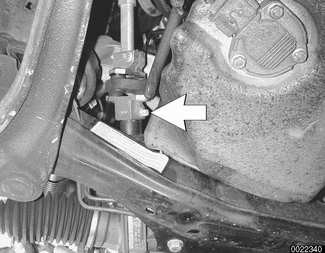

**Note:** *Do not remove alignment flange from steering rack.*

- Working near firewall, remove pinch bolt at universal joint and remove lower steering column.

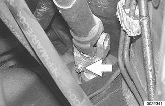

**Note:** *Upper steering column is keyed to lower steering column universal joint. It can only be installed in one position.*

- Installation is reverse of removal, noting the following:
    - Replace flexible and universal joint pinch bolts.
    - Align lower steering column to keyed upper steering column.
    - Align tab (**arrow**) on steering rack flange with lower steering column flexible joint.

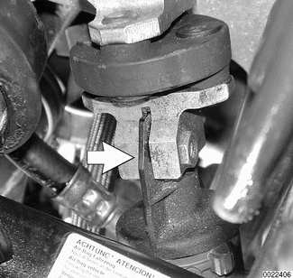

| Tightening torque |  |
|---|---|
| Pinch bolts at steering column joints | 22 Nm (16 ft-lb) |

## Upper steering column, removing and installing

- Remove steering wheel as described earlier.
- Fully lower and extend (**arrows**) adjustable steering column.

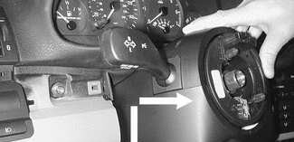

- Remove retaining screw from top of steering column upper trim cover.
- Push in sides of upper trim cover (**arrows**) to release from lower trim. Pull back and up on upper trim.

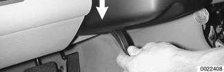

- Pry gently to detach flexible cover from upper trim. Lift off trim.

- Remove left footwell (pedal cluster) trim panel.

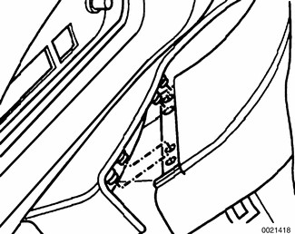

    - Remove screws (**A**).
    - Remove fasteners (**B**).

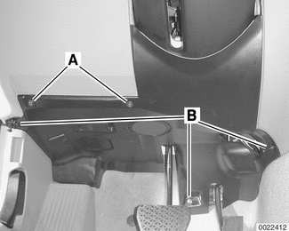

- Disconnect electrical harness connectors at left footwell trim panel and remove panel:

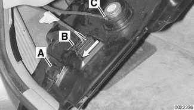

    - Unplug connector at footwell interior light (**A**), if equipped.
    - Slide lock at OBD II connector (**B**) in direction of **arrow**.
    - Unplug connector at cellular phone speaker (**C**) if equipped.
- Remove lower steering column as described earlier.
- To remove steering column lower trim, drive pins into expansion rivets (**arrows**) to release. Pull down on trim.

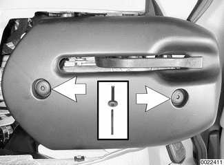

- Working at steering column:
    - Remove screws (**arrows**).
    - Slide switch block out from steering column.
    - Disconnect electrical harness connectors at ignition switch, wiper switch, turn signal / high beam switch, and steering wheel functions / airbag connector.
    - Remove switch block.

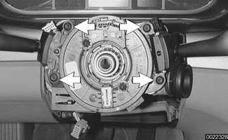

- Slide lower section of upper steering column into upper section (**arrow**).

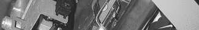

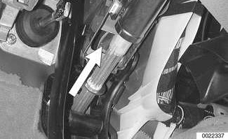

- Remove shift interlock cable (**A**) if necessary.

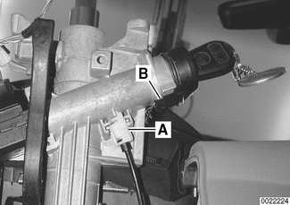

    - Disconnect electrical harness connector at EWS 3.3 ring antenna (**B**).
    - Working at steering column, detach wiring harness from cable duct.
- Drill out steering column mounting shear bolt (**A**), and remove mounting bolt (**B**).

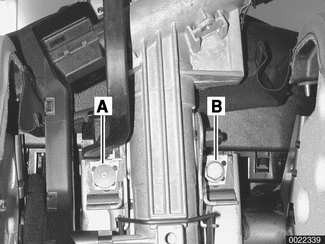

- Remove lower steering column mounting bolts (**arrows**). Remove upper steering column.

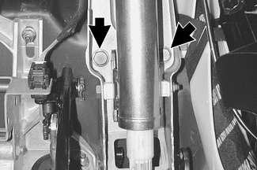

- Installation is reverse of removal, noting the following:
    - Replace shear bolt at steering column mounting bracket. Tighten until bolt head shears off.
    - Make sure lock of interlock cable snaps into place.
    - When installing column top trim panel, replace expansion nut for trim retaining screw.
    - When installing lower trim panel, push expansion rivet pin into rivet until pin head is flush with rivet head.

| Tightening torques |  |
|---|---|
| Universal joint pinch bolt at steering column | 22 Nm (16 ft-lb) |
| Steering column to dashboard carrier | 22 Nm (16 ft-lb) |
