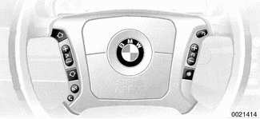
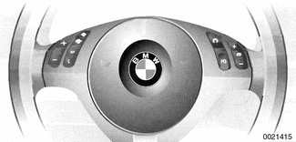
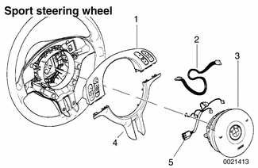

# Steering Wheel Switches

> Source: Bentley *BMW 3 Series (E46) 1999–2005 (M3) Repair Manual*, section 612-2 (PDF pages 1056–1058 of 1252).

E46 vehicles are equipped with either the multi-function (MFL) steering wheel or the sports steering wheel.

Incorporated into each steering wheel are an SRS airbag, horn contacts, selected cellular phone and radio controls and cruise control buttons.

To replace the steering wheel switches, remove the airbag first. See [721 Airbag System (SRS)].

> **WARNING!**
>
> - Improper handling of the airbag could cause serious injury. Store the airbag with the horn pad facing up. If stored facing down, accidental deployment could propel it violently into the air, causing injury.

> **CAUTION!**
>
> - Special test equipment is required to retrieve SRS fault codes, diagnose system faults, and reset/turn off the SRS indicator light. The SRS indicator light will remain on until any problem has been corrected and the fault memory has been cleared.

## Multi-function (MFL) steering wheel switches, accessing

- Remove airbag.

- Detach electrical harness connectors.

- 1 - Cruise control/radio/telephone electrical harness
- 2 - Horn button electrical harness
- 3 - Airbag electrical harness
- 4 - Radio/telephone control switch set
- 5 - Airbag
- 6 - Cruise control switch set

- Remove small screws on back side of airbag pad to release left or right switch set.

**Note:**

> BMW does not provide the horn contact switch as a separate part.

## Sport steering wheel switches, accessing

- Remove airbag.

**Note:**

> There is a special procedure for detaching the airbag from the sport steering wheel. See [721 Airbag System (SRS)].

- Remove screws mounting switch carrier to steering wheel.

- 1 - Switch carrier
- 2 - Steering wheel switch set electrical harness
- 3 - Airbag
- 4 - Lower cover
- 5 - Horn button and airbag electrical harness

- Pull switch carrier and trim down to detach from steering wheel. Remove electrical harness connector.
- Separate bottom trim piece from switch carrier.

**Note:**

> BMW does not provide the horn contact switch as a separate part.
