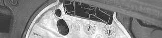
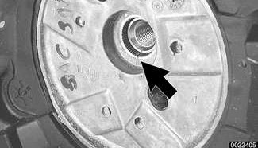

# Steering Wheel

> Source: BMW 3 Series (E46) Repair Manual, section 320-2, Steering and Wheel Alignment chapter (PDF pages 597–598 of 1252).

## Steering wheel, removing and installing

- Center steering wheel. Make sure front wheels are pointed straight ahead.
- Disconnect negative (-) cable from battery.

> **CAUTION!**
>
> - Prior to disconnecting the battery, read the battery disconnection cautions given at the front of this manual on page viii.

- Carefully remove airbag from front of steering wheel. See [721 Airbag System (SRS)]. Store airbag unit in a safe place.

> **WARNING!**
>
> Improper handling of the airbag could cause serious injury. Store the airbag with the horn pad facing up. If stored facing down, accidental deployment could propel it violently into the air, causing injury.

> **CAUTION!**
>
> - Avoid damaging the variety of convenience switches, such as radio and cruise controls, installed in the steering wheel of some models.

- Remove steering wheel center bolt.

**Note:** *The steering column and steering wheel are matchmarked (arrow) at the factory. Confirm these marks before removing wheel from column.*

- Remove steering wheel.
- When reinstalling steering wheel:
    - Align steering wheel and column match marks.
    - Align steering wheel to alignment pins located on steering column switch block.
    - Install steering wheel center bolt. Do not over-torque.

| Tightening torque |  |
|---|---|
| Steering wheel to steering shaft | 63 Nm (46 ft-lb) |

- Carefully install airbag. See [721 Airbag System (SRS)].

| Tightening torque |  |
|---|---|
| Airbag to steering wheel | 8 Nm (71 in-lb) |

**Note:** The airbag in some models is attached to the steering wheel using spring clips instead of mounting screws.
