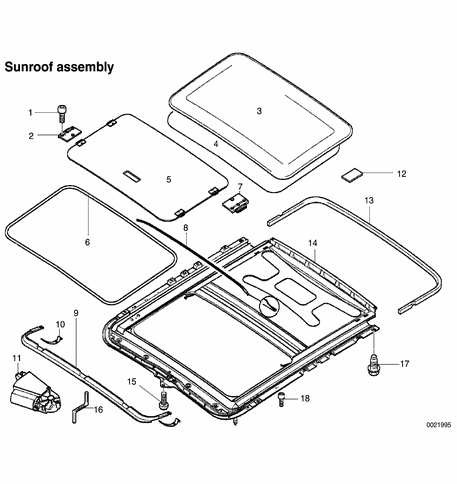
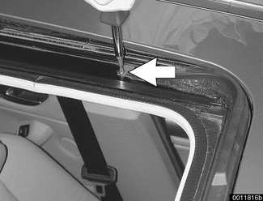
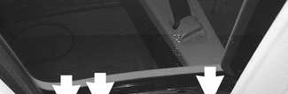
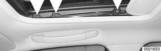
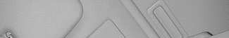
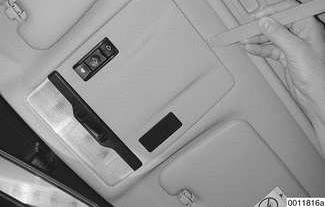
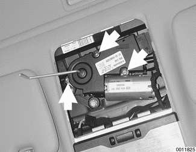

# Sunroof Components

> Source: Bentley *BMW 3 Series (E46) 1999–2005 (M3) Repair Manual*, section 540-2 (PDF pages 916–919 of 1252).

Sunroof assembly removal and installation involves headliner removal, and is not covered in this manual. After sunroof repairs be sure to follow initialization and adjustment procedures given earlier.

**Sunroof assembly**

1. Torx bolt M5
2. Slider
3. Glass sunroof panel
4. Sunroof panel gasket
5. Velour ceiling panel
6. Synthetic strip
7. Slider
8. Gasket
9. Wind deflector
10. Deflector spring
11. Sunroof motor
12. Felt
13. Frame gasket
14. Sunroof frame
15. Torx bolt M5, tighten to 3.5 Nm (31 in-lb)
16. Emergency operation crank handle
17. Hex bolt with washer
18. Torx bolt M4

## Sunroof panel, removing and installing

To remove sunroof panel, open sunroof and remove wind blocker by removing Torx screw (arrow) on each side.

Close sunroof and slide sunroof liner back into roof cavity until approximately 90 mm (3.5 in.) is exposed.

Remove three Torx screws (arrows) on each side, and lift panel out.

- Installation is reverse of removal.

Adjust sunroof height and gap as described earlier.

Tightening torque

| Component | Torque |
|---|---|
| Wind blocker to roof (Torx) | 1 Nm (9 in-lb) |
| Sunroof panel to roof (Torx) | 4.5 Nm (40 in-lb) |

## Sunroof panel gasket, replacing

- Remove sunroof panel as shown above.
- Pull old seal from panel.
- Coat new seal and channel in sunroof panel with soapy water.
- Starting at back center of panel, install new seal, taking care to not pull seal too tightly around four corners of panel.

- Installation is reverse of removal. Adjust sunroof height and gap as shown earlier in this repair group.

Tightening torque

| Component | Torque |
|---|---|
| Wind blocker to roof (Torx) | 1 Nm (9 in-lb) |
| Sunroof panel to roof (Torx) | 4.5 Nm (40 in-lb) |

## Sunroof motor, replacing

Remove access panel from below sunroof motor by gently prying at the rearmost edge with a plastic tool.

Remove sunroof motor mounting screws (arrows).

- Installation is the reverse of removal. Perform initialization procedure as described earlier.

Tightening torque

| Component | Torque |
|---|---|
| Sunroof motor to sunroof carrier | 2.8 Nm (25 in-lb) |
