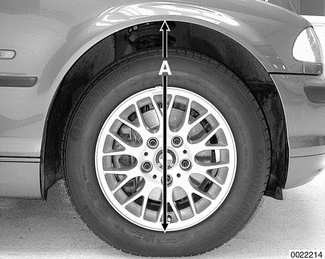

# Troubleshooting (Suspension, Steering and Brakes)

> Source: BMW 3 Series (E46) Repair Manual, section 300-3, Suspension, Steering and Brakes — General chapter (PDF pages 505–510 of 1252).

Stable handling and ride comfort both depend on the integrity of the suspension and steering components. Any symptom of instability or imprecise road feel may be caused by worn or damaged suspension components.

When troubleshooting suspension and steering problems, also consider the condition of tires, wheels and their alignment. Tire wear and incorrect inflation pressures can dramatically affect handling. Subtle irregularities in wheel alignment angles also affect stability. Mixing different types or sizes of tires, particularly on the same axle, can affect alignment and may unbalance a car's handling.

Table d. Suspension and steering troubleshooting lists the symptoms of common suspension and steering problems and their probable causes, and suggests corrective actions. Bold type indicates the repair groups where applicable test and repair procedures can be found.

Table d. Suspension and steering troubleshooting

| Symptom | Probable cause | Repairs |
|---|---|---|
| Breaking away while braking | Worn struts or shock absorbers | Replace struts or shock absorbers. 310, 330 |
| Car pulls to one side, wanders | Incorrect tire pressure | Check and correct tire pressures. 020 |
|  | Incorrect wheel alignment | Check and adjust wheel alignment. 320 |
|  | Faulty brakes (pulls only when braking) | Check for sticking/damaged front caliper. 340 |
|  | Worn struts or shock absorbers | Replace struts or shock absorbers. 310, 330 |
| Front end or rear end vibration or shimmy | Worn suspension bushings (control arm or trailing arm) | Replace worn bushings. 310, 330 |
|  | Worn front suspension ball joints (control arm, steering arm or steering tie-rod end) | Replace worn ball joints. 310 |
|  | Unbalanced or bent wheels/tires Loose wheel lug bolts | Balance tires. Check tires for uneven wear patterns. Check wheels for damage. |
|  | Loose wheel lug bolts | Tighten lug bolts to proper torque. |
| Poor handling, poor directional stability | Rear control arm or rear subframe bushings worn or damaged | Replace rear suspension bushings as necessary. 330 |
|  | Rear alignment incorrect | Check and adjust wheel alignment. 320 |
| Poor stability, repeated bouncing after bumps, suspension bottoms out easily | Worn struts or shock absorbers | Replace struts or shock absorbers. 310, 330 |
| Rear end hop with hard braking | Rear trailing arm bushing worn or damaged | Replace trailing arm bushing. 330 |
| Steering heavy, poor return-to-center | Worn upper strut mounts | Replace strut mounts. 310 |
|  | Incorrect tire pressure | Check and correct tire pressures. 020 |
|  | steering system faulty | Check power steering fluid level. 320 |
| Steering loose, imprecise | Incorrect tire pressure | Check and correct tire pressures. 020 |
|  | Loose steering rack mounting bolt(s) | Inspect and tighten bolts. 320 |
|  | Worn tie rod end(s) | Replace tie rod(s) and align wheels. 320 |
|  | Faulty front wheel bearing | Replace wheel bearing. 310 |
|  | Worn or damaged steering rack | Adjust or replace steering rack. 320 |
|  | Worn tires | Replace tires. |
| Suspension noise, especially over bumps (drumming, rattling) | Worn front upper strut mounts | Replace upper strut mounts. 310 |
|  | Worn suspension bushings (control arm or trailing arm) | Replace worn bushings. 310, 330 |
|  | Worn stabilizer bar rubber mounts | Replace stabilizer bar rubber mounts. 310, 330 |
|  | Loose suspension subframe | Check subframe for damage. Tighten mounting bolts. |
| Tail skid when braking | Rear trailing arm front bushing worn or damaged | Replace trailing arm bushing. 330 |
| Tire flat spots | Worn struts or shock absorbers | Replace struts or shock absorbers. 310, 330 |
| Uneven ride height | Incorrect coil springs | Measure ride height. 300 |
|  | Bent or damaged suspension components | Inspect, repair/replace as necessary. 310, 330 |
|  | Sagging coil springs | Replace springs as necessary. 310, |
|  | Rear subframe bushings worn or damaged | Replace rear suspension bushings as necessary. 330 |
|  | Differential bushings worn or damaged | Replace rear suspension bushings as necessary. 330 |
|  | Rear shock absorbers worn | Replace rear shock absorbers. 330 |
| Wheel noise, continuous growling, may be more noticeable when turning | Worn wheel bearing | Replace wheel bearing. 310, 330 |
| Wheel-hop on normal road surface | Worn struts or shock absorbers | Replace struts or shock absorbers. 310, 330 |
| Unsteady in curves, self-steering, poor rear end stability |  | 330 |

## ABS troubleshooting

ABS is designed to be maintenance free. There are no adjustments that can be made to the system. Repair and troubleshooting of major ABS components requires special test equipment and knowledge and should be performed by an authorized BMW dealer.

ABS is self-tested by the control module each time the car is started. Once the test is complete, the ABS dashboard warning light turns off. If the light remains lit or comes on at any time during driving, a system fault has occurred and ABS is electronically disabled. The conventional braking system remains fully functioning.

When a system or component failure occurs in the electronic braking and stability control systems, either the brake warning light, ABS warning light, or the ASC / DSC warning light will illuminate. Troubleshooting and diagnosis for the electronic braking and stability control systems must be made using an electronic scan tool. Brake bleeding functions, as well as component coding and initialization must be completed using BMW scan tools DIS or MoDiC.

## ABS system inspection

A visual inspection of the ABS system components may help to locate system faults. If no visual faults can be found and the ABS light remains on, have the system diagnosed by an authorized BMW dealer.

Carefully inspect the entire ABS wiring harness, particularly the pulse sensor harnesses and connectors near each wheel. Look for chafing or damage due to incorrectly routed wires.

Carefully remove the wheel speed sensors. Clean the sensor tips. Inspect toothed wheel on wheel hub. Check for missing, clogged or corroded teeth, or other damage that could alter the clearance between the sensor tip and toothed wheel.

## Ride height

Ride height measurement (A) at either axle is taken from center of wheel arch to bottom of wheel rim.

If the ride height is outside the specification listed, new springs should be installed. Be sure to have the old spring code number on hand when ordering new spring.

[Table e]. Front ride height specifications (measurement A) lists front suspension ride height specifications, [Table f]. Rear ride height specifications (measurement A) lists rear suspension ride height specifications. These specifications apply to a car in a normally loaded position. When checking ride height or installing suspension components that require the car to be "normally loaded," load the car as follows:

Normal loaded position

|  |  |
|---|---|
| Each front seat | 68 Kg (150 lbs) |
| Rear seat (center) | 68 Kg (150 lbs) |
| Trunk | 21 Kg (46 lbs) |
| Fuel tank | full |

Table e. Front ride height specifications (measurement A)

| Wheel size | Standard suspension | Sport suspension | Rough road suspension | All wheel drive suspension |
|---|---|---|---|---|
| 15 inch | 576 mm (22.67 in.) | 561 mm (22.08 in.) | 593 mm (23.35 in.) |  |
| 16 inch | 589 mm (23.19 in.) | 574 mm (22.59 in.) | 606 mm (23.86 in.) | 606 mm (23.85 in.) |
| 17 inch | 604 mm (23.77 in.) | 589 mm (23.19 in.) | 621 mm (24.44 in.) | 621 mm (24.44 in.) |
| 18 inch | 617 mm (24.29 in.) | 602 mm (23.71 in.) | 634 mm (24.96 in.) | 634 mm (24.96 in.) |

Maximum variation between sides: 10 mm (0.4 in)
Maximum deviation from specifications: 10 mm (0.4 in)

Table f. Rear ride height specifications (measurement A)

| Wheel size | Standard suspension | Sport suspension | Rough road suspension | All wheel drive suspension |
|---|---|---|---|---|
| 15 inch | 542 mm (21.33 in.) | 526 mm (20.70 in.) | 562 mm (22.12 in.) |  |
| 16 inch | 555 mm (21.85 in.) | 539 mm (21.22 in.) | 575 mm (22.64 in.) | 572 mm (22.52 in.) |
| 17 inch | 570 mm (22.44 in.) | 554 mm (21.81 in.) | 590 mm (23.22 in.) | 587 mm (23.11 in.) |
| 18 inch | 583 mm (22.95 in.) | 567 mm (22.32 in.) | 603 mm (23.74 in.) | 600 mm (23.62 in.) |

Maximum variation between sides: 10 mm (0.4 in)
Maximum deviation from specifications: 10 mm (0.4 in)
