# Tailgate (Sport wagon models)

> Source: BMW 3 Series (E46) Repair Manual, section 412-3, Trunk Lid, Tailgate chapter (PDF pages 773–780 of 1252).

## Tailgate, removing and installing

- Raise complete tailgate. Remove interior trim and disconnect wiring harnesses.
- Disconnect left and right support struts as detailed below.
- While supporting tailgate, remove hinge bolts for tailgate on left and right sides.

> **CAUTION!**
> - The tailgate is very heavy. Use assistance to properly support both sides prior to removal of the hinge bolts.

- Installation is the reverse of removal. Follow alignment procedures as shown below.

Tightening torques

| Tightening torques | |
|---|---|
| Tailgate to tailgate hinge (M8) | 20 Nm (15 ft-lb) |

## Tailgate, emergency release

The tailgate of the E46 Sport Wagon has no key cylinder. An emergency release mechanism is incorporated into the tailgate latch. This allows mechanical opening of the latch in case of an electrical failure. The release is located in the rear cargo area, along the lower edge of the rear apron behind a small access cover.

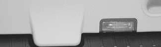

- Working inside car, at base of tailgate:
    - Remove release cover.
    - Push lever toward driver's side (**arrow**).

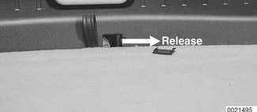

## Tailgate support strut, removing and installing

Open tailgate fully. Support tailgate and remove retaining clips (**arrow**) on upper end of pressurized lifting struts.

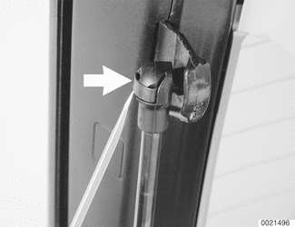

> **CAUTION!**
> - The tailgate is very heavy, and will close without both pressurized lifting struts installed. Properly support tailgate prior to removal of the lifting struts.

- Pull struts off tailgate.

- Remove spring retainer from lower end of support strut and remove strut.

- Installation is reverse of removal. Replace retaining clips if damaged during removal.

## Rear spoiler, removing and installing

- Raise rear window. Remove inner trim from glass panel by releasing clips on trim from retainers (**arrows**). For clarity, trim is removed in photo.

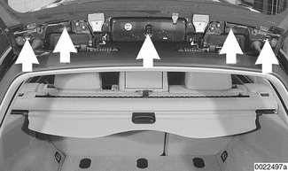

> **Note:**
> - Use two plastic prying wedge tools to release each pin retaining trim.

- Release spoiler mounting bolts (**arrows**). Disconnect wiring to brake light and AM radio antenna and release washer hose. Remove spoiler. (Window shown in place).

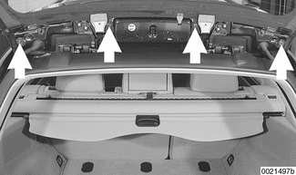

- Installation is the reverse of removal. Replace any waterproofing sheeting disturbed during removal. Adjust spoiler as shown later in this section.

## Rear window, removing and installing

- Remove rear spoiler as detailed above.

- Working at top outside of window, remove waterproofing sheeting over antenna amplifier and disconnect wiring connections. Release tape retaining wiring harnesses.

- Release grounds (**A**) and rubber grommets (**B**, **C**) at both hinges.

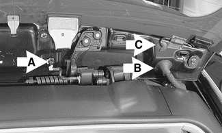

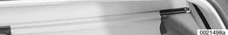

- Support window in open position. Working at top of tailgate, loosen screws (**arrows**) on each window hinge. Note positions of any spacers for reinstallation.

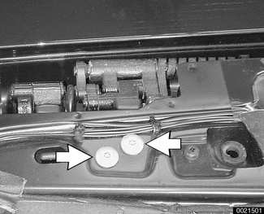

> **CAUTION!**
> - Rear window is heavy. Use a second person to support window prior to releasing from hinges.

- Remove screws and lift off window, taking care to release wiring to rear defroster/antenna.

- Installation is the reverse of removal. Replace waterproofing sheeting where disturbed. Align window as described below.

Tightening torques

| Tightening torques | |
|---|---|
| Hatchback window to hinge (M8) | 16 Nm (12 ft-lb) |

## Alignment of spoiler, rear window and tailgate

Alignment procedures involve adjusting tailgate, window, and spoiler to have equal space between left and right sides and to be flush with body. Measurement locations and specific dimensions are shown.

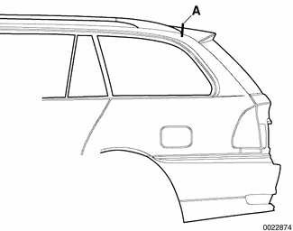

- If alignment has been disturbed during repair adjust fit of tailgate to body. Then adjust fit of rear window to hatch.
- Clearance of the rear window is adjusted by adding or removing shims between hinge bracket and rear window (maximum of three shims).
- Adjust spoiler gap to body last. Height of spoiler is set by alignment of the rear hatch. Gap of spoiler to body is set by adjusting spoiler attachment bolts.

Seam clearance specification

| Seam clearance specification | |
|---|---|
| Rear spoiler to roof (**A**) | 4.25 - 5 mm (0.167 - 0.197 in.) |
| Max. deviation from parallel | 0.5 mm (0.019 in.) |

- Lateral and vertical alignment is adjusted using hinge bolts for window and tailgate. Fine adjustment of the tailgate to the body is made using rubber stop buffers and latch assembly.

Tailgate and rear window position gap adjustment

| Tailgate and rear window position gap adjustment | |
|---|---|
| Rear spoiler / side panel (**A**) | 3.75 ± 1.3 mm (0.15 ± 0.05 in.) |
| Rear window / side panel (**B**) | 3.5 ± 1.4 mm (0.14 ± 0.06 in.) |
| Tailgate / side panel (**C**) | 3.6 ± 0.75 mm (0.14 ± 0.03 in.) |
| Tailgate / side panel (height) (**D**) | flush to 2 mm (0.08 in.) lower |
| Tailgate light / corner light (**D**) | 4.25 ± 0.75 mm (0.17 ± 0.03 in.) |
| Tailgate / rear bumper (**E**) | 5 ± 1 mm (0.2 ± 0.04 in.) |
| Rear window / tailgate (**F**) | 4 ± 1 mm (0.16 ± 0.04 in.) |
| Rear window / tailgate (**G**) | 5.4 ± 1 mm (0.21 ± 0.04 in.) |

### To adjust fit of tailgate to body:

- Close tailgate and open rear window.
- Tailgate hinge bolts (**A**, behind trim) should be centered both vertically and horizontally within their adjustment range. When centered, tighten bolts.

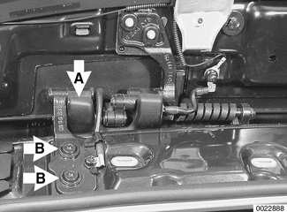

- Loosen screws (**B**) on left and right to adjust horizontal location (gap on left and right). When gap is correct, tighten screws.
- To prevent damage or poor operation adjustments must be made to the rear window if the vertical adjustment of the tailgate is changed.
- Window hinge must be parallel to the tailgate hinge.

- Stop buffers (**arrows**) are adjustable and set height between tailgate and body at sides.

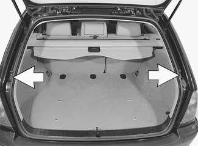

- To adjust buffers, remove inner trim panel and loosen lock nut. Initially adjust buffers to just contact tailgate when closed, then tighten buffers one turn. Tighten lock nut.

Tightening torques

| Tightening torques | |
|---|---|
| Lock nut for stop buffer (M8) | 15 Nm (11 ft-lb) |

- Loosen screws (**arrows**) and reposition rear latch to further adjust gap between tailgate and body at sides, and to assure smooth operation.

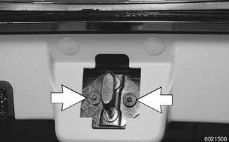

### To adjust striker position:

- Close tailgate slowly, allowing striker to center itself on lock. Striker must not touch lock housing.
- Tighten striker mounting bolts, then check tailgate to body gaps as shown below.

> **Note:**
> - Do not lubricate lock or lock striker with grease.

- Inspect plastic guides (**arrows**) on lock assembly for damage or wear, and replace if necessary. Trim panel is removed for clarity.

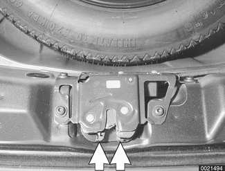

- The rear window lock striker height is adjusted by loosening lock nut **A**, then turning striker in or out. Retighten lock nut when window latch operates smoothly.

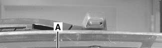

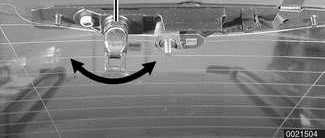

- To adjust rear window lock position, initially loosen lock mounting bolts (**arrows**).
- Close window slowly, allowing lock to center itself on striker.
- Tighten mounting bolts, then check rear window to body gaps as shown above.

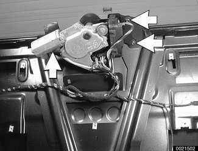
