# Tools

> Source: BMW 3 Series (E46) Repair Manual, section 010-7 (PDF pages 13–19 of 1252).

Most maintenance can be accomplished with a small selection of the right tools. Tools range in quality from inexpensive junk, which may break at first use, to very expensive and well-made tools for the professional. The best tools for most do-it-yourself BMW owners lie somewhere in between.

Many reputable tool manufacturers offer good quality, moderately priced tools with a lifetime guarantee. These are your best buy. They cost a little more, but they are good quality tools that will do what is expected of them. Sears' Craftsman® line is one such source of good quality tools.

Some of the repairs covered in this manual require the use of special tools, such as a custom puller or specialized electrical test equipment. These special tools are called out in the text and can be purchased through an authorized BMW dealer. As an alternative, some special tools mentioned may be purchased from the following tool manufacturers and/or distributors:

- Assenmacher Specialty Tools — 6440 Odell Place, Boulder, CO 80301, 303-530-2424, http://www.asttool.com
- Baum Tools Unlimited, Inc. — P.O. Box 5867, Sarasota, FL 34277-5867, 800-848-6657, http://www.baumtools.com
- Schley Products, Inc. — 5350 E. Hunter Ave., Anaheim Hills, CA 92807, 714-693-7666, http://www.sptool.com
- Zelenda Machine and Tool Corp. — 65-60 Austin Street, Forest Hills, NY 11374-4695, 718-896-2288, http://www.zelenda.com

## Basic tool requirements

The basic hand tools described below can be used to accomplish most of the simple maintenance and repair tasks.

**Screwdrivers.** The common flat-blade type and the Phillips type will handle almost all screws used on BMWs. Two or three different sizes of each type will be required, since a screwdriver of the wrong size will damage the screw head.

A complete set of screwdrivers should also include Torx® type screwdrivers.

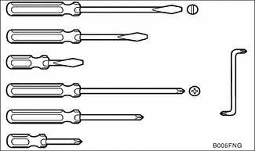

**Wrenches.** Wrenches come in different styles, including open-end, 12-point box-end, 6-point box-end and flare nut. The basic open-end wrench is the most widely used, but grips on only two sides. The box-end wrench has better grip on all six sides of a nut or bolt.

A 12-point box-end can loosen a nut or bolt where there is less room for movement, while a 6-point box-end provides better grip. For hex fasteners on fluid lines, like brake lines and fuel lines, a flare-nut wrench offers the advantages of a box-end wrench with a slot that allows it to fit over the line.

The combination wrench is the most universal. It has one open-end and one box-end. 10 mm and 13 mm wrenches are the most common sizes needed. A more complete set of wrenches would include 6 mm through 19 mm sizes.

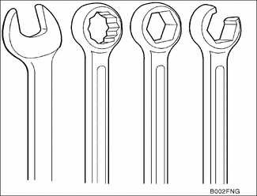

**Sockets.** Sockets are used with a ratchet handle for speed and convenience and can be combined with extensions and universal joints (swivels) to reach fasteners more easily. The most common drive sizes are 1/4 in., 3/8 in., and 1/2 in.

Sockets come in 6-point and 12-point styles. The 6-point offers a better grip on tight nuts and bolts. 6mm to 19mm sockets are the most needed sizes. Below is a list of typical bolt diameters and the corresponding wrench sizes.

Common bolt diameters and wrench sizes

| Bolt diameter | Wrench size |
|---|---|
| M5 | 8 mm |
| M6 | 10 mm |
| M8 | 12 mm or 13 mm |
| M10 | 17 mm |
| M12 | 19 mm |
| M14 | 22 mm |

**Spark plug socket.** A special socket for spark plugs is the correct size, is deep enough to accommodate a spark plug's length, and includes a rubber insert to both protect the spark plug from damage and grip it for easier removal.

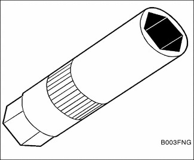

**Pliers.** There are many types of pliers including snap-ring, needlenose, adjustable-joint, slip-joint (Channellock®), and locking (ViseGrip®) most of which are used for holding irregular objects, bending, or crimping. Some have special applications.

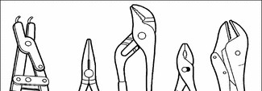

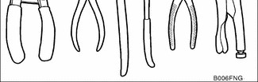

Needlenose pliers are used for gripping small and poorly accessible objects, and are useful for wiring and other electrical work. Locking pliers such as the Vise-Grip® are useful because of their tight grip.

Snap-ring and circlip pliers with special tipped jaws are used to remove and install snap-rings or circlips.

Channel-lock® or water pump pliers have adjustable jaws that can be quickly changed to match the size of the object being held to give greater leverage.

An adjustable wrench can be a useful addition to a small tool kit. It can substitute in a pinch if two wrenches of the same size are needed to remove a nut and bolt. Use extra care with adjustable wrenches, as they tend to loosen, slip, and damage fasteners. Compared to a wrench of the correct size, an adjustable wrench is always second best. They should only be used when the correct size wrench is not available. Choose one of average size range, about 6 to 8 inches in length.

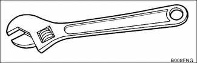

## Jack stands

Strong jack stands are extremely important for any work that is done under the car. Use only jack stands that are designed for the purpose. Blocks of wood, concrete, bricks, etc. are not safe or suitable substitutes.

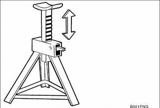

> **WARNING!**
> - A jack should be used only to raise the vehicle and should not be used to support the car for a long period. Always use jack stands to support a raised vehicle.

Jack stands are available in several styles. The best ones are made of heavy material for strength, have a wide base for stability, and are equipped to positively lock in their raised positions. Get the best ones available.

## Oil change equipment

Changing engine oil requires a 17 mm socket or wrench to loosen and tighten the drain plug and a drain pan (at least 8 qt. capacity). A wide, low drain pan will fit more easily under the car. Use a funnel to pour the new oil into the engine.

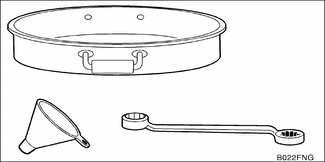

The M52/M54 engines use an oil filter canister with a disposable filter cartridge insert. Therefore, an oil filter wrench is not required. See [020 Maintenance] for oil change instructions.

## Feeler gauges

Feeler gauges are thin metal strips of precise thickness, used to measure small clearances. They are normally available as a set, covering a range of sizes.

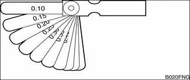

## Torque wrench

A torque wrench is used to precisely tighten threaded fasteners to a predetermined value. Many of the repair procedures in this manual include BMW-specified torque values in Newton-meters (Nm) and the equivalent values in foot-pounds (ft-lb).

Several types of torque wrenches are available. An inexpensive beam-type (top) is adequate but must be read visually. A ratchet-type (bottom) can be preset to indicate (click) when the torque value has been reached. They all do the same job, but offer different convenience features at different prices. The most convenient ones have a built-in ratchet, and can be preset to indicate when a specific torque value has been reached. Follow the wrench manufacturer's directions for use to achieve the greatest accuracy.

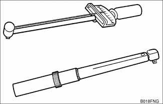

A torque wrench with a range up to about 150 Nm (185 ft-lb) has adequate capacity for most of the repairs covered in this manual. For recommended torque values of 10 Nm or below, the English system equivalent is given in inch-pounds (in-lb). These small values may be most easily reached using a torque wrench calibrated in inch-pounds. To convert inch-pounds to foot-pounds, divide by 12.

## Digital multimeter

Many of the electrical tests in this manual call for the measurement of resistance (ohms) or voltage values. For safe and accurate tests of sensitive electronic components and systems, a multimeter or Digital Volt/Ohmmeter (DVOM) with high input impedance (at least 10,000 ohms) should be used.

Some meters have automotive functions such as dwell and pulse width that are useful for troubleshooting ignition and fuel injection problems.

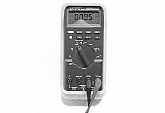

> **CAUTION!**
> - Vehicle electronic systems may be damaged by the high current draw of a test light with a normal incandescent bulb. As a general rule, use a high impedance digital multimeter or an LED test light for all electrical testing.

## BMW special tools

Many repairs covered in this manual call for the use of BMW special tools. This, however, does not automatically mean that the job is too complicated or out of reach of the do-it-yourselfer. Many of the BMW special tools mentioned in this manual are simply the best thing to use to do the job correctly. In these cases, the tool is identified with a BMW part number. See your authorized BMW dealer parts department for information on how to order special tools.

There are some jobs for which expensive special tools are essential, and not a cost-effective purchase for one-time repair by the do-it-yourself owner. This manual includes such repairs for the benefit of those with the necessary experience and access to tools. For the do-it-yourselfer, the need for special tools is noted in the text, and whether or not BMW dealer service is recommended.
