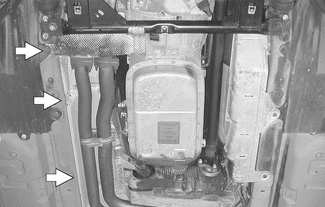
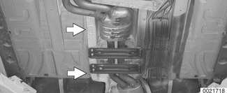
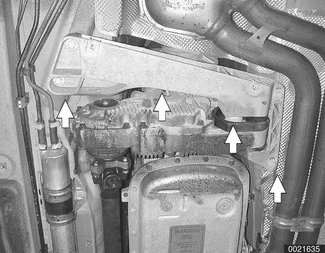
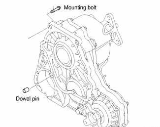

# Transfer Case

> Source: BMW 3 Series (E46) Repair Manual, section 270-2, Transfer Case chapter (PDF pages 471–473 of 1252).

## Transfer case, removing and installing

- Raise vehicle and safely support to access transfer case.

> **WARNING!**
> - When raising the car using a floor jack or a hydraulic lift, carefully position the jack pad to prevent damaging the car body. A suitable liner (wood, rubber, etc.) should be placed between the jack and the car to prevent body damage.
> - Watch the jack closely. Make sure it stays stable and does not shift or tilt. As the car is raised, the car may roll slightly and the jack may shift.

- Remove engine splash guard from underside of vehicle.
- Remove exhaust system. See [180 Exhaust System].
- Remove exhaust system heat shields (arrows).

- Remove front drive shaft. See [260 Driveshaft].
- Support transmission with transmission jack or suitable shop hoist.
- Remove transmission crossmember (arrows).

- Detach transfer case vent tube.
- Keeping the driveshaft in place, remove nuts retaining rear driveshaft to transfer case at flexible disc.

> **CAUTION!**
> - Do not allow the driveshaft to hang down. This may damage universal joints at drive shaft ends.

- Support rear driveshaft center bearing and release mounting nuts.
- Lower rear driveshaft at center bearing and remove from transmission output flange at flexible disk. Support from vehicle body using stiff wire.
- Remove bolts retaining transfer case to transmission and remove transfer case.

- Installation is reverse of removal, noting the following:
    - Replace dowel pins in transfer case mounting surface if damaged.
    - Coat dowel pins with anti-seize before installing.
    - On manual transmission cars: Replace sealing O-ring between transmission and transfer case.

> **Note:**
> - When refilling transfer case, recheck oil level again after driving car approximately 200 meters (600 ft).

Tightening torques

| Component | Tightening torque |
|---|---|
| Transmission crossmember to body (M8) | 21 Nm (15 ft-lb) |
| Transfer case to transmission (M10) | 41 Nm (30 ft-lb) |
| Transfer case filler plug (M18) | 33 Nm (24 ft-lb) |

Fluid capacities

| Application | Capacity |
|---|---|
| Transfer case oil change | 0.16 liter (0.16 qt.) |
| New transfer case fill | 0.24 liter (0.25 qt.) |
