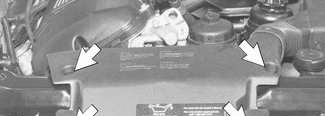
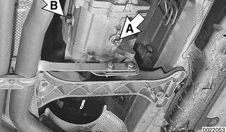

# Transmission Fluid Service

> Source: BMW 3 Series (E46) Repair Manual, section 230-2, Manual Transmission chapter (PDF pages 410–411 of 1252).

Manual transmissions installed in the 3 Series are normally filled with a "Lifetime" manual transmission fluid (BMW MTF LT-1) and do not require periodic fluid changes. Transmissions filled with MTF LT-1 lifetime oil are identified with a yellow label near the transmission fill plug labeled "Lifetime Oil MTF-LT-1".

## Transmission fluid level, checking

Checking the transmission fluid level involves simply removing the side fill plug and inserting a finger into the hole to check the fluid level. If the fluid level is up to the bottom of the fill hole (finger is wetted by transmission fluid), the level is correct.

## Transmission fluid, replacing

- Drive vehicle for a few miles to warm transmission.
- Raise and safely support vehicle to access drain plug.

> **CAUTION!**
> - Make sure the car is stable and well supported at all times. Use a professional automotive lift or jack stands designed for the purpose. A floor jack is not adequate support.

- Place a drain pan under transmission and remove drain plug (A) at bottom of transmission.

- Install and torque drain plug.
- Remove fill plug (B) from side of transmission.
- Slowly fill transmission with fluid until fluid overflows fill hole.
- Install and torque fluid fill plug.

Fluid capacity

| Transmission | Capacity |
|---|---|
| Getrag transmission | 1.0 liter (1.1 US qts) |
| ZF transmission | 1.2 liters (1.3 US qts) |

Tightening torque

| Component | Tightening torque |
|---|---|
| Transmission drain or fill plug | 50 Nm (37 ft-lb) |
