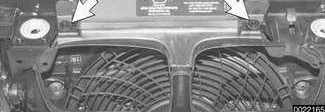
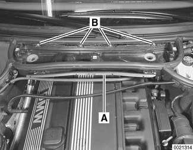
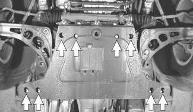
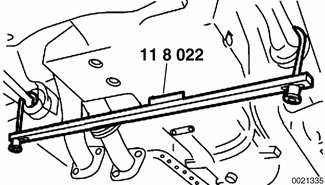
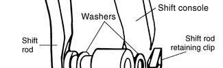
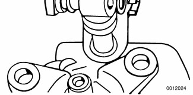
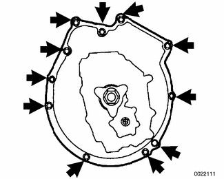
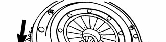
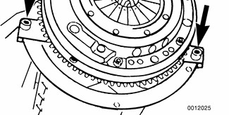

# Transmission Removal and Installation

> Source: BMW 3 Series (E46) Repair Manual, section 230-4, Manual Transmission chapter (PDF pages 420–425 of 1252).

Removal and installation of the transmission is best accomplished on a lift using a transmission jack. The engine must be supported from above using appropriate support equipment. This allows the engine to pivot on its mounts to access the upper Torx-head bolts at the bellhousing.

> **WARNING!**
> - Make sure the car is stable and well supported at all times. Use a professional automotive lift or jack stands designed for the purpose. A floor jack is not adequate support.
> - The removal of the transmission may upset the balance of the vehicle on a lift.

## Transmission, removing and installing

- Disconnect negative (-) cable from battery.

> **CAUTION!**
> - Prior to disconnecting the battery, read the battery disconnection cautions given at the front of this manual on page viii.

- Remove engine cooling intake hood fasteners (arrows) at front of engine compartment.

- Remove housing for interior ventilation microfilter.
    - Remove upper cover and microfilter.
    - Open wiring harness loom cover (A) and remove wires.
    - Unfasten screws (B) and remove lower microfilter housing.

- Remove heater bulkhead cover.
    - Remove engine compartment side trim panel. Turn locking knobs (A) and slide trim panel from mounting lip.
    - Remove heater bulkhead cover mounting screws (B) and lift cover up and out from firewall.

- Raise and safely support vehicle.
- Remove engine splashguard from underside of vehicle.
- Remove front suspension reinforcement bolts (arrows). Remove reinforcement (coupe shown) and front axle subframe.

> **Note:**
> - Tubular style front end reinforcements are used in rear wheel drive 3 Series sedans and wagons built up to 11/00 and coupes built up to 10/99.
> - Pan style front end reinforcements are used on rear wheel drive sedans and wagons built after 12/00, coupes built after 11/99 and all convertibles.
> - All wheel drive models require no reinforcement due to the construction of the front subframe.

- Attach BMW special tool 11 8 022 to left and right lower control arms. Tighten knurled screws until tool makes contact with engine oil pan.

- Support transmission with transmission jack. Remove reinforcing cross brace from below engine/transmission.
- Disconnect harness connector from back-up light switch on transmission.
- Remove exhaust system and heat shield. See [180 Exhaust System].
- Remove driveshaft. See [260 Driveshaft].
- On all wheel drive vehicles: Remove transfer case. See [270 Transfer Case].
- Disconnect shift rod from selector shaft coupling.
- Disconnect shift console from top of transmission. See [250 Gearshift Linkage].

- Unbolt clutch slave cylinder from side of transmission. Do not disconnect fluid hose. Suspend slave cylinder from chassis using stiff wire.

> **CAUTION!**
> - Do not operate clutch pedal with slave cylinder removed from transmission.

- Loosen knurled screws of BMW special tool 11 8 022 until transmission/engine assembly is just above, but not in contact with fire wall and heater connections.

> **CAUTION!**
> - Tilting the engine to lower the transmission can lead to damage to various components due to lack of clearance at rear of engine. Remove brake fluid reservoir if necessary.

- Remove transmission mounting Torx-head bolts (arrows). Note length and location of bolts.

- Remove transmission by pulling backward until the transmission input shaft clears the clutch disc splines, then pull downwards. Lower jack and remove transmission.

- Installation is reverse of removal, keeping in mind the following:
    - When installing a new transmission, be sure to transfer parts from old transmission if applicable.
    - Thoroughly clean input shaft and clutch disc splines. Lightly lubricate transmission input shaft before installing.
    - Be sure bellhousing dowels (arrows) are correctly located.
    - Center rear of transmission in driveshaft tunnel before tightening transmission support bracket.
    - Always replace front end reinforcement mounting fasteners on vehicles equipped with the plate style reinforcement.
    - Install driveshaft and preload center bearing bracket. Use new nuts when mounting driveshaft to transmission/flex disc and final drive. See [260 Driveshaft].
    - Refill transmission with appropriate lubricant before starting or towing the car. See [Transmission Fluid Service] earlier in this repair group.

> **Note:**
> - Torx-head mounting bolts should always be used with washers to prevent difficult removal in the future.

Tightening torques

| Component | Tightening torque |
|---|---|
| Front end reinforcement to chassis and subframe (M10), (tubular style) | 42 Nm (31 ft-lb) |
| Front end reinforcement to chassis and subframe (M10), (pan style) | 59 Nm (44 ft-lb) + 90° |
| Rubber mount to transmission or bracket nut (M8) | 21 Nm (15 ft-lb) |
| Slave cylinder to transmission | 22 Nm (16 ft-lb) |
| Transmission crossmember to chassis, M8 | 21 Nm (15 ft-lb) |
| Transmission to engine (Torx-head), M8 | 22 Nm (16 ft-lb) |
| Transmission to engine (Torx-head), M10 | 43 Nm (32 ft-lb) |
| Transmission to engine (Torx-head), M12 | 72 Nm (53 ft-lb) |
| Transmission drain/fill plug | 50 Nm (37 ft-lb) |
