# Transmission Service

> Source: BMW 3 Series (E46) Repair Manual, section 230-3, Manual Transmission chapter (PDF pages 412–419 of 1252).

## Back-up light switch, replacing

Raise and safely support vehicle to access back-up light switch. Unscrew switch from transmission.

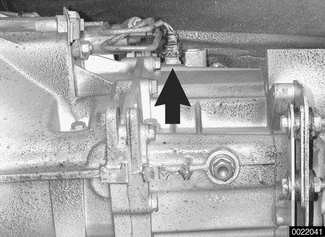

> **Note:**
> - The back-up light switch (arrow) on Getrag transmissions is in the left side of the transmission.
> - The back-up light switch on ZF transmission is in the right front of the transmission.

- Install new switch.
- Check transmission fluid level before lowering vehicle.

Tightening torque

| Component | Tightening torque |
|---|---|
| Back-up light switch to transmission | 20 Nm (15 ft-lb) |

## Selector shaft seal, replacing (transmission installed)

- Raise and safely support vehicle.
- Support transmission with transmission jack.
- On rear wheel drive cars:
    - Remove driveshaft. See [260 Driveshaft].
    - Remove transmission mount bolts (A).
    - Remove transmission crossmember bolts (B) and tilt down rear of transmission.
- On all wheel drive cars:
    - Remove front and rear driveshafts. See [260 Driveshaft]
    - Remove transfer case crossmember bolts (arrows) and remove transfer case. See [270 Transfer Case].

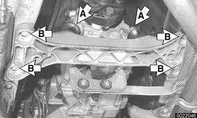

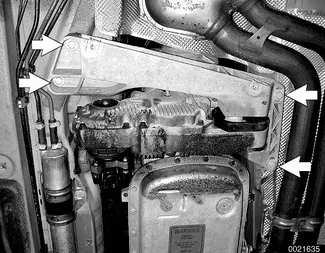

> **CAUTION!**
> - Tilting the engine to lower the transmission can lead to damage to various components due to lack of clearance.

- Working at rear of selector shaft, pry snap ring (A) out of groove with a small screwdriver. Push snap ring towards gear selector rod joint and drive out pin (B).

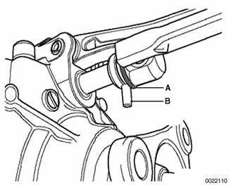

- Carefully pry out selector shaft oil seal with a narrow seal remover or small screwdriver.

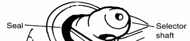

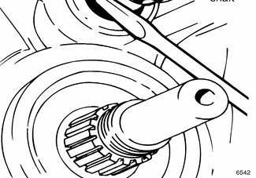

- Coat new selector shaft seal with transmission fluid. Drive new seal in flush with housing. Use BMW special seal installation tool 23 1 140 or equivalent and a soft-faced (plastic) hammer.

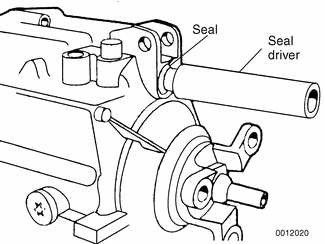

- Installation is reverse of removal, noting the following:
    - Install driveshaft using new lock nuts.
    - Check transmission oil level, topping up as necessary.

Tightening torques

| Component | Tightening torque |
|---|---|
| Center bearing (driveshaft) to body | 21 Nm (15 ft-lb) |
| Clamping sleeve (driveshaft) | 10 Nm (89 in-lb) |
| Driveshaft to final drive flange, With U-joint (M10 ribbed nut) | 80 Nm (59 ft-lb) |
| Driveshaft to final drive flange, With U-joint (M10 compressed nut) | 64 Nm (47 ft-lb) |
| Flex-disc to driveshaft or transmission flange, M10 (8.8 grade) | 48 Nm (35 ft-lb) |
| Flex-disc to driveshaft or transmission flange, M10 (10.9 grade) | 60 Nm (44 ft-lb) |
| Flex-disc to driveshaft or transmission flange, M12 (10.9 grade) | 100 Nm (74 ft-lb) |
| Transmission / transfer case crossmember to chassis (M8) | 21 Nm (15 ft-lb) |
| Transfer case to transmission (M10) | 41 Nm (30 ft-lb) |

## Output shaft seal, replacing (transmission installed)

- Raise and safely support vehicle.
- Support transmission with transmission jack.
- On rear wheel drive cars:
    - Remove driveshaft. See [260 Driveshaft].
    - Remove transmission mount bolts (A).
    - Remove transmission crossmember bolts (B) and tilt down rear of transmission.
- On all wheel drive cars:
    - Remove front and rear driveshafts. See [260 Driveshaft]
    - Remove transfer case crossmember bolts (arrows) and remove transfer case. See [270 Transfer Case].

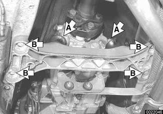

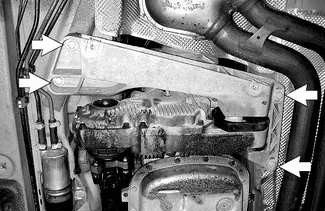

> **CAUTION!**
> - Tilting the engine to lower the transmission can lead to damage to various components due to lack of clearance.

- Bend back and remove transmission output collar nut lockplate.
- Remove collar nut with 30 mm thin-walled deep socket. Counterhold output flange to prevent it from turning.
- Remove output flange. If necessary, use a puller.

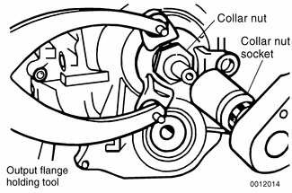

- Use a seal puller to remove seal from transmission housing.

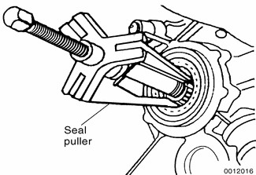

- Coat new seal with transmission fluid and drive into position until it is flush with housing. Use seal driver (BMW special tool 23 2 300) or equivalent.

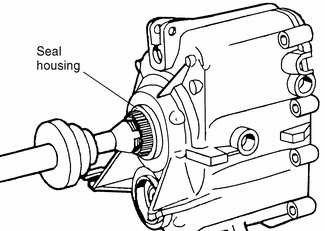

- Reinstall output flange (and shims, if applicable) to output shaft.

> **Note:**
> - On Getrag S5D 250G transmissions BMW recommends heating the output flange to about 176F (80C) to aid in installation. This can be done by placing the flange in hot water.

- Coat bearing surface of collar nut with sealer and install nut. Tighten collar nut in two stages. Install new lockplate. Bend tabs into flange grooves.

> **Note:**
> - BMW recommends the use of a sealer such as Loctite® 242 when installing the flange collar nut to prevent oil from leaking past the threads.

- Installation is reverse of removal, noting the following:
    - Install driveshaft using new nuts. See [260 Driveshaft].
    - Check transmission and transfer case fluid level, if applicable, topping up as necessary.

Tightening torque

| Component | Tightening torque |
|---|---|
| Transmission crossmember to chassis, M8 | 21 Nm (15 ft-lb) |
| Transmission output flange to output shaft, Stage I | 190 Nm (140 ft-lb) |
| Transmission output flange to output shaft, Stage II (after loosening) | 120 Nm (89 ft-lb) |

## Input shaft seal, replacing (transmission removed)

Replacement of the input shaft seal requires the removal of the transmission from the vehicle as described later in this repair group.

- Remove clutch release bearing and release lever from inside bellhousing.
- Remove bolts (arrows) for clutch release-bearing guide sleeve, noting bolt lengths (Getrag transmission shown). Remove sleeve and any spacers (shims) under it.

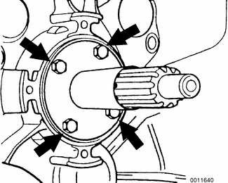

- With transmission on a workbench, remove input shaft seal cover from inside bell-housing.
- Locate two indents (arrows) in seal. Thread a slide hammer seal puller at indents, pull seal and remove seal.

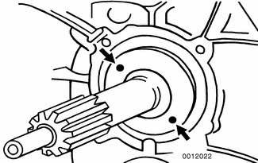

- Use care not to scratch or damage input shaft. Use a protective sleeve or tape the shaft when removing and installing the seal.
- Lubricate new seal with transmission oil and drive into place using an appropriate drift.
- Thoroughly clean guide sleeve mounting bolts, sealing surfaces, and threads in case. Apply sealer (Loctite® 242 or equivalent) to guide sleeve sealing surface and bolts. Reinstall guide sleeve and spacer(s).

Tightening torque

| Component | Tightening torque |
|---|---|
| Guide sleeve to transmission, M6x12 bolt | 10 Nm (89 in-lb) |
