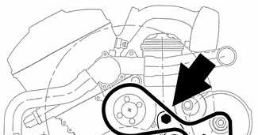
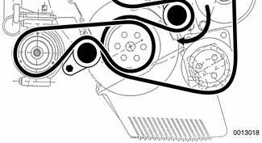
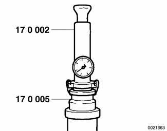

# Troubleshooting (Radiator and Cooling System)

> Source: BMW 3 Series (E46) Repair Manual, section 170-2, Radiator and Cooling System chapter (PDF pages 366–370 of 1252).

Begin the diagnosis of cooling system problems with a thorough visual inspection. If no visual faults are found, it is recommended that the DME system be checked for stored diagnostic fault codes (DTCs) using BMW scan tools DIS (Diagnostic Information System) or MoDiC (Mobile Diagnostic Computer) or an aftermarket equivalent.

Common cooling system faults can be grouped into one of four categories:

- Cooling system leaks
- Poor coolant circulation
- Radiator cooling fan faults
- Electrical/electronic faults

Be sure to check the condition and tension of the coolant pump drive belt. Check hoses for cracks or softness. Check clamps for looseness. Check the coolant level and check for evidence of coolant leaks from the engine.

Check that the radiator fins are not blocked with dirt or debris. Clean the radiator using low-pressure water or compressed air. Blow outward, from the engine side out.

To check coolant pump:

- Lever tensioner clockwise using wrench on hex (large arrow) and slip belt off pulley.
- Firmly grasp opposite sides of pulley and check for play in all directions.
- Spin pulley and check that shaft runs smoothly without play.

> **Note:**
> - The coolant provides lubrication for the pump shaft, so an occasional drop of coolant leaking from the pump is acceptable. If coolant drips steadily from the vent hole, the pump should be replaced.

The cooling system becomes pressurized at normal operating temperature, which raises the boiling point of the coolant. Leaks may prevent the system from becoming pressurized, allowing the coolant to boil at a lower temperature. If visual evidence is inconclusive, a cooling system pressure test can help to pinpoint hard-to-find leaks.

If the cooling system is full of coolant and holds pressure, the next most probable causes of overheating are:

- Faulty radiator fan or DME control circuit. Use an appropriate scan tool to interrogate the DME control module for faults.
- Loose or worn drive belt.
- Failed thermostat or coolant pump impeller. Some pumps may be fitted with plastic impellers.
- Clogged/plugged radiator or coolant passages.

## Cooling system pressure test

A cooling system pressure test is used to check for internal leaks. Some of the common sources of internal leaks are a faulty cylinder head gasket, a cracked cylinder head, or a cracked cylinder block.

To do a cooling system pressure test, a special pressure tester is needed.

> **WARNING!**
> - At normal operating temperature the cooling system is pressurized. Allow the system to cool before opening. Release the cap slowly to allow safe release of pressure.

- With engine cold, install pressure tester (BMW special tools 17 0 002/17 0 005 or equivalent) to expansion tank.

- Pressurize system to specification listed in [Table a].
- Pressure should not drop more than 0.1 bar (1.45 psi) for at least two minutes.
- If pressure drops rapidly and there is no sign of external leakage, cylinder head gasket may be faulty. Perform compression and leak-down tests as described in [100 Engine–General]
- Also test expansion tank cap using pressure tester and correct adapter (BMW special tool 17 0 007 or equivalent). Replace faulty cap or cap gasket.

Table a. Cooling system test pressures

| Component | Test pressure |
|---|---|
| Radiator | 1.5 bar (21.75 psi) |
| Radiator cap | 2 bar (29 psi) |

> **CAUTION!**
> - Exceeding the specified test pressure could damage the radiator or other system components.

## Combustion chamber leak test

- If you suspect that combustion chamber pressure is leaking into the cooling system past the cylinder head gasket, use an exhaust gas analyzer to test the vapors rising from the coolant at the expansion tank.

> **CAUTION!**
> - Use an extension tube above the reservoir neck to maintain distance between the top of the coolant and the gas analyzer nozzle. The gas analyzer is easily damaged if it is allowed to inhale liquid coolant.
> - While running engine to check for causes of overheating, observe coolant temperature carefully in order to avoid engine damage.

## Thermostat, checking

If the engine overheats or runs too cool and no other cooling system tests indicate trouble, the electrically heated thermostat may be faulty.

Check for thermostat diagnostic fault codes (DTCs) using BMW scan tools DIS or MoDiC or equivalent. DTCs pertaining to cooling system malfunctions are listed in [Table b]. See also [OBD On Board Diagnostics] at the back of this manual.

Table b. Cooling system fault codes

| BMW fault code | Explanation | Possible cause(s) |
|---|---|---|
| 10 | Engine coolant temperature out of predefined range | Faulty thermostat or cooling fan. Faulty wiring to cooling fan or thermostat. |
| 222 | Insufficient coolant temperature signal to permit closed loop operation | Faulty thermostat. Faulty thermostat electrical circuit. |
