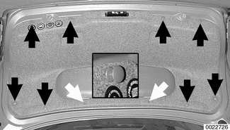
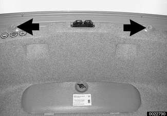
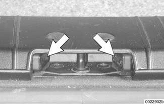
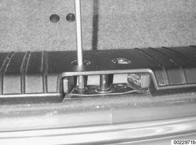
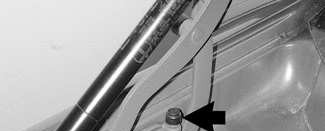
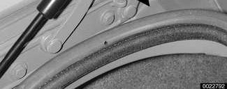
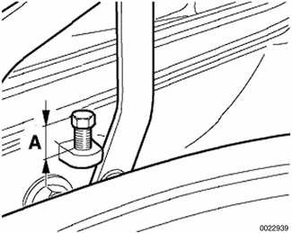
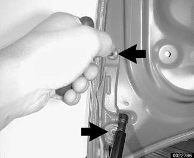
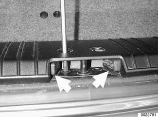
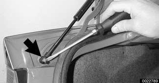

# Trunk Lid

> Source: BMW 3 Series (E46) Repair Manual, section 412-2, Trunk Lid, Tailgate chapter (PDF pages 767–772 of 1252).

## Trunk lid, removing and installing

- Raise trunk lid.
- Open tool kit and remove screws attaching tool kit to trunk lid (**white arrows**).
- Unclip retaining strap at trunk lid and remove tool kit.
- Remove insulating liner expansion rivets (**black arrows**), by prying upper portion out (**inset**).
- Remove trunk liner.

- Disconnect electrical harness connectors from components and remove wiring harness from trunk lid.
- While supporting trunk lid, loosen top hinge screws (**arrows**) and remove lower screws from left and right sides.

> **Note:**
> - Before loosening hinge bolts, mark hinge and hinge bolt locations for reinstallation.

- Installation is reverse of removal. If necessary, align trunk lid to body as described next.

## Trunk lid, aligning

- Raise trunk lid. Working at lower corners of trunk lid, unscrew out rubber buffers (**arrows**) on left and right sides.

- Inspect pads (**arrows**) on each side of latch assembly for damage or wear and replace if necessary.

- Remove protective caps at trunk lower trim panel and loosen screws of trunk lock until it can be moved.

- Check stop screw at trunk lid hinge: If stop screw has a round plastic head, cut or grind off bolt head. If head is removed, replace round headed stop screw with flat head screw and protective cap.

- If stop screw has removable protective cap (**arrow**) remove protective cap from stop screw.

- Adjust stop screw so that head is set to (**A**) 10 mm (0.40 in.) above bore height.

### To adjust trunk lid gap at rear fender:

- Loosen bolts retaining trunk hinge to trunk lid (**arrows**) until trunk lid is just able to move.
- If range of adjustment is insufficient, loosen lower bolts on trunk hinge.
- Once trunk lid gap is within specification, tighten trunk hinge to lid bolts.

Trunk lid gap specification

| Trunk lid gap at rear fender | 4.25 ± 0.75 mm (0.17 ± 0.03 in.) |
|---|---|

> **CAUTION!**
> - Before closing trunk lid, be sure that trunk lid and body are not damaged.

### To adjust trunk lid at lock:

- Remove protective caps from trim panel and loosen screws retaining latch assembly until it can just be moved.
- Inspect pads (**arrows**) on each side of latch assembly for damage or wear and replace if necessary.

- Insert key in trunk lock, and hold key in unlock position to prevent lock from closing. Close trunk lid to center latch assembly.
- Open trunk lid and tighten screws retaining latch. Replace protective caps on trim panel.
- Check adjustment of trunk lid and lock, repeat adjustment process if necessary.

- Screw in trunk lid detent buffers until left and right sides of lid rest on buffers with trunk lid closed.

> **CAUTION!**
> - Top surface of trunk lid must not protrude above top lip of fenders or height adjustment can be distorted.

- Gently twist detent buffer ejector clockwise with screwdriver to unlock buffer and release ejector.

### To adjust stop screw at trunk lid hinge:

- Working at trunk lid hinge, set stop screw to a height of 10 mm (0.40 in.). Place a strip of paper on top of stop screw, and gently close trunk lid.
- Adjust height of stop screw until paper strip can be removed with slight resistance. Once stop screw height has been adjusted, lower adjusted height of stop screw 2.5 mm (0.1 in.) to accommodate for stop screw protective cap.
- Fit protective cap on stop screw. Check that trunk lid is in correct position, adjust if necessary.

> **CAUTION!**
> - Excessive force should not be needed to close trunk lid.

- Set gap measurements as listed below.

Trunk position gap adjustment

| Trunk position gap adjustment | |
|---|---|
| Trunk lid / trunk panel (**A**) | 5 ± 1.5 mm (0.2 ± 0.06 in.) |
| Trunk lid / rear fender (**B**) | 4.25 ± 0.75 mm (0.17 ± 0.03 in.) |

## Trunk lid support strut, removing and installing

> **WARNING!**
> - Make sure to support trunk lid before removing strut.

- Open trunk lid and support in open position. Remove spring clips (**arrows**) from support strut ends.

- Remove strut from trunk lid.

- Installation is reverse of removal. Replace retaining clips damaged during removal.
