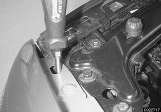
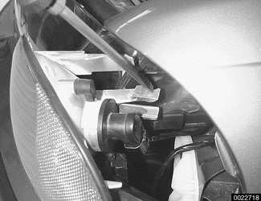
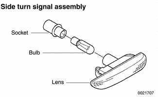
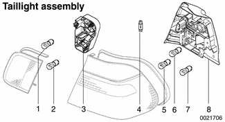
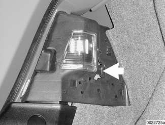
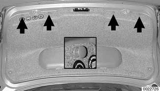
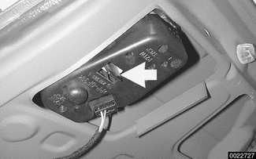
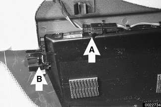
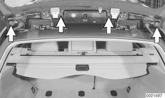
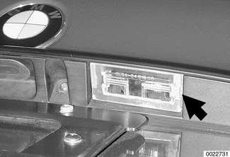

# Turn Signals, Taillights

> Source: Bentley *BMW 3 Series (E46) 1999–2005 (M3) Repair Manual*, section 630-5 (PDF pages 1102–1107 of 1252).

## Front turn signal assembly, removing and installing

The procedure below also includes turn signal bulb replacement.

With engine hood open, use a screwdriver to press turn signal assembly retaining clip down to disengage from retaining tab on headlight assembly frame.

Screwdriver must reach into fender hole a minimum of 3 in. to reach the retaining tab.

- Push turn signal forward. Light slides straight out.

- Detach electrical harness connector.
- Twist and remove bulb from rear of turn signal assembly.

> **CAUTION!**
> - Do not touch bulb with your bare hands. If necessary wipe bulb using a clean cloth dampened with rubbing alcohol.

**Note:**

*Before reinstalling, make sure rubber seal on wrap-around trim (underneath headlights) is firmly glued to trim. Reglue if necessary.*

| **Front turn signal** | |
|---|---|
| Turn signal bulb | 12V 21W |

## Side turn signal assembly

The yellow marker lights on the sides of the front fenders are turn signals. Use plastic prying tool to gently lever assembly out of fender.

| **Side turn signal** | |
|---|---|
| Side light bulb | 12V 5W |

## Taillight assembly, removing and installing

Taillight assembly

1 - Backup light bulb 12V 21W
2 - Rear foglight bulb (Euro only) 12V 21W
3 - Trunk lid/tailgate bulb carrier
4 - Trunk light bulb 12V 10W
5 - Taillight/brake light bulb 12V 21/4W
6 - Turn signal bulb 12V 21W
7 - Brake light bulb 12V 21W
8 - Corner bulb carrier

In E46 cars, taillight functions are split. The corner bulb carrier on each side contains:

- Taillight bulb
- Turn signal bulb
- Brake light bulb
- Trunk light bulb

The bulb carrier on each side of the trunk or tailgate contains:

- Back-up light
- Rear foglight (European models only)

- To access taillight bulbs carriers, open trunk lid or tailgate.

To access corner bulbs:

- Sport Wagon: Remove cargo area side trim. See [513 Interior Trim].
- Unlatch bulb carrier retainer (arrow), then pull carrier off taillight assembly.

- Detach electrical harness connector.
- Replace bulbs as necessary.

> **CAUTION!**
> - Do not touch bulb with your bare hands. If necessary wipe bulb using a clean cloth dampened with rubbing alcohol.

To access trunk lid taillight bulbs: Partially remove trunk lid trim panel by removing plastic expansion rivets (arrows). Expansion rivets are released by prying upper portion out (inset), then pulling off trunk lid.

To access tailgate taillight bulbs: Remove tailgate inside trim panel. See [412 Trunk Lid, Tailgate].

Unlatch bulb carrier retainer (arrow), then pull carrier off.

- Detach electrical harness connector.
- Replace bulb(s) as necessary.

> **CAUTION!**
> - Do not touch bulb with your bare hands. If necessary wipe bulb using a clean cloth dampened with rubbing alcohol.

- Installation of either bulb carrier is reverse of removal.

Taillight applications

| Location | Type & rating |
|---|---|
| Backup light bulb | 12V 21W |
| Brake light bulb | 12V 21W |
| Brake light/taillight bulb | 12V 21/4W |
| Rear foglight (European only) | 12V 21W |
| Turn signal bulb | 12 V 21W |

## Center brake light

The center brake light in all models is an LED unit. There are no replaceable bulbs.

**Sedan or Coupe:** Working from rear seat in passenger compartment, gently pull off trim cover over third brake light (at top of rear glass).

- Detach electrical harness connector (**A**).
- Remove retaining clips (**B**) on either side and remove assembly.

**Convertible:**

- Remove inner trunk lid trim adjacent to license plate light assembly.
- Detach electrical harness connector.
- Push center brake light out.

**Sport Wagon:** Open rear window.

- Carefully detach rear window hinge cover.
- Remove rear spoiler mounting bolts (arrows).

- Detach electrical harness connector and rear washer hose from spoiler.
- Remove mounting screws and remove third brake light assembly from spoiler.
- When installing, be sure electrical harness and rear window washer hose are not damaged or kinked.

**Note:**

*Replace sealing plastic and grommets as necessary during reassembly.*

**Tightening torque**

| Component | Torque |
|---|---|
| Rear spoiler to rear glass | 6 Nm (4 ft-lb) |

## License plate light, removing and installing

Using a flat tipped screw driver, pry gently on right side of license plate light assembly (arrow). Lift off lens.

> **CAUTION!**
> - To avoid marring trim, wrap the screwdriver tip with tape.

- Remove bulb.

**Note:**

*Inspect bulb contact springs for damage and corrosion. Replace socket assembly if necessary.*

License plate light application

| Location | Type & rating |
|---|---|
| License plate bulb | 12V 5W |

- Installation is reverse of removal.
