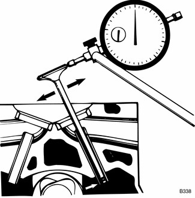
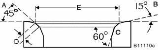

# Valves

> Source: BMW 3 Series (E46) Repair Manual, section 116-3, Cylinder Head and Valvetrain chapter (PDF pages 211–216 of 1252).

## Valves, removing and installing

- Remove cylinder head as described in [113 Cylinder Head Removal and Installation].

> **CAUTION!**
> - Do not let the hydraulic lifters fall out as the camshaft carrier is removed. Special suction cups are available from BMW to hold the hydraulic lifters in place during carrier removal. Hydraulic cam lifters should be stored in an upright position. If necessary, use a magnetic tool to aid in removal of the lifters.

- Remove valves using a valve spring compressor.

> **CAUTION!**
> - Label each valve assembly as it is removed so it can be installed in its original position.

- Remove and discard valve stem oil seals from valve guides. See [Valve stem oil seals] later in this section.
- Valve installation is reverse of removal.

Valve specifications are listed in [Table c]. Remove carbon deposits from the valves using a wire brush or wire wheel.

**Table c.** Valve specifications (M 52TU 2.5/2.8 engines, 1999 - 2000, and M 54 2.5/3.0 engines, 2000 - 2001)

| Specification | Value |
|---|---|
| Valve head diameter, intake | 33.0 mm (1.299 in.) |
| Valve head diameter, exhaust | 30.5 mm (1.201 in.) |
| Valve stem diameter, standard, intake | 6.0-0.015 mm (0.2362-0.0006 in.) |
| Valve stem diameter, standard, exhaust | 6.0 -0.015 mm (0.2362-0.0006 in.) |
| Valve stem diameter, oversize 1, intake | 6.1-0.025 mm (0.2401-0.0010 in.) |
| Valve stem diameter, oversize 1, exhaust | 6.1-0.040 mm (0.2401-0.0016 in.) |
| Valve stem diameter, oversize 2, intake | 6.2-0.025 mm (0.2441-0.0010 in.) |
| Valve stem diameter, oversize 2, exhaust | 6.2-0.040 mm (0.2441-0.0016 in.) |

## Valve guides

BMW does not supply valve guides as replacement parts. If a valve guide is excessively worn, it should be reamed to accept oversized valve stems. Valve guide specifications are listed in [Table d].

Valve guides should be checked for wear using a new valve. Be sure to thoroughly inspect the cylinder head to ensure that it can be reused before reworking the guides.

> **Note:**
> - International Organization for Standardization (ISO) tolerance classes are listed in [Table c]. ISO allowances are based on nominal sizes and should be used to determine proper fit. Most machine shops should have this information available.
> - Replacement valve guides may be available through aftermarket suppliers. Valve guide replacement requires special tools and a press. It is also necessary to heat the cylinder head and chill the valve guides when replacing the guides.

BMW supplies oversize valves. See [Table d] for additional information.

**Table d. Valve guide specifications** (M52TU / M54 engine (1999 - 2001))

| Specification | Value |
|---|---|
| Valve guide wear, maximum (valve tilt clearance measured with new valve) | 0.5 mm (0.020 in.) |
| Valve guide inside diameter, installed (tolerance per ISO allowance H7), standard | 6.0 mm (0.236 in.) |
| Valve guide inside diameter, installed, oversize 1 | 6.1 mm (0.240 in.) |
| Valve guide inside diameter, installed, oversize 2 | 6.2 mm (0.244 in.) |

## Valve stem oil seals

The purpose of the valve stem oil seal is to prevent excess oil from entering the combustion chamber. The sign of faulty valve stem oil seals is excessive oil consumption and smoke from the exhaust immediately after starting and during deceleration

> **Note:**
> - Valve stem oil seals should not be reused. If valves are removed, new valve stem oil seals should be installed. Valve stem oil seal replacement requires that the cylinder head be disassembled and the valves removed as described above under [Valves, removing and installing].
> - BMW special tools are available to remove the valve stem oil seals. As an alternative, standard valve seal removal tools are available from most automotive parts stores.

Lubricate new seal and install using hand pressure only. Be sure to install valve spring seat(s) before installing seal.

## Valve seats

The valve seats should be resurfaced whenever new valves or valve guides are installed. Cutters are required to resurface the seats. Always check the valves for leaks after reconditioning a valve seat as described above. [Table e] lists valve seat dimensions.

> **Note:**
> - Standard size replacement valve seats are not available from BMW. Replacement valve seats are only available from BMW in 0.4 mm oversize (oversized in both height and diameter). The manufacturer does not provide specifications for valve seat replacement for the engines covered by this manual.

**Table e.** Valve seat specifications (M52TU/M54 engines, 1999-2001)

| Specification | Value |
|---|---|
| A: Valve seat angle | 45° |
| B: Correction angle, outside | 15° |
| C: Correction angle, inside | 60° |
| D: Valve seat width, intake | 1.65 ± 0.25 mm (0.065 ± 0.010 in) |
| D: Valve seat width, exhaust | 1.65 ± 0.25 mm (0.065 ± 0.010 in) |
| E: Valve seat outside diameter, intake | 32.4 mm (1.276 in) |
| E: Valve seat outside diameter, exhaust | 30.0 mm (1.181 in) |

## Valve springs

The valve springs should be checked for fatigue. To quickly check the springs, line them up in a row. Place a straight edge across the top of the springs. Any spring that is significantly shorter than the others is worn and should be replaced.

> **Note:**
> - Valve spring specifications and wear limits are not available from BMW.
