# Vanos

> Source: BMW 3 Series (E46) Repair Manual, section 117-5, Camshaft Timing Chain chapter (PDF pages 252–270 of 1252).

The main components of the double VANOS system are:

- Intake and exhaust camshafts with helical spline inserts
- Camshaft sprockets with adjustable gears
- VANOS actuators (two position piston housing with internal/external helical spline cup)
- Three-way solenoid switching valves
- Camshaft position impulse wheels
- Hall effect camshaft position sensors

Camshaft position is varied based on engine rpm, throttle position signal, intake air and coolant temperature.

When engine is started, camshafts are in deactivated position:

- Intake camshaft is held in RETARDED position by oil pressure.
- Exhaust camshaft is held in ADVANCED position by preload spring and oil pressure.

- Within 2 - 5 seconds (50 engine revolutions), the ECM begins monitoring and controlling camshaft positions.

The Double VANOS system allows full variability of camshaft timing up to the limits of the system. When the ECM detects that the camshafts are in optimum position, the solenoids are modulated at approximately 100 - 220 Hz to maintain oil pressure on both sides of the actuator pistons to maintain timing.

In models with DME MS 43.0 (model year 2001), the engine control module (ECM) detects camshaft position before the engine starts, thereby adjusting camshaft timing immediately upon start-up

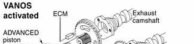

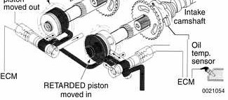

> **Note:**
> - BMW does not provide diagnostic information or specifications for the Double VANOS system. VANOS system troubleshooting and diagnostics is best accomplished using a scan tool.
> - Diagnostic Trouble Codes (DTCs) pertaining to the VANOS system are listed in [Table a]. See also [OBD On Board Diagnostics] at the back of this manual.
> - Elevated oil temperatures can cause VANOS to deactivate. Oil that is too thick (high viscosity) may cause a DTC to be set in the ECM. If VANOS is deactivated (limp-home mode), there will be a noticeable loss of power.

**Table a.** VANOS fault codes

| BMW code | P-code | Fault description |
|---|---|---|
| 19 | P1529 | VANOS solenoid valve activation, exhaust |
| 21 | P1525 | VANOS solenoid valve activation, intake |
| 103 | P1519 | VANOS faulty reference value intake |
| 104 | P1520 | VANOS faulty reference value exhaust |
| 105 | P1522 | VANOS stuck (Bank 1) intake |
| 106 | P1523 | VANOS stuck (Bank 2) exhaust |

## Double VANOS components

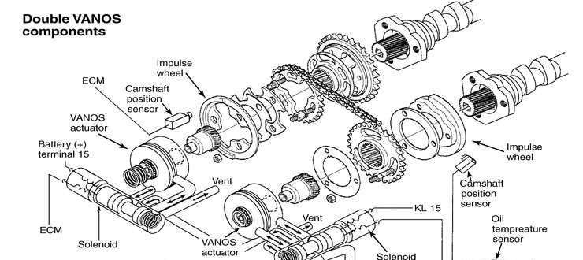

VANOS control unit

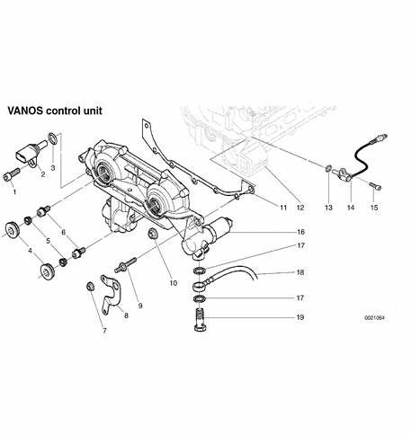

1. Bolt M6
2. Exhaust camshaft position sensor
3. Sealing ring
4. Camshaft end sealing plug — tighten to 50 Nm (37 ft-lb)
5. Camshaft seal cap
6. VANOS hydraulic piston set screw — CAUTION: left hand thread — tighten to 10 Nm (89 in-lb)
7. Nut M7 — tighten to 14 Nm (10 ft-lb)
8. Engine lifting hook
9. Stud M7
10. Nut M6 — tighten to 10 Nm (89 in-lb)
11. Gasket
12. Cylinder head
13. Sealing ring
14. Intake camshaft sensor
15. Bolt M6
16. VANOS control unit
17. Copper sealing ring
18. VANOS oil feed line
19. Banjo bolt — tighten to 32 Nm (24 ft-lb)

## VANOS control unit, removing

> **Note:**
> - If the Double VANOS control unit is being replaced, camshaft timing must be checked as described later in this group. This procedure requires multiple special tools. Be sure to read the procedures through before beginning the repair.

- Working inside trunk, disconnect negative (-) battery cable.

> **CAUTION!**
> - Prior to disconnecting the battery, read the battery disconnection cautions given at the front of this manual on page viii.
> - Disconnecting the battery may erase fault code(s) stored in control module memory. Check for fault codes using special BMW diagnostic equipment.

- Remove complete air filter housing, cylinder head cover, intake camshaft plastic cover and spark plugs, as described earlier in [Camshaft Timing Chains, Removing].

- Remove banjo bolt from VANOS unit oil pressure line. Use banjo bolt to attach BMW special tool 11 3 450 (compressed air fitting) to VANOS unit.

> **CAUTION!**
> - Oil will drain from pressure line. Have a container and rags ready. Do not allow oil to run onto drive belts.
> - Cover top of VANOS unit with lint-free shop cloth. Compressed air will force oil to spray out of oil bore on top of unit.

- Connect compressed air line (with line pressure set to 2 - 8 bar or 30 - 110 psi) to air fitting.
- With compressed air line connected, turn engine at least twice in direction of rotation until cylinder 1 intake and exhaust camshaft lobes (arrows) face each other.

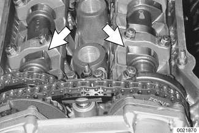

- Remove sealing plug from bore on lower left side of engine block (flywheel end). Secure crankshaft in TDC position with BMW special tool 11 2 300 (arrow).

- Unscrew and remove cylinder head cover studs at rear of cylinder head.
- Secure camshafts in TDC position using BMW special tools 11 3 240 and 11 3 244.

- Detach compressed air line, leaving compressed air fitting attached to VANOS unit.

> **Note:**
> - Oil will drain from fittings when air line is removed. Have a container and rags ready. Do not allow oil to run onto drive belts.

- Unscrew sealing plugs (arrows) from VANOS unit.

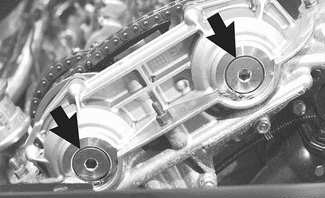

> **Note:**
> - Oil will drain from plugs when removed. Have a container and rags ready. Do not allow oil to run onto drive belts.

- Remove sealing caps from inside VANOS unit with BMW special tool 11 6 170, or with short flat nose pliers.

> **Note:**
> - Additional oil may drain from VANOS unit.

- Remove set screws (left hand thread) on ends of intake and exhaust camshaft hydraulic pistons.

> **CAUTION!**
> - Set screws have left-hand threads. Remove with a clockwise motion.

- Disconnect electrical harness connectors from camshaft position sensors and solenoid valves on both exhaust and intake sides of VANOS unit.

- Remove VANOS unit:
    - Remove fasteners from engine support eye.
    - Remove VANOS mounting nuts (arrows) from cylinder head. Slide VANOS unit and metal gasket off.

> **CAUTION!**
> - Do not crank or turn over engine with VANOS unit removed. Piston/valve interference is possible.

## VANOS control unit, installing

- Clean contact edges of cylinder head face and VANOS unit and apply a thin coat of sealing compound (3-Bond® 1209 or equivalent) to surfaces.

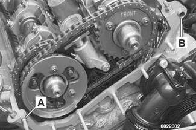

> **CAUTION!**
> - Make sure all gasket material is removed from face of cylinder head. Clean sealing face and keep free of oil. If any foreign material is present on the sealing surface, the camshaft timing will be incorrect.

- Check locating dowel (A) and dowel sleeve (B) at top of cylinder head for damage or incorrect installation.

> **Note:**
> - If the Double VANOS control unit is being replaced, be sure to check and adjust camshaft timing as described later in this group.
> - If work being carried out has no effect on camshaft timing, it is not necessary to recheck the timing. It is recommended however that the VANOS operation be checked using a compatible scan tool.

- Using new gasket, install VANOS unit to cylinder head.
- Reinstall engine support eye.

Tightening torque

| Component | Tightening torque |
|---|---|
| VANOS unit to cylinder head, M6 nut | 10 Nm (89 in-lb) |
| VANOS unit to cylinder head, M7 nut | 14 Nm (10 ft-lb) |

- Insert and tighten down VANOS hydraulic piston set screws on intake and exhaust camshafts.

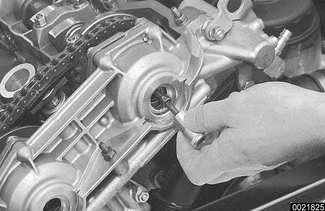

> **CAUTION!**
> - Set screws have left hand thread. Tighten counterclockwise.

Tightening torque

| Component | Tightening torque |
|---|---|
| Hydraulic piston to splined shaft M6 set screw | 10 Nm (89 in-lb) |

- Replace sealing caps inside VANOS unit with BMW special tool 11 6 170, or short flat nosed pliers.

- Insert and secure VANOS sealing plugs (arrows), using new sealing O-rings.

Tightening torque

| Component | Tightening torque |
|---|---|
| Sealing plug to VANOS unit | 50 Nm (37 ft-lb) |

- Remove compressed air fitting from VANOS unit.
- Fit VANOS oil line banjo bolt with new seals. Attach oil line to VANOS unit.

Tightening torque

| Component | Tightening torque |
|---|---|
| Oil line to VANOS unit (banjo bolt) | 32 Nm (24 ft-lb) |

- Attach electrical harness connectors to camshaft position sensors and VANOS solenoid valves.
- Remove BMW special locking tools from rear of cylinder head.
- Remove BMW special locking tool from flywheel and replace dust guard.
- Install intake camshaft plastic baffle and then install cylinder head cover.
    - Check for correct seating of half-moon seals (A) in back of cylinder head cover.
    - Use a small amount of 3-Bond® 1209 or equivalent sealant at corners (B) of half-moon cutouts.
    - Similarly, seat gasket and seal corners in front of cylinder head, at VANOS unit.

Tightening torque

| Component | Tightening torque |
|---|---|
| Cylinder head cover to cylinder head (M6) | 10 Nm (89 in-lb) |

- Remainder of installation is reverse of removal.

Tightening torques

| Component | Tightening torque |
|---|---|
| Radiator fan (viscous clutch) to coolant pump | 40 Nm (30 ft-lb) |
| Spark plug to cylinder head | 25 Nm (18 ft-lb) |

## Camshaft timing, adjusting

- Use this procedure to check and, if necessary, adjust camshaft timing. This procedure assumes that the cylinder head cover and intake camshaft plastic baffle have been removed as described under [Camshaft Timing Chains, Removing]. Also, be sure the cooling fan behind the radiator and the spark plugs have been removed.

- Remove primary camshaft chain tensioner cylinder (arrow).

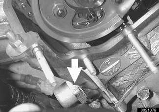

> **CAUTION!**
> - Primary camshaft chain tensioning piston is under spring pressure.

- Insert BMW special tool 11 4 220 in cylinder head and bring adjustment screw into contact with tensioning rail.

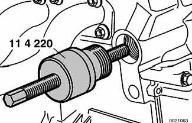

> **Note:**
> - BMW special tool 11 4 220 is a dummy primary chain tensioner and simulates the function of the tensioner.

- Preload primary chain tensioner rail: Tighten adjusting screw on BMW special tool 11 4 220.

Tightening torque

| Component | Tightening torque |
|---|---|
| Primary chain tensioner preload | 0.7 Nm (6 in-lb) |

- Unscrew oil pressure pipe from VANOS unit. Remove banjo bolt from oil pressure line and install BMW special tool 11 3 450.

> **CAUTION!**
> - Cover top of VANOS unit with lint-free shop cloth. Attachment of compressed air line will force oil to spray out of bore.

- Connect compressed air line to air fitting. Apply air pressure set to 2 - 8 bar (30 - 110 psi).
- With compressed air line connected, turn engine at least twice in direction of rotation until cylinder 1 intake and exhaust camshaft lobes (arrows) face each other.

> **CAUTION!**
> - Do not rotate engine counterclockwise to reach the top dead center position. Instead, complete another two complete rotations.

- Remove sealing plug from bore on lower left side of engine block near flywheel. Secure crankshaft in TDC position with BMW special tool 11 2 300 (arrow).

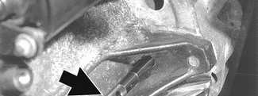

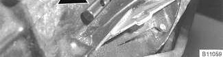

- Unscrew and remove cylinder head cover studs at rear of cylinder head.
- Place BMW special tool 11 3 240 over camshafts ends and measure clearance of tool to cylinder head surface.

> **Note:**
> - If the exhaust side of the tool (A) is not flush with the head, retime the camshafts as described below.
> - Due to flexible sprocket design, VANOS unit tolerances and play in the VANOS splines, when the camshaft timing is set correctly, the intake side of special tool 11 3 240 (B) may be up to 1 mm (0.04 in) above the surface of the cylinder head. This is normal. Reassemble engine. Otherwise, retime the engine as described below.

- Remove Double VANOS unit as described earlier.
- Press down on secondary chain tensioner and lock into place using BMW special tool 11 3 292 or equivalent.

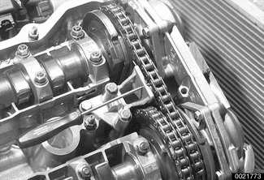

- Make sure primary chain tensioner dummy tool (special tool 11 4 220) is installed in side of cylinder head and just touching tensioning rail. Do not preload chain yet.
- Loosen intake camshaft sprocket mounting nuts (arrows) by 1 turn.

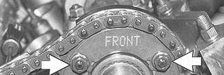

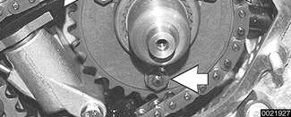

- Loosen exhaust camshaft sprocket mounting bolts (A) 1 turn.
- Loosen exhaust camshaft impulse wheel mounting nuts (B) 2 turns.

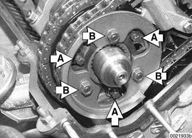

- Slide out intake camshaft splined shaft until approx. 1 mm (0.04 in) of splines (arrows) can be seen.

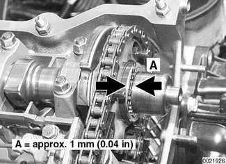

- Pull out exhaust camshaft splined shaft to stop.

- Make sure camshafts are secured in TDC position using BMW special tools 11 3 240 and 11 3 244.
- Preload primary chain tensioning rail: Tighten adjusting screw on BMW special tool 11 4 220.

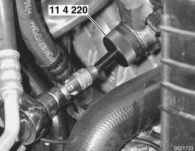

Tightening torque

| Component | Tightening torque |
|---|---|
| Primary chain tensioner preload | 0.7 Nm (6 in-lb) |

- Preload exhaust camshaft spring plate by pressing on impulse wheel. Tighten mounting nuts (arrows) by hand. Do not tighten fully.

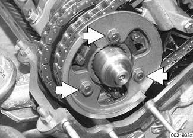

- Install BMW special tool 11 6 150 (VANOS setup bracket) to front of cylinder head timing case. Tighten nuts (arrows) by hand, and then tighten down uniformly until special tool is in full contact with cylinder head.

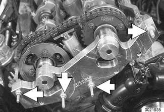

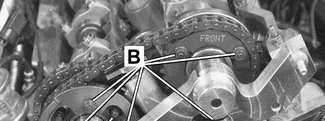

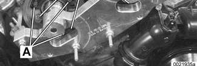

> **CAUTION!**
> - Make sure all gasket material is removed from face of cylinder head. Clean sealing face and keep free of oil. If any foreign material is present on the sealing surface, the camshaft timing will be incorrect.

- Secure camshaft impulse sprockets and wheels:
    - Pretighten Torx screws (A) on exhaust camshaft impulse wheel to approx. 5 Nm (44 in-lb).
    - Pretighten mounting nuts (B) on exhaust and intake sprocket assemblies to approx. 5 Nm (44 in-lb).
    - Torque down Torx screws (A) and nuts (B) to final specifications.

Tightening torques

| Component | Tightening torque |
|---|---|
| Sprocket assembly to camshaft initial torque | 5 Nm (44 in-lb) |
| Sprocket assembly to camshaft, M7 Torx screw (A) | 20 Nm (15 ft-lb) |
| Sprocket assembly to camshaft, M6 mounting nut (B) | 10 Nm (89 in-lb) |

- Remove flywheel locking tool from transmission bellhousing so that crankshaft is no longer locked.
- Remove camshaft locking tools from rear of cylinder head.
- Crank engine over twice by hand in direction of rotation until cylinder 1 intake and exhaust camshaft lobes face each other again.
- Secure crankshaft with BMW special tool 11 2 300.
- Place BMW special tool 11 3 240 over camshaft ends and measure clearance of tool to cylinder head surface.

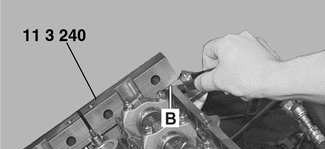

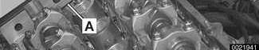

> **Note:**
> - If the exhaust side of the tool (A) is not flush with the head, camshaft timing is incorrect. Repeat camshaft timing procedure.
> - Due to flexible sprocket design, VANOS unit tolerances and play in the VANOS splines, when the camshaft timing is set correctly, the intake side of special tool 11 3 240 (B) may be up to 1 mm (0.04 in) above the surface of the cylinder head. This is normal. Otherwise, repeat camshaft timing procedure.

- Remove camshaft locking tools from rear of camshafts.
- Remove BMW special tool 11 4 220 (dummy primary chain tensioner). Reinstall primary chain tensioner.

Tightening torque

| Component | Tightening torque |
|---|---|
| Primary chain tensioner cylinder to cylinder head | 70 Nm (52 ft-lb) |

- Remove flywheel locking tool from transmission bellhousing. Reinstall sealing plug.
- Remove VANOS setup bracket from front of cylinder head.
- Install VANOS control unit as described earlier in this group.
- Remove compressed air fitting (special tool 11 3 450) from VANOS unit.
- Fit VANOS oil line banjo bolt with new seals. Attach oil line to VANOS unit.

Tightening torque

| Component | Tightening torque |
|---|---|
| Oil line to VANOS unit (banjo bolt) | 32 Nm (24 ft-lb) |

- Remainder of engine assembly is reverse of disassembly.

Tightening torques

| Component | Tightening torque |
|---|---|
| Radiator cooling fan (viscous clutch) to coolant pump | 40 Nm (30 ft-lb) |
| Cylinder head cover to cylinder head | 10 Nm (89 in-lb) |
| Spark plug to cylinder head | 25 Nm (18 ft-lb) |
